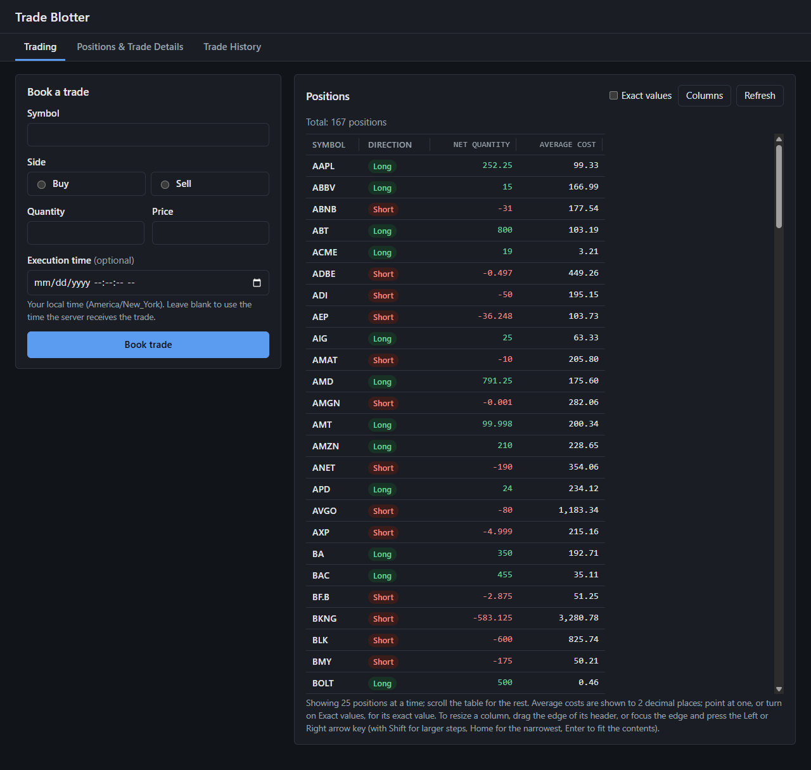
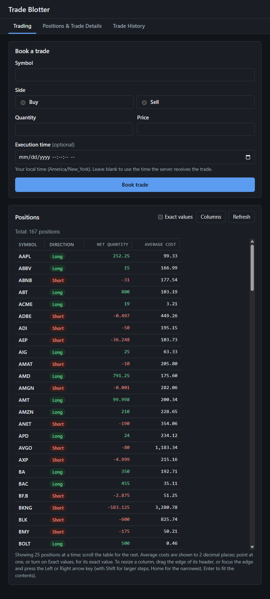
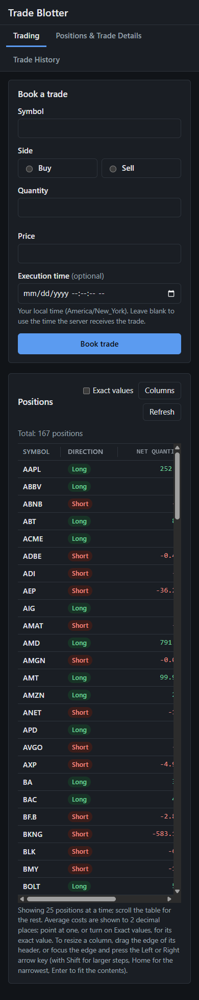
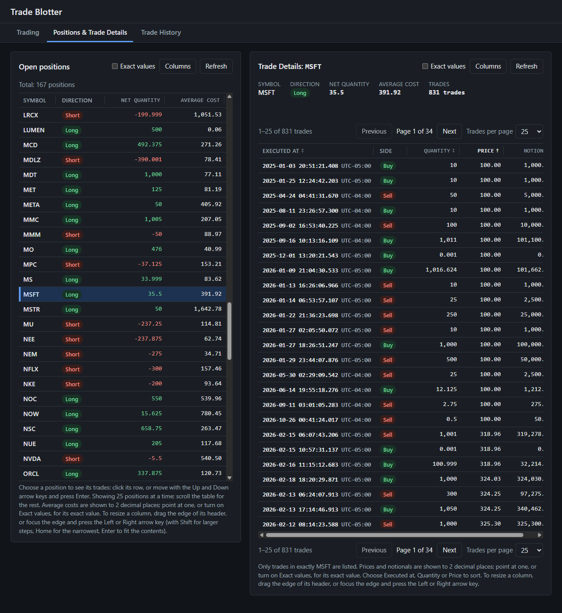
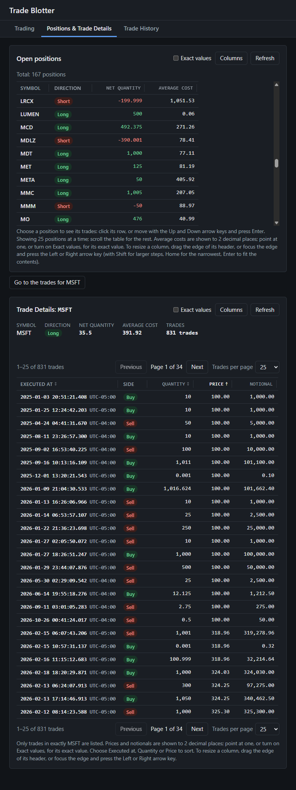
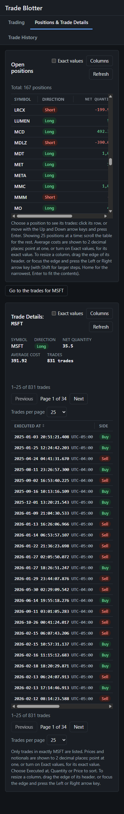
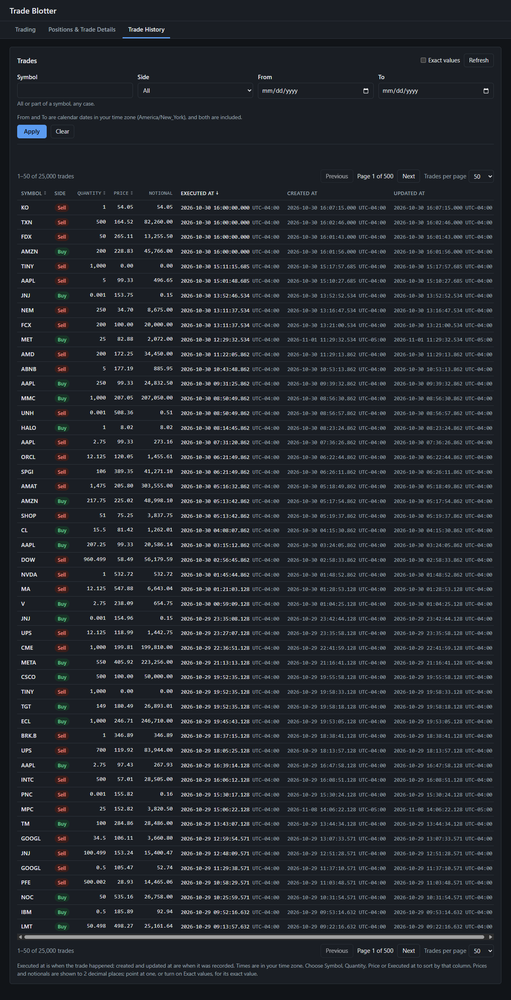
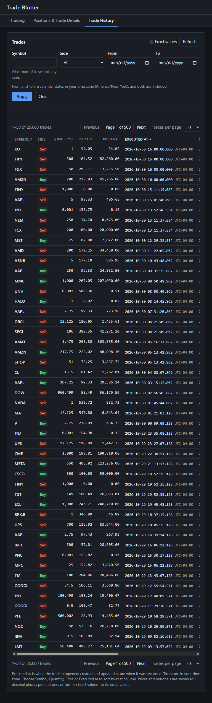
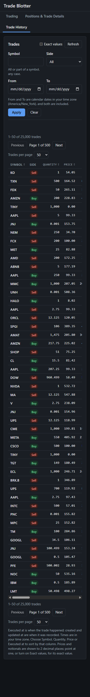
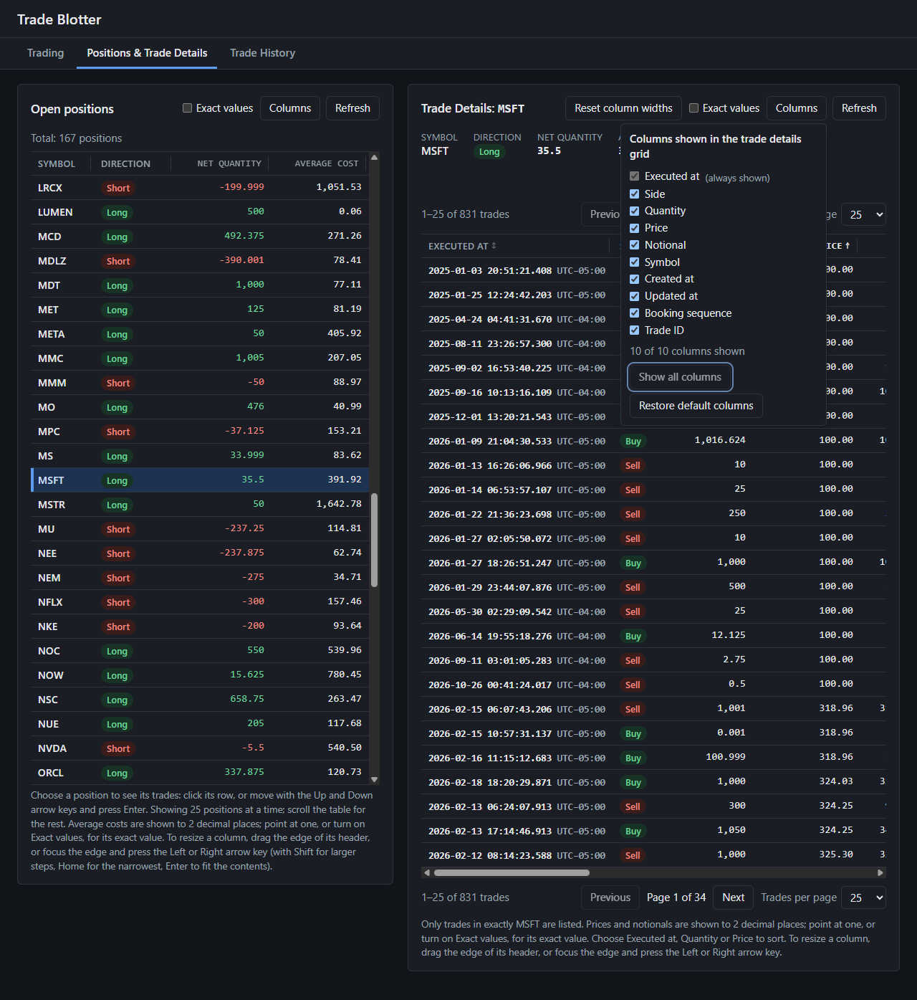

# Trade Blotter

Book trades, review them in a blotter, and see the position per symbol derived from the trade
history.

Trade Blotter is a full-stack TypeScript application: a Fastify API over SQLite and a Vue 3
frontend. Every quantity, price, notional and average cost is handled as an exact decimal, from
the JSON request to the database and back.

## Contents

- [Features](#features)
- [Technology](#technology)
- [Screenshots](#screenshots)
- [Prerequisites](#prerequisites)
- [Getting started](#getting-started)
- [Database](#database)
- [Running the application](#running-the-application)
- [Reviewer workflow: review:01 to review:07](#reviewer-workflow-review01-to-review07)
- [Test-drive search, filters and sorting](#test-drive-search-filters-and-sorting)
- [Browser checklist](#browser-checklist)
- [Build and test](#build-and-test)
- [API](#api)
- [Position accounting](#position-accounting)
- [Architecture](#architecture)
- [Performance](#performance)
- [Platform support](#platform-support)
- [Known limitations](#known-limitations)
- [Dependency advisories](#dependency-advisories)
- [Further documentation](#further-documentation)

## Features

The page has three tabs; each keeps what you typed, chose and loaded while another is shown, and
changing tab sends no request.

- **Trading:** book a trade with a symbol, a side (Buy or Sell), a quantity, a price and an
  optional execution time. Invalid input is reported field by field, every problem at once, and
  the confirmation says where the trade went (on the trade list's page, on another page, or left
  out by its filters). Beside the form, the **Positions** grid: every open position (long or short,
  net quantity, average cost), 25 rows in view under a header that stays put, the rest scrolling
  inside the grid. Above it, the number of open positions ("Total: 167 positions"), counted from
  the loaded list rather than the rows in view; the master grid on the next tab shows the same
  total from the same list.
- **Positions & Trade Details:** the open positions as a master grid; choose one (click it, or
  move with the arrow keys and press Enter) to see its trades, a page at a time from the server,
  matched on the exact symbol (`symbolMatch=exact`, so MS never lists MSFT or MSTR), with the
  position's summary and trade count, Previous and Next, 25/50/100 a page and sorting by Executed
  at, Quantity or Price. Side by side on a wide screen, stacked (with a button that moves to the
  trades) on a narrow one.
- **Trade History:** every trade, newest execution first, 50 a page (25 or 100 on request), with
  Previous and Next above and below the table and the range ("51–100 of 25,000 trades").
  Search by all or part of a symbol, filter by side and by execution dates in your time zone
  (daylight-saving days included exactly), and sort by the Executed at, Symbol, Quantity or Price
  header. The API filters, sorts (decimals by exact value), counts and pages; the page never loads
  the whole history.
- **Grids you can arrange:** in both Positions grids and the Trade Details, drag a column's
  header edge to resize it (or focus the edge and use the arrow keys; Enter fits the contents),
  down to a least width that keeps the header readable; **Columns** shows and hides optional
  columns (the identifying one always stays) and says how many are shown ("4 of 4 columns shown");
  **Show all columns** shows every column, those hidden by default included, each in its place
  and with the width it had, and is marked unavailable once all are shown; **Restore default
  columns** puts back the grid's own choice (in Trade Details, five columns hidden by default
  again), and is likewise marked unavailable, keeping focus, once the defaults are shown; **Reset
  column widths** sizes the columns by their contents again. Hidden columns leave no gap; tables
  scroll sideways inside their own box, never the page.
- **Money to two places, exactly:** prices, notionals and average costs are shown to 2 decimal
  places, rounded half to even on the decimal text itself. The exact value is in the tooltip, read
  out to screen readers after the rounded one, and shown beside it when the grid's **Exact values**
  checkbox is checked (one tab stop, for keyboard users; unchecked at first). In Trade Details it
  also governs the chosen position's average cost above the grid, which otherwise shows two places
  only. Quantities are shown with every digit. Only the
  display is rounded: the API, the database and the accounting keep every digit.
- **Exact decimals:** values are read from the JSON source text, calculated with `decimal.js`,
  stored as text and written back without passing through a binary floating-point number.
- **Times** are shown in your time zone with their UTC offset (the UTC value in the tooltip). A
  skipped local execution time is refused, and one that happens twice asks which you mean.
- **Keyboard and screen readers:** tabs, grids, resize handles, Columns and Exact values work from
  the keyboard with a visible focus; the master grid is an ARIA grid with the chosen row
  `aria-selected`; every table has a caption.
- **Safe persistence:** one SQLite file, migrated automatically at startup or with a command.
  A failed migration stops startup and changes nothing; the application never deletes or
  recreates a database. A trade that would breach the position limit is refused inside the same
  transaction that would store it.
- **Documented API:** OpenAPI 3.1 with Swagger UI, and RFC 9457 problem details for errors.
- **Reviewer workflow:** seven short commands set up, seed, start, check, test, benchmark and stop
  an isolated copy of the application on a deterministic 25,000-trade benchmark, never touching
  your own data or other applications.
- **Responsive** at desktop, tablet and phone widths, with light and dark themes that follow the
  system setting.

## Technology

| Part | Technology |
| --- | --- |
| Runtime | Node.js 22.23.1 |
| API | TypeScript, Fastify 5, TypeBox schemas, `@fastify/swagger` and Swagger UI |
| Persistence | SQLite through Node's built-in `node:sqlite`, Drizzle ORM and drizzle-kit (`1.0.0-rc.5-5935859`) |
| Decimals | `decimal.js` |
| Frontend | Vue 3, Pinia, Vite |
| Real-browser checks | Chrome, Edge or Chromium driven over the DevTools protocol with Node.js's built-in WebSocket (`check:ui`, `perf:ui`); no browser is installed by the project |
| Tests | Vitest; Vue Test Utils and jsdom for the frontend |
| Quality | ESLint with typescript-eslint and eslint-plugin-vue; strict TypeScript |

There is no database server, Docker image or external service. npm workspaces hold the API
(`server/`) and the frontend (`client/`).

## Screenshots

The three tabs on the reviewer's benchmark (25,000 trades, 167 open positions), taken by
`npm run check:ui` in headless Chrome 157 on 2026-11-13, dark theme.

| | Desktop (1280 px) | Tablet (768 px) | Phone (390 px) |
| --- | --- | --- | --- |
| Trading |  |  |  |
| Positions & Trade Details |  |  |  |
| Trade History |  |  |  |

Show all columns in Trade Details at 1280 px, with the list still open, every column shown and
focus kept on the button:


Earlier screenshots (before the tabs), including the form asking which occurrence of a repeated
local time is meant and the page while the API is unavailable, are in
[docs/verification/screenshots/](docs/verification/screenshots/).

## Prerequisites

| Tool | Required | Notes |
| --- | --- | --- |
| Node.js 22.23.1 | Yes | The supported and verified version, recorded in `.nvmrc` |
| npm 12.0.1 | Yes | Bundled with Node.js 22.23.1 |
| Git | Yes | To clone the repository |
| A web browser | For the frontend | Any current Chrome, Edge, Firefox or Safari |

Nothing else needs installing: SQLite is built into Node.js, Drizzle is an npm dependency, and no
package compiles native code or runs an install script.

**Node.js 22.23.1 is the only supported version.** The `engines` range is `^22.23.1`: later 22.x
releases are accepted but have not been verified, and other major versions are not supported.
`npm ci` warns `EBADENGINE` on another version, and the server refuses to start if a runtime
feature it needs is missing.

Install it from <https://nodejs.org/dist/v22.23.1/>, or with a version manager that reads
`.nvmrc`: `nvm install` with [nvm](https://github.com/nvm-sh/nvm) or
`fnm install` with [fnm](https://github.com/Schniz/fnm); on Windows,
`nvm install 22.23.1` with [nvm-windows](https://github.com/coreybutler/nvm-windows). Check with:

```bash
node --version   # v22.23.1
npm --version    # 12.0.1
```

## Getting started

```bash
git clone https://github.com/cs973112/trade-blotter-ts.git
cd trade-blotter-ts
npm ci           # installs the exact versions in package-lock.json, for the API and the frontend
npm run verify   # lint, typecheck, build and run every test
```

`npm run verify` exiting with code 0 means the setup works. Run every command in this README from
the repository root.

## Database

The database is a single SQLite file, `server/data/trade-blotter.db` by default (ignored by Git).
The API creates it and applies any pending migration every time it starts, before it accepts
requests. To do this without starting the API:

```bash
npm run db:migrate -w server
```

It prints `Database is up to date: <path>`; running it again changes nothing. If a migration
fails, every pending migration is rolled back, the command prints
`Database migration failed; no migration was applied.` with the reason, and it exits with code 1.

Set `DATABASE_PATH` to use another file; an absolute path is recommended. The
[setup guide](docs/setup.md#database) covers other files, backups, starting afresh and schema
changes.

## Running the application

### Development

In two terminals, from the repository root:

```bash
npm run dev -w server   # the API on http://localhost:5299, restarting on changes
npm run dev -w client   # the frontend on http://localhost:5173
```

Open <http://localhost:5173>. The frontend calls the API through Vite's proxy, so start the API
first; if it is not running, the page says so.

### Production build

```bash
npm run build               # the API to server/dist/, the frontend to client/dist/
npm start -w server         # terminal 1: the compiled API on http://localhost:5299
npm run preview -w client   # terminal 2: the built frontend on http://localhost:4173
```

Stop either with Ctrl+C: the API finishes requests in progress, closes the database and exits.

### In the background: app:start, app:stop, app:status

One command starts the compiled API and the built frontend in the background, so the terminal
stays free; the same commands work on Windows, Linux and macOS. Build first (`npm run build`).

```powershell
npm run app:start                                               # API :5299, frontend :4173, default database
npm run app:status                                              # running or stopped, ports, URLs, database, process ids
npm run app:stop                                                # stops both; the database is left as it is
npm run app:start -- --database "$env:TEMP\tb-review\trades.db" # a separate database
npm run app:start -- --api-port 5399 --web-port 4273            # other ports
```

| Option | Else from | Default |
| --- | --- | --- |
| `--api-port <n>` | `PORT` | `5299` |
| `--web-port <n>` | `WEB_PORT` | `4173`, the built frontend's preview port |
| `--host <name>` | `HOST` | `localhost` |
| `--database <path>` | `DATABASE_PATH` | `server/data/trade-blotter.db` |

`LOG_LEVEL`, `DOCS_ENABLED` and `SYMBOL_MAX_LENGTH` reach the API as usual. A relative database
path is relative to the folder you run the command from. On Linux and macOS set variables the
usual way (`DATABASE_PATH=/tmp/tb-review/trades.db npm run app:start`).

- **Start** runs the API as `npm start -w server` does and the frontend as
  `npm run preview -w client` does, with the frontend forwarding API requests to the API it
  started. It refuses a port that is already in use, and starts nothing if the applications are
  already running. It reports both URLs and Swagger UI once each application answers; if one does
  not, it stops whatever it started and prints the end of that application's log. It never
  creates, resets or seeds data beyond what the API itself does at startup (migrations).
- **Stop** stops only processes that `app:start` started, with their child processes, and waits
  until their ports are free; running it again is harmless. Each process is recorded with a
  random token that is part of its command line, so a process whose id the operating system has
  since given to another program is recognised and left alone; nothing is ever stopped because
  of the port it uses. On Linux and macOS each application gets SIGTERM and shuts down cleanly
  (SIGKILL only after 10 seconds). On Windows a background process cannot be asked to stop, so it
  is terminated; SQLite keeps every committed trade.
- **Status** says whether each application is running and gives its port, URL and process id,
  the database and the log files.
- The run record and the logs (`api.log`, `web.log`) are in `.run/` at the repository root,
  which Git ignores.

With seeded data the order is: stop, clear or seed, start, try it, and stop again before
clearing or reseeding; see [Sample data](#sample-data-dbseed-and-dbclear). Tools that change trade
records call `refuseIfDatabaseInUse(path)` from `server/scripts/lifecycle.ts`, which refuses a
database that an application started by `app:start` is using, and tools that only read should
still refuse the development database (`isDevelopmentDatabase(path)`).

### Sample data: db:seed and db:clear

Fill a separate database with realistic trades to try the application at volume, and empty it
again. Both work on Windows, Linux and macOS. In PowerShell:

```powershell
$db = "$env:TEMP\tb-review\seed.db"
npm run app:stop                                       # nothing may be running on it
npm run db:seed -- --count 10000 --database $db        # 100, 1000, 10000, 25000, ... trades
npm run app:start -- --database $db                    # browse, search, filter, sort, book
npm run app:stop
npm run db:clear -- --database $db --confirm           # removes the trades; keeps the file
```

On Linux and macOS use `db=/tmp/tb-review/seed.db` and `"$db"`.

- **`db:seed -- --count <n> --database <path> [--seed <text>]`** seeds an empty trade table:
  a new file is created and migrated as the API would at startup; an existing Trade Blotter
  database must have no trades (clear it first). The trades are deterministic: the same count and
  seed (default `trade-blotter`) give the same trades every time (dataset version 2). They cover
  181 symbols, some traded thousands of times and a dozen only a handful (MS, MSFT and MSTR share
  letters; BRK.B and BF.B have punctuation; several trade at prices with up to ten decimal places),
  Buy and Sell, executions from 2025-01-02 to 2026-10-30 across several daylight-saving changes,
  repeated execution times, quantities and prices, and trades that open, increase, reduce, close
  and cross positions. The 25,000-trade benchmark leaves 167 open positions, 89 long and 78
  short, many with fractional quantities and average costs beyond two decimal places. Every
  trade is validated by the application's own rules, all are inserted in one transaction (in
  batches, so 25,000 take a few seconds), and they are read back through the application,
  counted and checked with its accounting. It prints the verified count and the time taken.
- **`db:clear -- --database <path> --confirm`** removes every trade and nothing else: the file,
  its schema and its migrations stay. SQLite's record of the highest booking sequence also stays,
  so booking sequences are never reused: trades seeded after a clear continue from there. It
  checks that no trade is left; clearing an empty database is harmless.
- **Safety.** Both need `--database` (`DATABASE_PATH` is ignored here) and refuse the
  development database `server/data/trade-blotter.db`, however its path is written (including a
  link to it), and anything else in `server/data/`, such as backups. They refuse a file that is not
  a Trade Blotter database without changing it, and refuse to run while an application started
  with `app:start` is running. Neither ever deletes a database file.
- **Limitation:** an API started some other way (`npm start -w server`, `npm run dev -w server`)
  cannot be detected. Stop every API using the database before seeding or clearing it.

### API performance: perf:api

Measures the running API on a seeded database, 62 scenarios in all: 14 of `GET /trades` (every
trade, a partial symbol search, each side, an execution-date range, all three combined, and every
sort field in both directions), 47 of `GET /trades/page` (the first, a middle and the last page,
50 and 100 a page, in every sort order, alone and with each filter), and `GET /positions`. In
PowerShell:

```powershell
$db = "$env:TEMP\tb-perf\perf.db"
npm run db:seed -- --count 10000 --database $db
npm run app:start -- --database $db
npm run perf:api -- --database $db                     # tables on screen
npm run perf:api -- --database $db --json "$env:TEMP\tb-perf\api-10000.json"
npm run app:stop
```

Or every size in one go, on the same file (100, 1,000, 10,000 and 25,000 trades by default):

```powershell
npm run perf:api:sizes -- --database $db
```

For each size it clears the file, seeds it, starts the applications on it, measures, saves the
results and stops the applications. The file is kept, with the last size in it, for trying the
UI. It refuses to begin while an application started with `app:start` is running: it starts and
stops only its own. On Linux and macOS use `db=/tmp/tb-perf/perf.db` and `"$db"`.

- **Options.** `perf:api`: `--database <path>` (required), `--api-url <url>` (default: the API
  started with `app:start`; another spelling of its address, such as `http://127.0.0.1:5299`, is
  accepted, any other address refused), `--warmup <n>` (default 5), `--iterations <n>` (default
  10) and `--json <file>`. `perf:api:sizes`: `--database`, `--sizes 100,1000,...`, `--warmup`,
  `--iterations`, `--api-port`, `--web-port` and `--out <folder>` (default `.run/perf/api-<time>/`,
  which Git ignores: one JSON file per size and `summary.txt`). Results are never committed.
- **What it measures.** Requests are sequential, one at a time over one kept-alive connection,
  so results compare across dataset sizes; there is no concurrent load. Each request is timed
  with `performance.now()` (monotonic) from sending it until the last byte of the body has
  arrived. JSON parsing is **not** included in that time; `JSON.parse` is timed separately after
  each response (the frontend's own exact-decimal parsing is measured in the browser, by
  [perf:ui](#browser-performance-perfui)). For each scenario it reports the matched rows, the response
  size in bytes, the minimum, median, p95 (nearest rank, so with 10 samples it is the maximum) and
  maximum latency, and the API process's memory: the working set on Windows, RSS on Linux and
  macOS, sampled between scenarios, never during a request, with the process's own peak where the
  system records it (not on macOS).
- **What it does not measure.** It times whole requests; the number of SQL statements and the
  query plans SQLite chose are not recorded; a slow plan shows only as a slow request.
- **What it checks.** Every response, warmups included, must be `200 application/json` with the
  same bytes as the first, and the first is compared trade by trade (id, booking sequence, symbol,
  side, quantity, price, notional, executedAt) or position by position with the database, read
  read-only. A page must hold exactly the trades the database holds at that position, with the
  right `page`, `pageSize`, `totalCount` and `totalPages`. Decimals are read from their exact JSON text, as the API reads request bodies, and
  compared with the stored values in canonical form. An invalid response stops the run, and nothing is recorded for it. The trades are
  fingerprinted before and after; any change discards the results. It never seeds, clears,
  starts or stops anything.
- **Safety.** It needs `--database`, refuses the development database and anything in
  `server/data/`, and measures only the API that `app:start` started on that exact file: the run
  record must name the file, the API's process must be alive and hold its token, and that process,
  and no other, must be listening on its port (on Windows another program can listen on the same
  port on another address). It then checks that the API serves exactly the trades in the file.
  Anything else is refused, with nothing measured.

### Browser performance: perf:ui

Measures the built frontend in headless Chrome on the same running applications, 17 scenarios:
loading the page (page 1 of 50), Next and Previous, 100 and 25 a page, choosing the Price header
twice and the Quantity, Symbol and Executed at headers, a partial symbol search, Buy, Sell, the
combined filters, Next with a filter applied, Clear, and typing in Symbol. In PowerShell, with the
applications started on a seeded database as above:

```powershell
npm run perf:ui -- --database $db
npm run perf:ui -- --database $db --json "$env:TEMP\tb-perf\ui-10000.json"
npm run perf:ui:sizes -- --database $db        # 100, 1,000, 10,000 and 25,000 trades, as perf:api:sizes
```

- **Options.** `--database <path>` (required), `--web-url <url>` (default: the frontend started
  with `app:start`), `--warmup <n>` (default 2), `--iterations <n>` (default 5), `--json <file>`,
  `--chrome <path>`, `--timeout <seconds>` for each action (default 180) and `--max-heap-mb <n>`
  (default 4096), and `--scenarios <ids>` to measure only some of them (`load`, `next`,
  `previous`, `size-100`, `size-25`, `price-asc`, `price-desc`, `quantity-asc`, `symbol-asc`,
  `executed-asc`, `search`, `buy`, `sell`, `combined`, `next-buy`, `clear`, `typing`; the initial
  load always runs, as it opens the page).
  `perf:ui:sizes` takes these and the `perf:api:sizes` options; its results go to
  `.run/perf/ui-<time>/`.
- **Interrupted runs.** The JSON file (`--json`, or each size's file of `perf:ui:sizes`) is
  rewritten after every scenario, with `"complete": false` until the run ends, so stopping a run
  keeps every scenario it finished. Each result carries a `runId`, and every scenario names the run
  its samples come from: results of separate runs are kept apart, never pooled.
- **Chrome.** It uses a Chromium-based browser found as described in
  [Finding a browser](#finding-a-browser), or `--chrome <path>`. It starts the browser itself,
  headless, with an empty temporary profile and its own DevTools port, so your own browser and its
  profile are never touched, and closes it and removes the profile at the end, also after an error
  or Ctrl+C. It drives the browser over the DevTools protocol with Node.js's built-in WebSocket;
  nothing is installed.
- **What it measures.** It uses the page's own controls: real mouse clicks on Apply and Clear and
  real key presses; the selects and dates are set and their change events fired. An action is done
  when the table shows the expected rows from a request made after it, with no update in progress,
  and the browser has produced the next frame (to within one frame). For each action it reports the
  matched rows, the minimum, median and maximum of the measured runs (no percentile: there are too
  few runs for one to mean anything; every run is in the JSON), and these medians, from the
  browser's own clocks: **before request** (click until the request started), **waiting** (until
  the first byte: the frontend's proxy and the API), **transfer**, and **after response** (parsing,
  exact-decimal conversion, Vue, layout and paint together: they cannot be told apart without
  changing the application), plus long tasks (50 ms or more), and script, style and layout time
  from Chrome. The initial load uses a new browser context each run (empty cache), from navigation
  start until the first page of trades and every position are shown. Typing reports each key
  press until the second frame after it. Separately, the frontend's exact-decimal parser (its
  source, `client/src/api/json.ts`, run in the page) and `JSON.parse` are timed on a page of 100
  trades. Memory: the page's JavaScript heap (before and
  after a forced garbage collection), DOM nodes, and the resident memory of every Chrome process,
  summed. Console errors and page crashes are reported.
- **What it checks.** The same as perf:api for the database and the API, and also that the
  frontend is the one `app:start` started (its process, on its port, forwarding to that API), that
  it is the production build, and that through it the trades are exactly those in the file. After
  every run the rows on the page (symbol, side and execution time, in order) are compared with the
  database. Nothing is booked, so the trades are unchanged; that is checked at the end.
- **Limits.** Headless Chrome on the same machine as the applications, without throttling: absolute
  times differ from a desktop browser on another machine. A page that needs more than
  `--max-heap-mb` is stopped (Chrome reports it out of memory), and every action has a timeout;
  both are reported as failures, never as results.

### Configuration

All settings are optional environment variables; an invalid value stops the API at startup with
a message naming the variable.

| Variable | Default | Meaning |
| --- | --- | --- |
| `HOST` | `localhost` | Interface the API listens on |
| `PORT` | `5299` | API port; `0` lets the operating system choose |
| `DATABASE_PATH` | `server/data/trade-blotter.db` | SQLite file; `:memory:` is refused |
| `LOG_LEVEL` | `info` | `fatal`, `error`, `warn`, `info`, `debug` or `trace` |
| `DOCS_ENABLED` | `true` | `false` disables Swagger UI and the OpenAPI document |
| `SYMBOL_MAX_LENGTH` | `64` | Longest symbol accepted, an integer from 1 to 255 |
| `API_TARGET` | `http://localhost:5299` | Where the frontend servers forward API requests |

There are no secrets and no `.env` files. Examples for each shell, port changes and
troubleshooting are in the [setup guide](docs/setup.md).

## Reviewer workflow: review:01 to review:07

Seven short commands check a clone end to end: the same on Windows PowerShell and Linux, run from
the repository root after `npm ci`, with no paths, ports or options to type. Everything they
create stays in `.run/review/` (ignored by Git). They never open your development database, and
they stop only the applications they started.

```powershell
npm run review:01   # setup
npm run review:02   # seed
npm run review:03   # start
npm run review:04   # functional checks
npm run review:05   # lint, typecheck, build, tests, schema check, UI checks in a real browser
npm run review:06   # performance
npm run review:07   # stop
```

| Command | What it does | Expected (Windows 11, from a clean `.run/review/`) |
| --- | --- | --- |
| `review:01` | Checks Node.js 22.23.1, npm, every installed package against `package-lock.json`, SQLite and the four ports; looks for Chrome or Chromium; creates and migrates `benchmark.db` and `scratch.db`, or preserves and replaces one holding other trades (see Data below); fingerprints the development database | 13 PASS, 4 s (the first run after the dataset changed: 11 PASS and 2 WARN, one for each database preserved and replaced) |
| `review:02` | Seeds 25,000 benchmark trades and 120 scratch trades (dataset version 2), or recognises them by their fingerprint | 2 PASS, 13 s |
| `review:03` | Builds if anything is missing or older than its sources; starts the benchmark pair (API 5391, frontend 4191) and the scratch pair (API 5392, frontend 4192) and confirms both | 3 PASS, 19 s |
| `review:04` | 52 functional checks against the running applications, each compared with the database: `GET /trades` unchanged, pages, sizes, sorts, exact decimals, ties, filters, invalid parameters, positions, the frontends, bookings on a throwaway database | 52 PASS, 23 s |
| `review:05` | `lint`, `typecheck`, `build`, both test suites and `db:check`, each with a log in `.run/review/logs/`; then the 49 UI checks (`check:ui`) in a real browser, with screenshots in `.run/review/ui-check/<time>/`. Without a browser the UI checks are SKIPPED and the result is INCOMPLETE | 56 PASS (6 commands, 49 UI checks, no console errors) and 1 WARN (one Linux-only test skipped on Windows), 2.5 min |
| `review:06` | The API benchmark (62 scenarios) and the UI benchmark (17 scenarios) on 25,000 trades; results in `.run/review/perf/` | 2 PASS, 3 min |
| `review:07` | Stops the reviewer's applications after confirming they are its own; compares the development database with step 01 | 3 PASS, 17 s |

Each command prints one line per check, PASS, FAIL, WARN or SKIPPED, then the counts and the
result, and exits **0** (passed; warnings allowed), **1** (something failed) or **3**
(incomplete). PASS means that check ran and held. SKIPPED names something that did not run.
`review:06` without Chrome or Chromium runs the API benchmark, reports the UI benchmark SKIPPED and
ends `INCOMPLETE` with exit code 3, never as a pass. Every output is also saved in
`.run/review/logs/review-0N.log`, which holds the current run only: `review:01` starts a new run
and moves the previous run's logs to `.run/review/logs/history/<run id>/`. Each step ends with the
run's summary, one status for each of the seven steps (PASSED, FAILED, INCOMPLETE, RUNNING,
INTERRUPTED or NOT RUN), taken from `.run/review/logs/run.json` alone, so a step not yet run in
this run never shows an earlier run's result.

**Runs and their logs.** `review:01` starts a run with an id such as `20261113T055224.547Z-73297f`
and moves the previous run's logs, untouched, to `.run/review/logs/history/<its id>/` (logs from
before runs were recorded are in `history/before-runs-<time>/`). Steps 02 to 07 join that run.
Each step prints which run it belongs to and ends with the run's summary, for example
`01 PASSED, 02 PASSED, 03 NOT RUN, …`: a step that has not run in this run says NOT RUN, and one
whose process ended before it finished says INTERRUPTED, never an earlier run's result. A step run
again in the same run keeps its earlier log as `review-0N.attempt-<n>.log`. Nothing in the history
is deleted, and no database, backup or fingerprint is touched by any of this.

Between `review:03` and `review:07`, book trades in the scratch frontend,
<http://localhost:4192>, or browse 25,000 trades at <http://localhost:4191> (read only: please do
not book there; the next `review:01` would then preserve and replace the benchmark database).
Running any command again is safe: setup and seeding keep what is there, start recognises its
running applications, and stop says when nothing is running.

- **Data.** A database is recognised by its dataset's identity: the seed generator's version and
  the SHA-256 fingerprint of every trade, never its count. `review:02` never reseeds or clears.
  Scratch trades you book are kept. A database that holds anything else (an earlier dataset
  version, changed trades, or trades booked into the benchmark) is copied into a verified backup
  in `.run/review/backups/` by `review:01`, and only then replaced by a new database for
  `review:02` to seed; `review:01` reports it as a WARN with the backup's folder. A file that is
  not a sound Trade Blotter database is never replaced. See the
  [setup guide](docs/setup.md#reviewer-workflow).
- **Processes.** `review:07` stops a pair only after checking its record's database and ports,
  that each process still carries the random token it was started with, that it alone listens on
  its port, and that it answers as that pair's application. A reused process id, another
  application or another database is reported as FAIL and left running. A port used by another
  program makes `review:03` fail for that pair, and the program is left alone.
- **Your development database.** `review:07` compares it with `review:01`'s fingerprint. A
  difference is a WARN, not a FAIL: if you used your own application in between, that explains it;
  the workflow never opens the file.

The [setup guide](docs/setup.md#reviewer-workflow) lists every file the workflow creates and how
to start afresh.

### Finding a browser

`check:ui`, `perf:ui` and steps 05 and 06 need a Chromium-based browser. None is installed by the
project, and no path is configured in the repository; the same commands find one on Windows,
Linux (WSL included) and macOS:

1. `CHROME_PATH`, when set. If it does not name a browser that can run, that is an error with
   how to correct it, never a silent fall back to another browser.
2. A browser installed on the system: Google Chrome, then Microsoft Edge, then Chromium on
   Windows; Google Chrome, then Chromium on Linux (the `PATH` and `/opt/google/chrome`); Google
   Chrome on macOS.
3. A browser downloaded for testing, newest version first: Chrome for Testing unpacked into
   `~/.local/chrome-for-testing/<version>/`, then Puppeteer's cache; then Playwright's cache (or
   `PLAYWRIGHT_BROWSERS_PATH`) and, on Linux, `/opt/playwright-browsers`.

Under WSL the tools run as Linux processes, which cannot drive a Windows browser, so Windows
programs are never chosen there. `review:01` reports which browser it found; without one, steps
05 and 06 report their browser parts SKIPPED and end INCOMPLETE (exit code 3), never as passed.

## Test-drive search, filters and sorting

A walk-through for a reviewer: build, run the compiled API on a throwaway database, open the
frontend, book a few trades and try the trade-list controls. Your own database
(`server/data/trade-blotter.db`) is never opened. The commands are for Windows PowerShell, run
from the repository root; [Linux and macOS](#on-linux-and-macos) differs only in how variables are
set.

**1. Check the tools, install and build** (Node.js 22.23.1 and npm 12.0.1; see
[Prerequisites](#prerequisites)):

```powershell
node --version          # v22.23.1
npm --version           # 12.0.1
npm ci                  # the exact versions in package-lock.json
npm run build           # the API to server/dist/, the frontend to client/dist/
```

**2. Terminal 1: the API, on a database in your temp folder.** `$env:` settings last only for
this terminal.

```powershell
$env:DATABASE_PATH = "$env:TEMP\trade-blotter-review\trades.db"
npm start -w server     # http://localhost:5299; created and migrated on first start
```

(Or start both in the background from one terminal, against the built frontend on port 4173:
`npm run app:start -- --database "$env:TEMP\trade-blotter-review\trades.db"`; see
[In the background](#in-the-background-appstart-appstop-appstatus).)

**3. Terminal 2: the frontend.**

```powershell
npm run dev -w client   # http://localhost:5173
```

Open <http://localhost:5173>. Swagger UI is at <http://localhost:5299/documentation> (also
through the frontend, at <http://localhost:5173/documentation>).

If port 5299 or 5173 is already in use, for example by your own running copy, choose others:
`$env:PORT = '5399'` before `npm start -w server` in terminal 1, and in terminal 2
`$env:API_TARGET = 'http://localhost:5399'; npm run dev -w client -- --port 5183`.

**4. Book these trades** with the form on the **Trading** tab (Execution time is your local
time; type it or pick it):

| # | Symbol | Side | Quantity | Price | Execution time | What it does to the position |
| --- | --- | --- | --- | --- | --- | --- |
| 1 | AAPL | Buy | 100 | 150.25 | 2026-03-02 09:30 | opens long 100 at 150.25 |
| 2 | AAPL | Buy | 50 | 155.5 | 2026-03-03 10:00 | increases: 150 at 152 |
| 3 | NVDA | Sell | 0.5 | 1000 | 2026-03-07 23:59:59 | opens short 0.5 at 1,000 |
| 4 | MSFT | Sell | 20 | 410 | 2026-03-07 15:45 | opens short 20 at 410 |
| 5 | AAPL | Sell | 30 | 160 | 2026-03-08 12:00 | reduces: 120, still at 152 |
| 6 | MSFT | Buy | 20 | 400 | 2026-03-09 00:00 | closes: MSFT disappears from Positions |
| 7 | TSLA | Buy | 10 | 200 | 2026-03-10 09:45 | opens long 10 at 200 |
| 8 | GOOG | Buy | 10 | 200 | 2026-03-10 09:45 | opens long 10 at 200 |
| 9 | TSLA | Sell | 25 | 210.75 | 2026-03-11 14:20 | crosses: short 15 at 210.75 |
| 10 | BRK.B | Buy | 3 | 9.5 | 2026-03-12 16:00 | opens long 3 at 9.5 |

Positions then show AAPL long 120 at 152.00, BRK.B long 3 at 9.50, GOOG long 10 at 200.00, NVDA
short 0.5 at 1,000.00 and TSLA short 15 at 210.75 (average costs to 2 places; quantities exact).

**5. Open the Trade History tab and try the controls above and in the trade table.** Filters
change nothing until you press
**Apply**; **Clear** resets the filters and the sort, and goes back to page 1. The column headers
Symbol, Quantity, Price and Executed at sort as soon as you choose them.

| Do this | Expect |
| --- | --- |
| Symbol `aPl`, Apply | the three AAPL trades (any case, any part of the symbol), "1–3 of 3 matching trades" |
| Symbol `sf`, Apply | the two MSFT trades |
| Side Sell, Apply | the four Sell trades |
| From and To both 2026-03-08, Apply | only trade 5: trade 3 at 23:59:59 on the 7th and trade 6 at midnight on the 9th are outside |
| Symbol `a`, Side Sell, From 2026-03-01, To 2026-03-31, Apply | trades 9, 5 and 3 |
| Clear, then choose the Price header | BRK.B at 9.50 first and NVDA at 1,000.00 last: numbers, not text; ↑ beside Price |
| Choose Price again | descending: NVDA first; ↓ |
| Choose Executed at, then again | oldest first: trade 1 first, trades 7 and 8 (same time) in booking order; then newest first |
| Symbol `zzz`, Apply | "No trades match these filters.", and no pager |
| From 2026-03-10, To 2026-03-08, Apply | a message under To; nothing is sent |
| Side Buy, Apply; then book a Sell | "It is not in the trade list because it does not match the current filters."; Positions include it |
| Side Buy applied; type `zzz` in Symbol without Apply; choose Quantity | sorted with the applied Side Buy filter only; "Changes not applied yet." stays |
| 25 trades per page (either pager) | both pagers change; page 1 |
| Positions & Trade Details tab: choose AAPL | its 3 trades; MSFT, closed, is not in the list |
| Book a trade at price 10.125, then check Exact values in Trade History | the price shows 10.12 (half to even), then "10.12 exactly 10.125" |

With ten trades everything fits on one page, so Previous and Next stay disabled. To try paging,
use the scratch applications of the [reviewer workflow](#reviewer-workflow-review01-to-review07)
(120 trades, three pages of 50), or the [browser checklist](#browser-checklist) on 25,000.
Reloading the page always starts again from the default filters. The same queries work against
the API directly, for example:

```powershell
curl.exe "http://localhost:5299/trades?symbol=aPl&side=Buy&sortBy=price&sortDirection=asc"
curl.exe "http://localhost:5299/trades/page?symbol=aPl&page=1&pageSize=2"
```

**6. Finish.** Stop both servers with Ctrl+C, then remove the throwaway database and the setting:

```powershell
Remove-Item -Recurse -Force "$env:TEMP\trade-blotter-review"
Remove-Item Env:DATABASE_PATH
```

**7. Run the automated tests** (no server, browser or existing database needed; each test makes
its own temporary database):

```powershell
npm run verify               # lint, typecheck, build and every test
npm run db:check -w server   # the migrations match the schema
```

### On Linux and macOS

The commands are the same; only setting variables differs (not verified on these systems, see
[Platform support](#platform-support)):

```bash
export DATABASE_PATH=/tmp/trade-blotter-review/trades.db
npm start -w server                       # terminal 1
npm run dev -w client                     # terminal 2
PORT=5399 npm start -w server             # other ports, if 5299 or 5173 is taken
API_TARGET=http://localhost:5399 npm run dev -w client -- --port 5183
rm -rf /tmp/trade-blotter-review          # afterwards
```

On a machine without a desktop browser (a container, WSL or a remote host), start the frontend
with `npm run dev -w client -- --host 0.0.0.0` and open it from your own browser through the
forwarded port; the API can stay on `localhost`, because the frontend forwards to it.

## Browser checklist

A manual check of paging on real volumes, after `review:01` to `review:03`. The reviewer's data
is generated from a fixed seed, so every clone holds the same trades and the values below are
exact. Use the benchmark frontend, <http://localhost:4191>, for rows 1 to 12 (read only: book
nothing there; rows 1 to 10 are on the Trade History tab) and the scratch frontend,
<http://localhost:4192>, for bookings. Times are shown in
your time zone, and From and To are days in your time zone, so the date-range count in row 8
(395) holds in New York time; elsewhere it can differ by a few trades. The values are for dataset
version 2 (see [Sample data](#sample-data-dbseed-and-dbclear)).

| # | On | Do this | Expect |
| --- | --- | --- | --- |
| 1 | 4191 | Open the page | "1–50 of 25,000 trades" and "Page 1 of 500" above and below the table; Previous disabled; Executed at ↓; first row KO Sell 1 at 54.05, then TXN Sell 500 at 164.52 (same time, later booking first) |
| 2 | 4191 | Next, then Next in the lower pager, then Previous | page 2 ("51–100"), page 3 ("101–150"), page 2; both pagers always agree |
| 3 | 4191 | Tab to Next and press Enter, then Space | the page changes each time and Next keeps the focus, with a visible outline |
| 4 | 4191 | 25, then 100, then 50 a page | "Page 1 of 1,000", "Page 1 of 250", "Page 1 of 500"; always back to page 1 |
| 5 | 4191 | Choose Price | ↑; first row TINY Buy 950 at 0.00, then TINY Sell 5 and TINY Sell 0.001, also at 0.00; pointing at each price, or Exact values, shows the exact one (0.0000003906, 0.0000003909, 0.0000003909) |
| 6 | 4191 | Choose Price again; then Quantity twice; then Symbol | BKNG Buy 2.75 at 3,547.55 first; Quantity ↑ (SOFI Sell 0.001 first) then ↓ (BRK.B Sell 4,880.499 first); Symbol ↑, AAPL first. Page 1 each time |
| 7 | 4191 | Choose Price (↑); then Side Buy, Apply | "1–50 of 12,519 matching trades", "Page 1 of 251"; still sorted by price |
| 8 | 4191 | Clear; Symbol `ms`, Side Sell, From 2025-07-01, To 2026-06-30, 100 a page, Apply; then Next to the end | "1–100 of 395 matching trades", "Page 1 of 4"; page 4 shows "301–395", Next disabled and the focus on Previous |
| 9 | 4191 | Clear | every trade, Executed at ↓, page 1; the page size (100) is kept |
| 10 | 4191 | Symbol `zzz`, Apply | "No trades match these filters.", no pager and no table; Clear restores the list |
| 11 | 4191 | Positions (Trading) | 167 open positions, 25 in view, AAPL first and ZTS last; the header stays as the grid scrolls; the same whatever page, filter or sort the trade list shows |
| 11a | 4191 | Positions & Trade Details: choose MS, then MSFT | MS: "301 trades", 13 pages of 25, only MS (a search for `ms` in the trade list matches 1,440); MSFT: "831 trades", 34 pages; Next and Price sort the details on the server |
| 11b | 4191 | Narrow the window to 390 px, on Trading | the Positions grid scrolls sideways and up and down inside its box, each on its own; the page does not scroll sideways |
| 12 | 4191 | Narrow the window to a phone's width (390 px) | the pager wraps, the page never scrolls sideways; the table scrolls within its own box |
| 13 | 4192 | Open the page | "1–50 of 120 trades", "Page 1 of 3" (more if you have booked already) |
| 14 | 4192 | Book Buy 2.5 of a new symbol at 10.0000000001, executed now | "It is on this page of the trade list." |
| 15 | 4192 | Side Sell, Apply; book a Buy | "It is not in the trade list because it does not match the current filters." |
| 16 | 4192 | With Side Sell applied, choose Symbol; book a Sell of `ZZ…` | "It matches the filters but is on another page of the trade list."; the filter and the sort stay as they were |
| 17 | 4192 | Positions | include every booking at once, whatever the trade list shows |

The values in rows 1 to 11a were read from the running benchmark applications of dataset version 2
on 2026-11-13; rows 11, 11a and 11b are also checked automatically by `check:ui` on the same 25,000
trades. The checklist as a whole is a manual check: run it yourself in a desktop browser.

## Build and test

| Command | What it does |
| --- | --- |
| `npm run lint` | ESLint over the whole repository |
| `npm run typecheck` | Type-check the API and the frontend without emitting files |
| `npm run build` | Build the API to `server/dist/` and the frontend to `client/dist/` |
| `npm test` | Run every test once (1,572 API and tool tests, one of them Linux-only, and 406 frontend tests, on 2026-11-13) |
| `npm test -w server` | API tests only |
| `npm test -w client` | Frontend tests only |
| `npm run verify` | Lint, typecheck, build and test, in that order |
| `npm run app:start` / `app:status` / `app:stop` | The built applications in the background; see [In the background](#in-the-background-appstart-appstop-appstatus) |
| `npm run db:seed` / `db:clear` | Sample trades in a separate database; see [Sample data](#sample-data-dbseed-and-dbclear) |
| `npm run perf:api` / `perf:api:sizes` | API benchmark on a seeded database; see [API performance](#api-performance-perfapi). Not part of `npm test` or `verify` |
| `npm run perf:ui` / `perf:ui:sizes` | Browser benchmark in headless Chrome; see [Browser performance](#browser-performance-perfui). Not part of `npm test` or `verify` |
| `npm run check:ui` | The page in a real headless browser, found as for `perf:ui`: 49 checks. The three tabs, the Positions grid (25 rows in view, sticky header, column resizing), layouts at 1280, 768 and 390 px, booking with exact decimals, money to 2 places with the exact value kept; then Positions & Trade Details (choosing by pointer and keyboard, exact-symbol matching against MS, MSFT, MSTR and AMS, server paging and sorting, the Columns chooser, resizing after hiding columns, a late answer dropped, its layouts); then both Positions grids at the benchmark's scale (167 positions: 25 in view, first, middle and last by keyboard and wheel, sticky header, sideways and vertical scrolling apart at 390 px, the positions total in both grids at 1280, 768 and 390 px, Show all columns and Restore default columns by keyboard in all three grids, columns, resizing, choosing positions after scrolling, MSFT's 831 trades paged and sorted on the server); console errors. Uses three throwaway databases of its own (40 open positions; a master-detail set; the benchmark's 25,000 trades, generated afresh) and free ports; needs `npm run build`. `--out <folder>` for the screenshots |
| `npm run db:check -w server` | The migrations folder is consistent (`drizzle-kit check`); schema drift is a test |
| `npm run review:01` ... `review:07` | The reviewer workflow; see [Reviewer workflow](#reviewer-workflow-review01-to-review07) |

```bash
npm test -w server -- test/domain              # one folder
npm test -w server -- -t "positions"           # tests whose name matches
npm exec -w server -- vitest                   # watch mode
```

The tests need no running server, browser, network or existing database (`check:ui` and the
reviewer's steps 05 and 06 are the ones that start a real browser). They create their own
databases in the operating system's temp folder, use ports chosen by the operating system, and
remove everything afterwards. The API tests run in two groups, one after the other: first the
application's own (`app`), then those of the tools in `server/scripts` (`scripts`), which start
background processes and seed large databases; kept apart, the tests that hold a child process to
a deadline never compete with them for the CPU.

## API

With the API running, Swagger UI is at <http://localhost:5299/documentation> and the OpenAPI 3.1
document at <http://localhost:5299/documentation/json>.

| Endpoint | What it does |
| --- | --- |
| `POST /trades` | Book a trade. Returns `201` and the stored trade. |
| `GET /trades` | Every matching trade as a JSON array, newest `executedAt` first; optional parameters search, filter and sort. Unchanged by pagination. |
| `GET /trades/page` | One page of the same list, with `totalCount` and `totalPages`; the frontend uses this. |
| `GET /positions` | Every open position, sorted by symbol. |

A trade request has `symbol`, `side` (`Buy` or `Sell`, any case), `quantity`, `price`, and
optionally `executedAt`, an RFC 3339 date-time with an offset (the server clock when omitted).
Quantity and price may be JSON numbers or numeric strings: greater than zero, less than 10^15,
with at most 10 decimal places. The server sets `id`, `bookingSequence`, `createdAt` and
`updatedAt`; the same names in a request are ignored.

`GET /trades` takes optional query parameters, combined with AND: `symbol` (case-insensitive,
matches anywhere in the symbol), `symbolMatch` (`contains`, the default, or `exact`: the whole
symbol, so `symbol=ms&symbolMatch=exact` lists MS but not MSFT or MSTR; the Trade Details use it),
`side` (`Buy` or `Sell`), `executedFrom` and `executedTo`
(inclusive, RFC 3339 with `Z` or an offset; write `+` as `%2B`), `sortBy` (`executedAt`,
`symbol`, `quantity` or `price`) and `sortDirection` (`asc` or `desc`). Without them the list is
unchanged. Invalid values are answered with `400` and an `invalid-query` problem.
[docs/architecture.md](docs/architecture.md#api-contract) has the details.

`GET /trades/page` takes the same parameters, and `page` (from 1, default 1) and `pageSize` (1 to
100, default 50), digits only; anything else is a `400` naming them. It answers
`{"items":[...],"page":2,"pageSize":50,"totalCount":25000,"totalPages":500}`, the items being
exactly the matching slice of what `GET /trades` returns. A page past the last answers `200` with
no items and the real counts. Filters apply before paging; ties are ordered by `executedAt`, then
`bookingSequence`; quantities and prices sort by exact value.

```bash
curl -i -X POST http://localhost:5299/trades \
  -H 'Content-Type: application/json' \
  -d '{"symbol":"MSFT","side":"Buy","quantity":100,"price":"301.25","executedAt":"2026-01-02T09:30:00-05:00"}'
curl 'http://localhost:5299/trades?symbol=sf&side=buy&executedFrom=2026-01-01T00:00:00Z&sortBy=price&sortDirection=asc'
curl 'http://localhost:5299/trades/page?side=Buy&sortBy=quantity&sortDirection=desc&page=2&pageSize=25'
curl 'http://localhost:5299/trades/page?symbol=MS&symbolMatch=exact&page=1&pageSize=25'
curl http://localhost:5299/positions
```

In Windows PowerShell, use `curl.exe` with the same arguments, and a backtick instead of `\` at
the end of a line.

A created trade:

```json
{"id":"0b8f4c6e-…","bookingSequence":1,"symbol":"MSFT","side":"Buy","quantity":100,"price":301.25,
 "notional":30125,"executedAt":"2026-01-02T14:30:00.000Z","createdAt":"2026-03-01T12:00:00.000Z",
 "updatedAt":"2026-03-01T12:00:00.000Z"}
```

A position: `{"symbol":"MSFT","netQuantity":100,"averageCost":301.25}`. `netQuantity` is negative
for a short. The API always sends every digit; rounding to 2 places is done by the frontend, for
display only.

Errors are RFC 9457 problem details (`application/problem+json`). An invalid trade names every
invalid field at once:

```json
{"type":"urn:trade-blotter:problem:invalid-trade","title":"Invalid trade","status":400,
 "detail":"Symbol is required.","errors":{"symbol":["Symbol is required."],"price":["Price must be greater than zero."]}}
```

Other statuses: `400` for a body that is not a JSON object or a trade that would exceed the
position limit, `404` for an unknown path, `405` with an `Allow` header for an unsupported method,
`413` for a body over 1 MiB, `415` for a body that is not JSON, and `500` for anything unexpected.
The [API contract](docs/architecture.md#api-contract) has the details.

## Position accounting

Positions are never stored. Each request folds the trades for every symbol, in trade order,
through one pure domain function. A Buy adds to the net quantity and a Sell subtracts from it, so
long and short positions follow the same rules. Each trade falls under exactly one rule:

| Rule | When | Net quantity | Average cost |
| --- | --- | --- | --- |
| Open | The position is flat | The trade's signed quantity | The trade price |
| Increase | Same direction as the position | Grows | Quantity-weighted average of the position and the trade |
| Reduce | Opposite direction, smaller | Shrinks | Unchanged |
| Close | Opposite direction, equal | Zero; the position is omitted | Zero |
| Cross | Opposite direction, larger | Changes sign | The trade price |

- **Trade order** is execution time, then booking order. A trade recorded late for an earlier
  execution time is applied at its execution time. Creation and update times never affect it.
- **Symbols** are trimmed, composed to Unicode NFC and upper-cased, so `brk.b` and ` BRK.B ` are
  the same position. Control and invisible characters are refused.
- **Precision:** notionals and net quantities are exact. Average cost is the only value that can
  need rounding (5/3, for example); it is calculated to 50 significant digits, rounding half to
  even, and reported as calculated.
- **Position limit:** a trade that would take any intermediate position to 10^30 or beyond is
  refused with `400` and never stored.
- Realised profit and loss is out of scope.

The [business rules](docs/architecture.md#business-rules) and the
[numeric policy](docs/architecture.md#numeric-policy) give the full detail.

## Architecture

```
Vue 3 frontend ──HTTP──► Fastify routes ─► application services ─► repository interface
                                                                        ▲
                                         Drizzle repository ────────────┘ ─► SQLite
```

Source dependencies point inward: the domain imports no framework or database code, and the
Drizzle repository implements an interface the application defines.

| Layer | Folder | Responsibility |
| --- | --- | --- |
| Domain | `server/src/domain/` | Trades, validation, symbols, timestamps, positions and the decimal policy, as pure functions |
| Application | `server/src/application/` | Trade and position services; the repository, clock and id interfaces |
| API | `server/src/api/` | Routes, request and response schemas, lossless JSON, problem details, OpenAPI |
| Infrastructure | `server/src/infrastructure/` | Drizzle schema, migrations, the repository, the system clock, the id generator |
| Composition | `server/src/main.ts`, `server/src/server.ts` | Builds everything and passes dependencies in explicitly, without a dependency-injection framework |
| Frontend | `client/src/` | Vue components (three tabs), two Pinia stores (the trade list and positions; the chosen position's trades), a typed HTTP client |

ESLint rules and a test both fail if a layer imports something it must not. Creating a trade
checks the symbol's position and inserts the trade in one SQLite transaction. Listing filters,
sorts, counts and pages in SQLite: quantities and prices sort by two generated text columns whose
order is their exact value (added by the second migration, with their indexes), and a page and its
count are read in one transaction. `compareTrades` in the domain stays the reference order the SQL
is tested against.

Each trade has three timestamps: `executedAt` (optional in the request; the server clock when
omitted), and `createdAt` and `updatedAt`, which only the server sets. Trades are immutable, so
`updatedAt` equals `createdAt`.

[docs/architecture.md](docs/architecture.md) has diagrams, the database schema, the transaction
boundary, error handling and the test strategy.

## Performance

Measured with `review:06` on the 25,000-trade benchmark, dataset version 2 (181 symbols, 167 open
positions), on one Windows 11 machine (8 logical cores, Node.js 22.23.1, headless Chrome 157),
with the API and frontend on the same machine and requests sent one at a time, on 2026-11-13.
Absolute times will differ elsewhere; each run saves its full results in `.run/review/perf/`.

**API** (`perf:api`, medians of 10 requests after 5 warmups):

| Request | Rows sent | Size | Median |
| --- | ---: | ---: | ---: |
| `GET /trades/page`, first, middle or last page of 50, newest first | 50 | 13 KB | 1.1–4.0 ms |
| `GET /trades/page`, a page of 100 by price | 100 | 27 KB | 2.8–7.0 ms |
| `GET /trades/page`, middle page of 50 with a side filter, by date or quantity | 50 | 13 KB | 11–35 ms |
| `GET /trades/page`, middle page of 50 with a symbol search or a date range, by price or symbol | 50 | 13 KB | 14–28 ms |
| `GET /trades/page`, all 47 page scenarios | 50 or 100 | 13–28 KB | 0.41–35 ms |
| `GET /trades`, every trade, in each of the 8 orders | 25,000 | 6.6 MB | 0.43–0.54 s |
| `GET /trades`, filtered (symbol, side, dates) | 395–12,519 | 0.11–3.3 MB | 14–318 ms |
| `GET /positions` | 167 | 12.6 KB | 0.46 s |

A page costs the same at either end of the list, because it is read from the nearer end. The
slowest pages are deep in a filtered list sorted by another column: SQLite counts the matches and
steps over the earlier ones. `GET /positions` calculates every position from all 25,000 trades on
each request.

**Browser** (`perf:ui`, medians of 5 runs after 2 warmups, from the action to the next painted
frame): the first page loads in 0.64–0.87 s with an empty cache, positions included. Next,
Previous, a page size, any header, any filter, and Clear each take 30–47 ms. Typing in Symbol
takes 32 ms a key. The page uses about 5 MiB of JavaScript heap after garbage collection and about
10,000 DOM nodes: both Positions grids (Trading, and Positions & Trade Details) hold all 167
positions, beside the page of trades.

The two measurements were repeated in a second run of the workflow, and agree with these within
normal variation (for example `GET /positions` 0.44 s and 0.46 s).

**Earlier measurements are not comparable.** Until 2026-11-13 the benchmark was dataset version
1 (24 symbols, 18 open positions), and the page had no tabs or master-detail grid. Figures
measured then are kept below for the record. They describe a different workload, so they are not
a before-and-after of this version.

**Paging compared with loading every trade (dataset version 1, measured before 2026-11-13)**: the
version before paging, which loaded and showed every matching trade, on the same machine on the
same day, from a separate checkout of that version with its own benchmark tools and the same
25,000 trades of dataset version 1. The measures differ: the previous version's actions return the
whole list, this version's a page, so the table compares what a user waits for, not identical
work.

| Action | Previous version (every trade shown) | This version (a page of 50) |
| --- | ---: | ---: |
| Initial load | 12.5–14.1 s | 1.3 s |
| Search "ms" | 4.3 s | 45 ms |
| Side Buy | 4.7 s | 47 ms |
| "ms" + Sell + date range | 4.1 s | 46 ms |
| Clear | 12.5 s | 47 ms |
| Sort by price, ascending | 11.9 s | 45 ms |
| Sort by quantity, ascending | 11.9 s | 44 ms |
| Typing in Symbol, per key | 0.8 s | 32 ms |
| JavaScript heap after the load | 253 MiB | 2.3 MiB |
| DOM nodes | 675,518 | 1,929 |

The previous version's initial load, sorting and typing figures come from a second, shorter run
(1 warmup, 3 runs), the rest from 2 warmups and 5 runs; the initial load was measured in both
(14.1 s and 12.5 s). `GET /trades` and `GET /positions` themselves are unchanged: on the same
machine every trade took 0.55–1.02 s in the 8 orders before and 0.67–1.01 s now, and positions
0.67 s before and 0.62 s now; individual scenarios moved both ways, within what separate runs vary
by.

**Positions** are computed from the whole history on every `GET /positions` (and after every
booking), so their cost grows with the number of trades: 0.46 s at 25,000 (dataset version 2).
Timed apart on dataset version 1, reading the rows from SQLite took about 0.14 s, turning them
into validated trades with exact decimals most of the rest, and the accounting itself about
0.08 s. This is expected, not a
defect, and nothing was changed. Options for later, none of them implemented: reading only the
columns the accounting needs; not validating stored trades again on every read; caching the
positions by the highest booking sequence, which is safe because trades are never changed; or a
position table updated with each booking.

## Platform support

The same npm commands work on Windows, Linux (WSL included) and macOS: paths are built with
`node:path`, process handling has a branch for each platform, and the browser is found by the
same search everywhere ([Finding a browser](#finding-a-browser)). What has actually been run:

- **Windows 11 x64** (Node.js 22.23.1, npm 12.0.1, Chrome 157): everything, most recently on
  2026-11-13: installation, lint, typecheck, build, every test, `db:check`, migrations (including
  the upgrade of a populated database), the compiled API, the built frontend, `check:ui`, both
  benchmarks and the seven reviewer commands. The reviewer workflow is run in the environment
  being developed in, which is Windows.
- **Linux under WSL 2** (Debian 11, Node.js 22.23.1, Chrome for Testing 156 in `~/.local`): the
  real-browser checks ran there, found without `CHROME_PATH` (44 of 44 on 2026-11-13, before the
  final screenshot changes and the five checks added since), as did the browser search itself, the process probe (`/proc`), the
  background process manager with a stand-in application, and reviewer setup and seeding. The full
  test suite, the build and the seven reviewer commands were not run there.
- **Linux sandboxes** (such as a container with Playwright's browsers in `/opt/playwright-browsers`):
  not run. Covered by tests that describe such a machine to the browser search
  (`server/test/scripts/browser.test.ts`) and by the platform-independent code.
- **macOS: not run.** The process manager reads command lines with `ps` and listeners with `lsof`
  there, untested.
- The lockfile includes the native build packages for Linux x64 and arm64 (glibc and musl), macOS
  x64 and arm64, and Windows x64 and arm64; files use LF line endings.

## Known limitations

- Fully run on Windows 11 x64 only; see [Platform support](#platform-support) for what ran under
  WSL and what was only simulated.
- Node.js 22.23.1 is the only supported runtime.
- Trades cannot be amended or deleted, and there is no audit history.
- Realised profit and loss is not calculated.
- The frontend and API have no authentication; the API listens on `localhost` by default.
- The frontend tests use jsdom; layout, scrolling and real input are checked in a real browser
  by `check:ui` (49 checks), which runs in `review:05` but not in `npm test` or `verify`.
- `GET /trades` still returns every matching trade in one response (6.6 MB and about a second for
  25,000), for clients that need the whole list; the frontend uses `GET /trades/page`.
- The symbol search (a substring match) cannot use an index. A page deep in a filtered list
  sorted by another column takes longest, about 14–35 ms at 25,000 trades (see
  [Performance](#performance)), and grows with the number of matching trades.
- Pages are numbered, not anchored to a trade: a booking made while you look at page 3 moves
  later trades one place down, so the next page can repeat one trade.
- Positions are recomputed from every trade on each request, about 0.46 s at 25,000 trades; see
  [Performance](#performance) for the breakdown and the options.
- Search, filter, sort and page settings, the chosen position, column widths, hidden columns and
  the Exact values setting are kept while you change tab, but not when the page is reloaded.
- The Trade History table has no column resizing or Columns control; the Positions grids and the
  Trade Details do.
- At 1280 px, side by side, the Trade Details' five default columns on the benchmark need about
  45 px more than their panel (the full timestamp alone takes about 260 px), so the end of Notional
  is reached by scrolling the grid sideways; long values (a 21-digit quantity, a 32-character
  symbol) do the same in the master. Exact values shown beside rounded ones make money columns
  wider. The page itself never scrolls sideways.
- In table cells the exact value of a rounded figure is a tooltip, screen-reader text, or (with
  Exact values) visible text; tooltips alone do not appear on keyboard focus.
- About 10,000 DOM nodes with the benchmark's 167 positions, because both Positions grids render
  every position (no virtual scrolling).
- From and To dates are turned into instants in the browser's time zone when Apply is pressed;
  a reload or a later booking reuses those instants.
- Building the frontend needs the native Vite packages (rolldown and lightningcss) for your
  platform; `npm ci` installs them from the npm registry.
- The benchmarks ran in full on Windows 11 only. Under WSL the process probe, the `/proc` memory
  readings, the browser search and `check:ui` ran; the UI benchmark did not. Nothing ran on
  macOS (`lsof`, `ps`).
- One browser-finding test cannot hide an installed Chrome on Windows, because Windows sets
  `ProgramFiles` for every process itself; that case is tested with an injected search instead.
- `review:07` reports a WARN, not a FAIL, when the development database changed since `review:01`:
  that is expected if you used your own application in between. The workflow never opens it.
- **`db:migrate` test timeout, once.** On Windows, `test/infrastructure/migrate-command.test.ts`
  once failed its first test: the command, started as a fresh Node.js process, was still running
  at its 5 s deadline (Vitest's default test budget) during a full `npm run verify`. It has not
  happened again, in five full test runs, five runs of that file alone and every later `verify`. A cold start of the command took 0.28–0.69 s with the machine idle (9 samples)
  and 0.37–1.85 s, median 1.0 s, during three full runs of the API tests (34 samples), each of
  which passed (the file's tests took 0.9–3.5 s; the slowest runs the command twice). The cause
  is not known; the deadline was not raised without one.
- **Intermittent test hang, unexplained.** Once, on Windows, `npm test` stopped for about ten
  minutes in the setup of `test/platform/compiled-server.test.ts`, which then reported its 7 tests
  as skipped; at the same time an unrelated in-process test (`test/platform/lossless-json.test.ts`)
  took 15 s and failed its 5 s limit, so more than one test worker was stalled. It did not happen
  again in 8 runs of that file alone, 3 runs of the application tests and several full runs. The
  cause is not known; a machine-wide stall is suspected, not confirmed. If a run stops for minutes,
  note which processes are running (and any antivirus activity) before stopping it, then run the
  tests again.

## Dependency advisories

`npm audit` reports 15 moderate advisories (on 2026-11-13; the count changes as advisories are
published, with the same lockfile), all from two packages:
[GHSA-3g3m-2fjr-6pw4](https://github.com/advisories/GHSA-3g3m-2fjr-6pw4) in `glob` and
[GHSA-g3hv-75wg-m249](https://github.com/advisories/GHSA-g3hv-75wg-m249) in `minimatch`.

- They are reached through development tooling (ESLint, typescript-eslint, Vue Test Utils) and,
  at runtime, through `@fastify/static`, which Swagger UI uses to serve its files.
- Patched releases are new major versions that none of the packages depending on them accepts
  yet, so there is no update within the declared ranges. No `overrides` are used.
- In a local check, the API loaded `glob` at startup but called none of its functions while
  serving Swagger UI, its static files, the OpenAPI document and `GET /positions`. Whether either
  advisory can be exploited in this application has not been assessed.
- Do not run `npm audit fix --force`: it proposes major downgrades that break the build.
- They are an open item, tracked separately from the application's features.

## Further documentation

- [Setup guide](docs/setup.md): installation, configuration, database, ports, troubleshooting
- [Architecture](docs/architecture.md): layers, diagrams, business rules, numeric and timestamp
  policies, persistence, API contract, testing
