# Trade Blotter

Book trades, review them in a blotter, and see the position per symbol derived from the trade
history.

Trade Blotter is a full-stack TypeScript application: a Fastify API over SQLite and a Vue 3
frontend. Every quantity, price, notional and average cost is handled as an exact decimal, from
the JSON request to the database and back.

## Contents

- [Features](#features)
- [Technology](#technology)
- [Screenshots](#screenshots)
- [Prerequisites](#prerequisites)
- [Getting started](#getting-started)
- [Database](#database)
- [Running the application](#running-the-application)
- [Reviewer workflow: review:01 to review:07](#reviewer-workflow-review01-to-review07)
- [Complete verification: check:all](#complete-verification-checkall)
- [Test-drive search, filters and sorting](#test-drive-search-filters-and-sorting)
- [Browser checklist](#browser-checklist)
- [Build and test](#build-and-test)
- [API](#api)
- [Position accounting](#position-accounting)
- [Architecture](#architecture)
- [Performance](#performance)
- [Platform support](#platform-support)
- [Known limitations](#known-limitations)
- [Dependency advisories](#dependency-advisories)
- [Further documentation](#further-documentation)

## Features

The page has three tabs; each keeps what you typed, chose and loaded while another is shown, and
changing tab sends no request.

- **Trading:** book a trade with a symbol, a side (Buy or Sell), a quantity and a price. Every
  trade is booked **Pending**, with no execution time: the form has no status and no execution
  time, and the API refuses a booking as Executed or Cancelled and any execution time. The trade is
  then executed, separately, from Trade History or Trade Details (M7). Invalid input is reported
  field by field, every problem at once; a booking refused at the position limit says it was
  checked against the Executed and Pending trades together; and the confirmation says where the
  trade went (on the trade list's page, on another page, or left out by its filters). Beside the
  form, the **Positions** grid: the actual position of every symbol, its **Executed net** (Executed
  trades only) and **Average cost** (from the same trades), Long, Short, or Flat for a symbol with
  only Pending trades. Pending and Cancelled trades count in neither. The page shows no Pending or
  Projected net anywhere: the API still calculates and sends them, but Pending exposure is a
  deferred feature, with no column, Columns choice or summary for it. 25 rows in view under a
  header that stays put, the rest scrolling inside the grid. Above it, the number of open positions ("Total: 167 positions"), counted from
  the loaded list rather than the rows in view; the master grid on the next tab shows the same
  total from the same list.
- **Positions & Trade Details:** the open positions as a master grid; choose one (click it, or
  move with the arrow keys and press Enter) to see its trades, a page at a time from the server,
  matched on the exact symbol (`symbolMatch=exact`, so MS never lists MSFT or MSTR), with the
  position's summary (its Executed net, average cost and trade count), each trade's status, Previous
  and Next, 25/50/100 a page and sorting by Executed at, Quantity or Price. Each Pending row has
  **Execute…** and **Cancel…**; **Cancel a Pending trade in …** lists the symbol's Pending trades
  (side, quantity, price, when booked and id) to choose one. **History** shows a trade's audit history
  below the grid, read only. Side by side on a wide screen, stacked (with a button that moves to the
  trades) on a narrow one.
- **Trade History:** every trade, newest execution first, 50 a page (25 or 100 on request), with
  Previous and Next above and below the table and the range ("51–100 of 25,000 trades"). Each
  logical trade is listed once with its **Status** (Pending, Executed or Cancelled, each written out
  and drawn differently: an outline for Pending, struck through for Cancelled, whose reason is the
  tooltip); a cancellation record is never listed as a trade, and a Pending trade shows a dash for
  its execution time. **Execute…** and **Cancel…** appear only on Pending trades: Executed and
  Cancelled are final. Search by all or part of a
  symbol, filter by side, by status and by execution dates in your time zone (daylight-saving days
  included exactly), and sort by the Executed at, Symbol, Quantity or Price header. The API filters, sorts (decimals by exact value), counts and pages; the page never loads
  the whole history.
- **Grids you can arrange:** in both Positions grids and the Trade Details, drag a column's
  header edge to resize it (or focus the edge and use the arrow keys; Enter fits the contents),
  down to a least width that keeps the header readable; **Columns** shows and hides optional
  columns (the identifying one, and Trade Details' Actions, always stay) and says how many are shown ("4 of 4 columns shown" in a Positions grid);
  **Show all columns** shows every column, those hidden by default included, each in its place
  and with the width it had, and is marked unavailable once all are shown; **Restore default
  columns** puts back the grid's own choice (in Trade Details, five columns hidden by default
  again), and is likewise marked unavailable, keeping focus, once the defaults are shown; **Reset
  column widths** sizes the columns by their contents again. Hidden columns leave no gap; tables
  scroll sideways inside their own box, never the page.
- **Executing a Pending trade:** **Execute…** opens a dialog that shows the trade and asks for
  confirmation, with focus on **Keep Pending**. Nothing is typed and nothing but the trade's id is
  sent: the server executes it in one transaction, with its own clock as the execution time, and
  records it as User. The same trade becomes Executed (no record is added) and counts in the
  Executed net and average cost from then on. Confirm can be pressed once (it shows "Executing…"
  until the answer); a refusal is explained (a trade already executed or cancelled elsewhere, one
  that no longer exists, an execution the position limit refuses), and the trade list, the
  positions and the Trade Details are loaded again after it, or after a successful execution. The
  page behind is inert while the dialog is open; Escape or **Keep Pending** closes it, and focus
  returns to what opened it.
- **Cancelling a Pending trade:** a dialog shows the trade (or, from Trade Details, lets you choose
  among the symbol's Pending trades), asks for a reason (required, up to 500 characters, no line
  breaks or other control characters) and for confirmation. It sends only the reason: the server
  records the cancellation as Admin, with its own time and a cancellation record. Confirm can be
  pressed once (it shows "Cancelling…" until the answer); a refusal is explained (a reason the API
  did not accept, a trade already cancelled, one that no longer exists), and after a successful,
  or a refused because out of date, cancellation the trade list, the positions and the Trade
  Details are loaded again. The page behind is inert while the dialog is open; Escape or **Keep
  trade** closes it, and focus returns to what opened it.
- **Audit history:** in Trade Details, a trade's history from the database's audit trail
  (`scope=logical`): the original's entries and its cancellation record's in one timeline, oldest
  first, each with what happened ("Trade booked by User as Pending", "Trade executed by User",
  "Trade cancelled by Admin", "Cancellation record created by Admin"), the audit action, when and by whom it was recorded
  (System, the database), the trade id, the original's id on a record, the status, created and
  updated by, side, quantity, price (to 2 places), execution time and reason. Nothing on the page
  changes or removes an entry.
- **Money to two places, exactly:** prices, notionals and average costs are shown to 2 decimal
  places, rounded half to even on the decimal text itself. The exact value is in the tooltip, read
  out to screen readers after the rounded one, and shown beside it when the grid's **Exact values**
  checkbox is checked (one tab stop, for keyboard users; unchecked at first). In Trade Details it
  also governs the chosen position's average cost above the grid, which otherwise shows two places
  only. Quantities are shown with every digit. Only the
  display is rounded: the API, the database and the accounting keep every digit.
- **Exact decimals:** values are read from the JSON source text, calculated with `decimal.js`,
  stored as text and written back without passing through a binary floating-point number.
- **Times** are shown in your time zone with their UTC offset (the UTC value in the tooltip).
  Execution times are set by the server when a trade is executed, in canonical UTC.
- **Keyboard and screen readers:** tabs, grids, resize handles, Columns and Exact values work from
  the keyboard with a visible focus; the master grid is an ARIA grid with the chosen row
  `aria-selected`; every table has a caption.
- **Safe persistence:** one SQLite file, migrated automatically at startup or with a command.
  A failed migration stops startup and changes nothing; the application never deletes or
  recreates a database. A booking or an execution that would breach the position limit is refused
  inside the same transaction that would store it.
- **Documented API:** OpenAPI 3.1 with Swagger UI, and RFC 9457 problem details for errors.
- **Reviewer workflow:** seven short commands set up, seed, start, check, test, benchmark and stop
  an isolated copy of the application on a deterministic 25,000-trade benchmark, never touching
  your own data or other applications.
- **Responsive** at desktop, tablet and phone widths, with light and dark themes that follow the
  system setting.

## Technology

| Part | Technology |
| --- | --- |
| Runtime | Node.js 22.21.0 exactly, with npm 10.9.4 and SQLite 3.50.4 |
| API | TypeScript, Fastify 5, TypeBox schemas, `@fastify/swagger` and Swagger UI |
| Persistence | SQLite through Node's built-in `node:sqlite`, Drizzle ORM and drizzle-kit (`1.0.0-rc.5-5935859`) |
| Decimals | `decimal.js` |
| Frontend | Vue 3, Pinia, Vite |
| Real-browser checks | Chrome, Edge or Chromium driven over the DevTools protocol with Node.js's built-in WebSocket (`check:ui`, `perf:ui`); no browser is installed by the project |
| Tests | Vitest; Vue Test Utils and jsdom for the frontend |
| Quality | ESLint with typescript-eslint and eslint-plugin-vue; strict TypeScript |

There is no database server, Docker image or external service. npm workspaces hold the API
(`server/`) and the frontend (`client/`).

## Screenshots

The three tabs on the reviewer's benchmark (25,000 trades, 167 open positions), taken by
`npm run check:ui` in headless Chrome 157 on 2026-11-22 (`check:all` run `20261122T011915.335Z-3961c7`), dark theme.
The Positions grids show the actual position only (Executed net and average cost): since M6 Phase 2
the page offers no Pending or Projected net.

| | Desktop (1280 px) | Tablet (768 px) | Phone (390 px) |
| --- | --- | --- | --- |
| Trading | 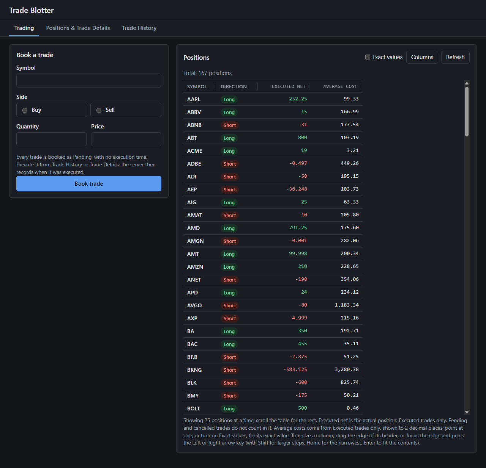 | 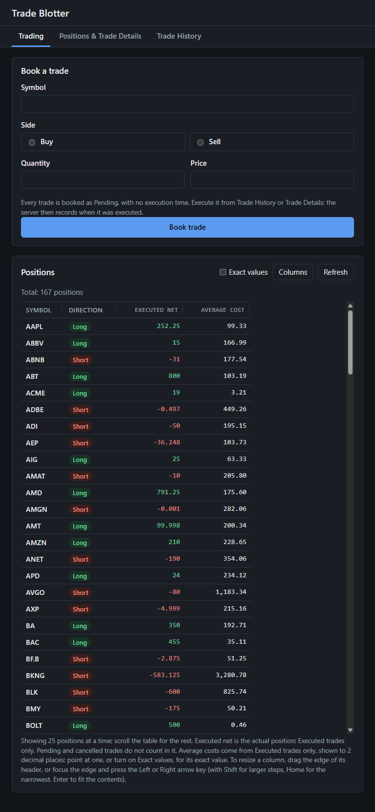 | 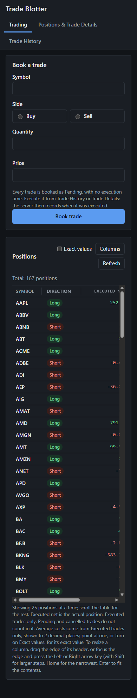 |
| Positions & Trade Details | 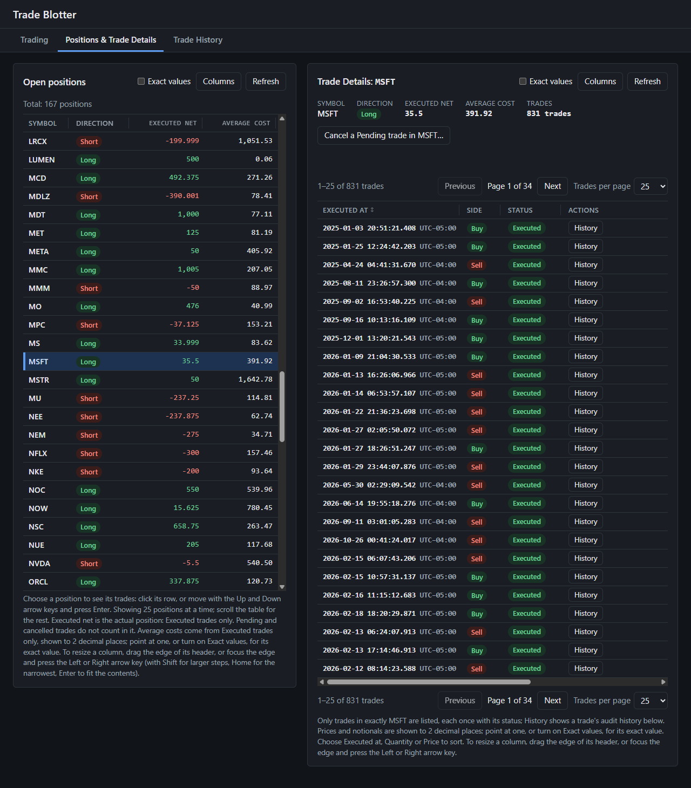 | 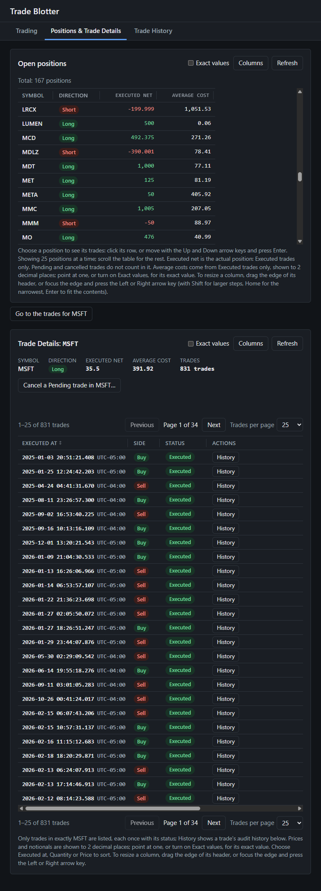 | 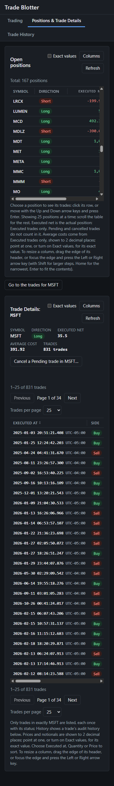 |
| Trade History | 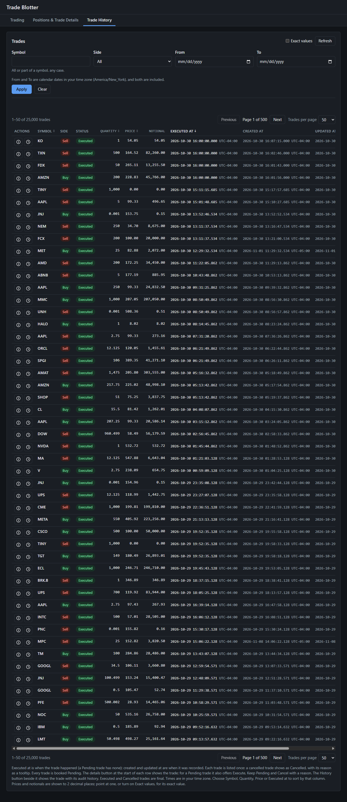 | 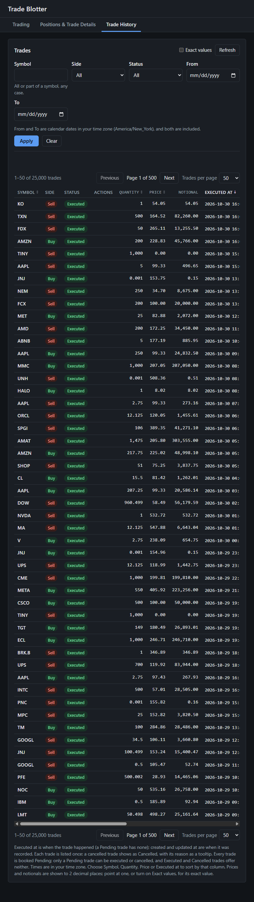 | 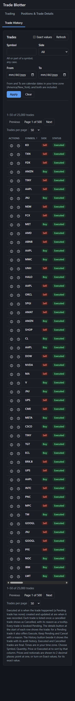 |

Show all columns in Trade Details at 1280 px, with the list still open, every column shown and
focus kept on the button:
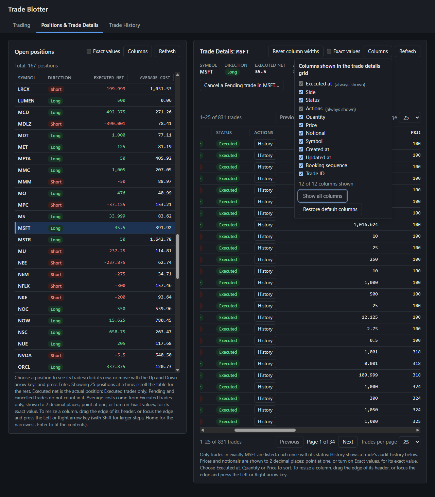

Cancelling a Pending trade from Trade History at 1280 px (the lifecycle fixture of `check:ui`):
the trade, its exact quantity and the 2-decimal price and notional, the required reason with its
count, and the page behind made inert:
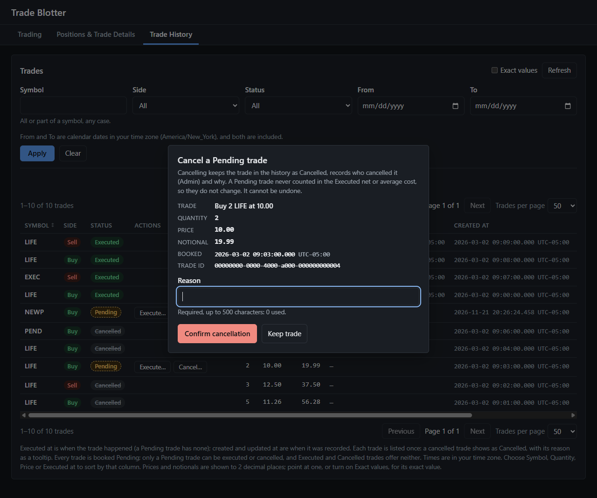

Executing a Pending trade (M7), from the same list: the trade and the confirmation, with focus on
Keep Pending and nothing to type, since the server sets the execution time:
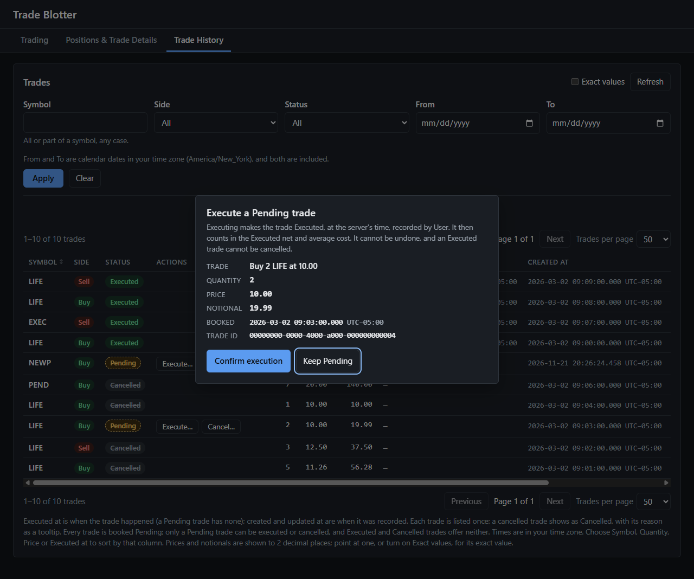

Earlier screenshots (before the tabs), including the form asking which occurrence of a repeated
local time is meant and the page while the API is unavailable, are in
[docs/verification/screenshots/](docs/verification/screenshots/).

## Prerequisites

| Tool | Required | Notes |
| --- | --- | --- |
| Node.js 22.21.0 | Yes | Exactly this version: `22.21.0` in every `engines` field and in `.nvmrc` (see [Node.js versions](#nodejs-versions)) |
| npm 10.9.4 | Yes | The npm bundled with Node.js 22.21.0 |
| Git | Yes | To clone the repository |
| A web browser | For the frontend | Any current Chrome, Edge, Firefox or Safari |

Nothing else needs installing: SQLite is built into Node.js, Drizzle is an npm dependency, and no
package compiles native code or runs an install script.

### Node.js versions

**Supported and verified: Node.js 22.21.0 only** (`22.21.0` in every `engines` field and in
`.nvmrc`), with the npm and SQLite it bundles:

| Node.js | npm | SQLite (`node:sqlite`) |
| --- | --- | --- |
| 22.21.0 | 10.9.4 | 3.50.4 |

`review:01` (and so `check:all`) reports 22.21.0 as PASS and every other version, newer or older,
as FAIL. The server itself checks features, not the version: it refuses to start if `node:sqlite`,
`JSON.rawJSON` or JSON source text is missing. Until 2026-11-20 the policy was `^22.21.0`, and
Node.js 22.23.1 was verified as well (the results are kept in [Platform support](#platform-support));
22.23.1 is no longer supported or verified.

**Expected `npm ci` warnings.** Six development-only packages in the locked versions declare
`^22.22.2 || ^24.15.0 || >=26.0.0`, so npm prints `EBADENGINE` for each on 22.21.0:

| Package | Used through |
| --- | --- |
| `jsdom` 30.1.3 | The frontend test environment (`client` devDependency) |
| `@asamuzakjp/css-color` 7.1.9, `@asamuzakjp/dom-selector` 10.0.5, `w3c-xmlserializer` 6.0.0 | `jsdom` |
| `nopt` 10.0.1, `abbrev` 5.0.0 | `@vue/test-utils` → `js-beautify` |

The warnings are not resolved; they are accepted, and not suppressed. None of these packages is
part of the application or its build: they run only in the frontend tests. On 22.21.0 every check
passed with them, the complete frontend test suite included, but they are used outside the range
their authors support, so a behaviour the tests do not exercise could differ. Versions that
declare support for 22.21.0 exist (`jsdom` 29.1.1, and `@vue/test-utils` 2.4.x or an npm override
for `nopt`); changing them has not been approved or tested.

On Windows, a portable Node.js 22.21.0 (the `node-v22.21.0-win-x64.zip` from
<https://nodejs.org/dist/v22.21.0/>, checked against its `SHASUMS256.txt`) can be used per shell
without changing the installed Node.js or `PATH` for anything else: put its folder first in that
shell's `PATH` (PowerShell: `$env:PATH = "<folder>;$env:PATH"`). Elsewhere, a version manager that
reads `.nvmrc` installs 22.21.0: `nvm install` with [nvm](https://github.com/nvm-sh/nvm) or
`fnm install` with [fnm](https://github.com/Schniz/fnm); on Windows also `nvm install 22.21.0`
with [nvm-windows](https://github.com/coreybutler/nvm-windows). Check with:

```bash
node --version   # v22.21.0
npm --version    # 10.9.4
```
## Getting started

```bash
git clone https://github.com/cs973112/trade-blotter-ts.git
cd trade-blotter-ts
npm ci           # installs the exact versions in package-lock.json, for the API and the frontend
npm run verify   # lint, typecheck, build and run every test
```

`npm run verify` exiting with code 0 means the setup works. Run every command in this README from
the repository root.

## Database

The database is a single SQLite file, `server/data/trade-blotter.db` by default (ignored by Git).
The API creates it and applies any pending migration every time it starts, before it accepts
requests. To do this without starting the API:

```bash
npm run db:migrate -w server
```

It prints `Database is up to date: <path>`; running it again changes nothing. If a migration
fails, every pending migration is rolled back, the command prints
`Database migration failed; no migration was applied.` with the reason, and it exits with code 1.

**Trade lifecycle and audit (M3 in the database, M4 in the API).** The third migration,
`20261120220032_trade_lifecycle_audit`, rebuilds `trades` with a status (Pending, Executed or
Cancelled), the actors who created and last changed each row (User or Admin), an execution time
only on Executed trades, and, on a cancellation row, the original it cancels and the reason. Every
existing trade is kept with its id, booking sequence and values, as Executed by User, and the
booking sequence never goes back. It also creates `trade_audit`, which SQLite triggers fill with a
snapshot of every column of a trade at each insert, update and delete (`Inserted`, `Updated`,
`Deleted`, by `System`, at SQLite's UTC time); its entries can never be changed or removed, and
no entry is invented for trades that existed before. The API serves all of it (see [API](#api));
the page does not show it yet. Later migrations add partial indexes on Executed trades and on
logical trades (no rebuild, no row changed). **Back up an
existing database before the API or `db:migrate` upgrades it** (see the
[setup guide](docs/setup.md#database)); the upgrade is one transaction, applied completely or not
at all.

Set `DATABASE_PATH` to use another file; an absolute path is recommended. The
[setup guide](docs/setup.md#database) covers other files, backups, starting afresh and schema
changes.

## Running the application

### Development

In two terminals, from the repository root:

```bash
npm run dev -w server   # the API on http://localhost:5299, restarting on changes
npm run dev -w client   # the frontend on http://localhost:5173
```

Open <http://localhost:5173>. The frontend calls the API through Vite's proxy, so start the API
first; if it is not running, the page says so.

### Production build

```bash
npm run build               # the API to server/dist/, the frontend to client/dist/
npm start -w server         # terminal 1: the compiled API on http://localhost:5299
npm run preview -w client   # terminal 2: the built frontend on http://localhost:4173
```

Stop either with Ctrl+C: the API finishes requests in progress, closes the database and exits.

### In the background: app:start, app:stop, app:status

One command starts the compiled API and the built frontend in the background, so the terminal
stays free; the same commands work on Windows, Linux and macOS. Build first (`npm run build`).

```powershell
npm run app:start                                               # API :5299, frontend :4173, default database
npm run app:status                                              # running or stopped, ports, URLs, database, process ids
npm run app:stop                                                # stops both; the database is left as it is
npm run app:start -- --database "$env:TEMP\tb-review\trades.db" # a separate database
npm run app:start -- --api-port 5399 --web-port 4273            # other ports
```

| Option | Else from | Default |
| --- | --- | --- |
| `--api-port <n>` | `PORT` | `5299` |
| `--web-port <n>` | `WEB_PORT` | `4173`, the built frontend's preview port |
| `--host <name>` | `HOST` | `localhost` |
| `--database <path>` | `DATABASE_PATH` | `server/data/trade-blotter.db` |

`LOG_LEVEL`, `DOCS_ENABLED` and `SYMBOL_MAX_LENGTH` reach the API as usual. A relative database
path is relative to the folder you run the command from. On Linux and macOS set variables the
usual way (`DATABASE_PATH=/tmp/tb-review/trades.db npm run app:start`).

- **Start** runs the API as `npm start -w server` does and the frontend as
  `npm run preview -w client` does, with the frontend forwarding API requests to the API it
  started. It refuses a port that is already in use, and starts nothing if the applications are
  already running. It reports both URLs and Swagger UI once each application answers; if one does
  not, it stops whatever it started and prints the end of that application's log. It never
  creates, resets or seeds data beyond what the API itself does at startup (migrations).
- **Stop** stops only processes that `app:start` started, with their child processes, and waits
  until their ports are free; running it again is harmless. Each process is recorded with a
  random token that is part of its command line, so a process whose id the operating system has
  since given to another program is recognised and left alone; nothing is ever stopped because
  of the port it uses. On Linux and macOS each application gets SIGTERM and shuts down cleanly
  (SIGKILL only after 10 seconds). On Windows a background process cannot be asked to stop, so it
  is terminated; SQLite keeps every committed trade.
- **Status** says whether each application is running and gives its port, URL and process id,
  the database and the log files.
- The run record and the logs (`api.log`, `web.log`) are in `.run/` at the repository root,
  which Git ignores.

With seeded data the order is: stop, clear or seed, start, try it, and stop again before
clearing or reseeding; see [Sample data](#sample-data-dbseed-and-dbclear). Tools that change trade
records call `refuseIfDatabaseInUse(path)` from `server/scripts/lifecycle.ts`, which refuses a
database that an application started by `app:start` is using, and tools that only read should
still refuse the development database (`isDevelopmentDatabase(path)`).

### Sample data: db:seed and db:clear

Fill a separate database with realistic trades to try the application at volume, and empty it
again. Both work on Windows, Linux and macOS. In PowerShell:

```powershell
$db = "$env:TEMP\tb-review\seed.db"
npm run app:stop                                       # nothing may be running on it
npm run db:seed -- --count 10000 --database $db        # 100, 1000, 10000, 25000, ... trades
npm run app:start -- --database $db                    # browse, search, filter, sort, book
npm run app:stop
npm run db:clear -- --database $db --confirm           # removes the trades; keeps the file
```

On Linux and macOS use `db=/tmp/tb-review/seed.db` and `"$db"`.

- **`db:seed -- --count <n> --database <path> [--seed <text>]`** seeds an empty trade table:
  a new file is created and migrated as the API would at startup; an existing Trade Blotter
  database must have no trades (clear it first). The trades are deterministic: the same count and
  seed (default `trade-blotter`) give the same trades every time (dataset version 2). They cover
  181 symbols, some traded thousands of times and a dozen only a handful (MS, MSFT and MSTR share
  letters; BRK.B and BF.B have punctuation; several trade at prices with up to ten decimal places),
  Buy and Sell, executions from 2025-01-02 to 2026-10-30 across several daylight-saving changes,
  repeated execution times, quantities and prices, and trades that open, increase, reduce, close
  and cross positions. The 25,000-trade benchmark leaves 167 open positions, 89 long and 78
  short, many with fractional quantities and average costs beyond two decimal places. Every
  trade is validated by the application's own rules, all are inserted in one transaction (in
  batches, so 25,000 take a few seconds), and they are read back through the application,
  counted and checked with its accounting. It prints the verified count and the time taken.
- **`db:clear -- --database <path> --confirm`** removes every trade and nothing else: the file,
  its schema and its migrations stay. SQLite's record of the highest booking sequence also stays,
  so booking sequences are never reused: trades seeded after a clear continue from there. It
  checks that no trade is left; clearing an empty database is harmless.
- **Safety.** Both need `--database` (`DATABASE_PATH` is ignored here) and refuse the
  development database `server/data/trade-blotter.db`, however its path is written (including a
  link to it), and anything else in `server/data/`, such as backups. They refuse a file that is not
  a Trade Blotter database without changing it, and refuse to run while an application started
  with `app:start` is running. Neither ever deletes a database file.
- **Limitation:** an API started some other way (`npm start -w server`, `npm run dev -w server`)
  cannot be detected. Stop every API using the database before seeding or clearing it.

### API performance: perf:api

Measures the running API on a seeded database, 62 scenarios in all: 14 of `GET /trades` (every
trade, a partial symbol search, each side, an execution-date range, all three combined, and every
sort field in both directions), 47 of `GET /trades/page` (the first, a middle and the last page,
50 and 100 a page, in every sort order, alone and with each filter), and `GET /positions`. In
PowerShell:

```powershell
$db = "$env:TEMP\tb-perf\perf.db"
npm run db:seed -- --count 10000 --database $db
npm run app:start -- --database $db
npm run perf:api -- --database $db                     # tables on screen
npm run perf:api -- --database $db --json "$env:TEMP\tb-perf\api-10000.json"
npm run app:stop
```

Or every size in one go, on the same file (100, 1,000, 10,000 and 25,000 trades by default):

```powershell
npm run perf:api:sizes -- --database $db
```

For each size it clears the file, seeds it, starts the applications on it, measures, saves the
results and stops the applications. The file is kept, with the last size in it, for trying the
UI. It refuses to begin while an application started with `app:start` is running: it starts and
stops only its own. On Linux and macOS use `db=/tmp/tb-perf/perf.db` and `"$db"`.

- **Options.** `perf:api`: `--database <path>` (required), `--api-url <url>` (default: the API
  started with `app:start`; another spelling of its address, such as `http://127.0.0.1:5299`, is
  accepted, any other address refused), `--warmup <n>` (default 5), `--iterations <n>` (default
  10) and `--json <file>`. `perf:api:sizes`: `--database`, `--sizes 100,1000,...`, `--warmup`,
  `--iterations`, `--api-port`, `--web-port` and `--out <folder>` (default `.run/perf/api-<time>/`,
  which Git ignores: one JSON file per size and `summary.txt`). Results are never committed.
- **What it measures.** Requests are sequential, one at a time over one kept-alive connection,
  so results compare across dataset sizes; there is no concurrent load. Each request is timed
  with `performance.now()` (monotonic) from sending it until the last byte of the body has
  arrived. JSON parsing is **not** included in that time; `JSON.parse` is timed separately after
  each response (the frontend's own exact-decimal parsing is measured in the browser, by
  [perf:ui](#browser-performance-perfui)). For each scenario it reports the matched rows, the response
  size in bytes, the minimum, median, p95 (nearest rank, so with 10 samples it is the maximum) and
  maximum latency, and the API process's memory: the working set on Windows, RSS on Linux and
  macOS, sampled between scenarios, never during a request, with the process's own peak where the
  system records it (not on macOS).
- **What it does not measure.** It times whole requests; the number of SQL statements and the
  query plans SQLite chose are not recorded; a slow plan shows only as a slow request.
- **What it checks.** Every response, warmups included, must be `200 application/json` with the
  same bytes as the first, and the first is compared trade by trade (id, booking sequence, symbol,
  side, quantity, price, notional, executedAt) or position by position with the database, read
  read-only. A page must hold exactly the trades the database holds at that position, with the
  right `page`, `pageSize`, `totalCount` and `totalPages`. Decimals are read from their exact JSON text, as the API reads request bodies, and
  compared with the stored values in canonical form. An invalid response stops the run, and nothing is recorded for it. The trades are
  fingerprinted before and after; any change discards the results. It never seeds, clears,
  starts or stops anything.
- **Safety.** It needs `--database`, refuses the development database and anything in
  `server/data/`, and measures only the API that `app:start` started on that exact file: the run
  record must name the file, the API's process must be alive and hold its token, and that process,
  and no other, must be listening on its port (on Windows another program can listen on the same
  port on another address). It then checks that the API serves exactly the trades in the file.
  Anything else is refused, with nothing measured.

### Browser performance: perf:ui

Measures the built frontend in headless Chrome on the same running applications, 17 scenarios:
loading the page (page 1 of 50), Next and Previous, 100 and 25 a page, choosing the Price header
twice and the Quantity, Symbol and Executed at headers, a partial symbol search, Buy, Sell, the
combined filters, Next with a filter applied, Clear, and typing in Symbol. In PowerShell, with the
applications started on a seeded database as above:

```powershell
npm run perf:ui -- --database $db
npm run perf:ui -- --database $db --json "$env:TEMP\tb-perf\ui-10000.json"
npm run perf:ui:sizes -- --database $db        # 100, 1,000, 10,000 and 25,000 trades, as perf:api:sizes
```

- **Options.** `--database <path>` (required), `--web-url <url>` (default: the frontend started
  with `app:start`), `--warmup <n>` (default 2), `--iterations <n>` (default 5), `--json <file>`,
  `--chrome <path>`, `--timeout <seconds>` for each action (default 180) and `--max-heap-mb <n>`
  (default 4096), and `--scenarios <ids>` to measure only some of them (`load`, `next`,
  `previous`, `size-100`, `size-25`, `price-asc`, `price-desc`, `quantity-asc`, `symbol-asc`,
  `executed-asc`, `search`, `buy`, `sell`, `combined`, `next-buy`, `clear`, `typing`; the initial
  load always runs, as it opens the page).
  `perf:ui:sizes` takes these and the `perf:api:sizes` options; its results go to
  `.run/perf/ui-<time>/`.
- **Interrupted runs.** The JSON file (`--json`, or each size's file of `perf:ui:sizes`) is
  rewritten after every scenario, with `"complete": false` until the run ends, so stopping a run
  keeps every scenario it finished. Each result carries a `runId`, and every scenario names the run
  its samples come from: results of separate runs are kept apart, never pooled.
- **Chrome.** It uses a Chromium-based browser found as described in
  [Finding a browser](#finding-a-browser), or `--chrome <path>`. It starts the browser itself,
  headless, with an empty temporary profile and its own DevTools port, so your own browser and its
  profile are never touched, and closes it and removes the profile at the end, also after an error
  or Ctrl+C. It drives the browser over the DevTools protocol with Node.js's built-in WebSocket;
  nothing is installed.
- **What it measures.** It uses the page's own controls: real mouse clicks on Apply and Clear and
  real key presses; the selects and dates are set and their change events fired. An action is done
  when the table shows the expected rows from a request made after it, with no update in progress,
  and the browser has produced the next frame (to within one frame). For each action it reports the
  matched rows, the minimum, median and maximum of the measured runs (no percentile: there are too
  few runs for one to mean anything; every run is in the JSON), and these medians, from the
  browser's own clocks: **before request** (click until the request started), **waiting** (until
  the first byte: the frontend's proxy and the API), **transfer**, and **after response** (parsing,
  exact-decimal conversion, Vue, layout and paint together: they cannot be told apart without
  changing the application), plus long tasks (50 ms or more), and script, style and layout time
  from Chrome. The initial load uses a new browser context each run (empty cache), from navigation
  start until the first page of trades and every position are shown. Typing reports each key
  press until the second frame after it. Separately, the frontend's exact-decimal parser (its
  source, `client/src/api/json.ts`, run in the page) and `JSON.parse` are timed on a page of 100
  trades. Memory: the page's JavaScript heap (before and
  after a forced garbage collection), DOM nodes, and the resident memory of every Chrome process,
  summed. Console errors and page crashes are reported.
- **What it checks.** The same as perf:api for the database and the API, and also that the
  frontend is the one `app:start` started (its process, on its port, forwarding to that API), that
  it is the production build, and that through it the trades are exactly those in the file. After
  every run the rows on the page (symbol, side and execution time, in order) are compared with the
  database. Nothing is booked, so the trades are unchanged; that is checked at the end.
- **Limits.** Headless Chrome on the same machine as the applications, without throttling: absolute
  times differ from a desktop browser on another machine. A page that needs more than
  `--max-heap-mb` is stopped (Chrome reports it out of memory), and every action has a timeout;
  both are reported as failures, never as results.

### Configuration

All settings are optional environment variables; an invalid value stops the API at startup with
a message naming the variable.

| Variable | Default | Meaning |
| --- | --- | --- |
| `HOST` | `localhost` | Interface the API listens on |
| `PORT` | `5299` | API port; `0` lets the operating system choose |
| `DATABASE_PATH` | `server/data/trade-blotter.db` | SQLite file; `:memory:` is refused |
| `LOG_LEVEL` | `info` | `fatal`, `error`, `warn`, `info`, `debug` or `trace` |
| `DOCS_ENABLED` | `true` | `false` disables Swagger UI and the OpenAPI document |
| `SYMBOL_MAX_LENGTH` | `64` | Longest symbol accepted, an integer from 1 to 255 |
| `API_TARGET` | `http://localhost:5299` | Where the frontend servers forward API requests |

There are no secrets and no `.env` files. Examples for each shell, port changes and
troubleshooting are in the [setup guide](docs/setup.md).

## Reviewer workflow: review:01 to review:07

Seven short commands check a clone end to end: the same on Windows PowerShell and Linux, run from
the repository root after `npm ci`, with no paths, ports or options to type. Everything they
create stays in `.run/review/` (ignored by Git). They never open your development database, and
they stop only the applications they started.

```powershell
npm run review:01   # setup
npm run review:02   # seed
npm run review:03   # start
npm run review:04   # functional checks
npm run review:05   # lint, typecheck, build, tests, schema check, UI checks in a real browser
npm run review:06   # performance
npm run review:07   # stop
```

| Command | What it does | Result and observed time (Windows 11, from a clean `.run/review/`; times are observations, not guarantees, and vary with the machine and its load) |
| --- | --- | --- |
| `review:01` | Checks the Node.js version (PASS on a verified version, WARN on another 22.x from 22.21.0, FAIL otherwise; see [Node.js versions](#nodejs-versions)), npm, every installed package against `package-lock.json`, SQLite and the four ports; looks for Chrome or Chromium; creates and migrates `benchmark.db` and `scratch.db`, or preserves and replaces one holding other trades (see Data below); fingerprints the development database | 13 PASS, 4 s (the first run after the dataset changed: 11 PASS and 2 WARN, one for each database preserved and replaced) |
| `review:02` | Seeds 25,000 benchmark trades and 120 scratch trades (dataset version 2), or recognises them by their fingerprint | 2 PASS, 13 s |
| `review:03` | Builds if anything is missing or older than its sources; starts the benchmark pair (API 5391, frontend 4191) and the scratch pair (API 5392, frontend 4192) and confirms both | 3 PASS, 19 s |
| `review:04` | 56 functional checks against the running applications, each compared with the database: `GET /trades` unchanged, pages, sizes, sorts, exact decimals, ties, filters, invalid parameters, positions, the frontends, and on a throwaway database bookings (Pending, no actual position, Executed bookings refused) and executions (in place at the server clock, a second execution and a cancellation of it refused, then listed and in the positions) | 56 PASS, 10 s |
| `review:05` | `lint`, `typecheck`, `build`, both test suites and `db:check`, each with a log in `.run/review/logs/`; then the 65 UI checks (`check:ui`) in a real browser, with screenshots in `.run/review/ui-check/<time>/`. Without a browser the UI checks are SKIPPED and the result is INCOMPLETE | 72 PASS (6 commands, 65 UI checks, no console errors) and 1 WARN (one Linux-only test skipped on Windows); observed 437 s, about 7.3 min, in `check:all` run `20261122T011915.335Z-3961c7` (the server tests alone 310 s) |
| `review:06` | The API benchmark (62 scenarios) and the UI benchmark (17 scenarios) on 25,000 trades; results in `.run/review/perf/` | 2 PASS, 3 min |
| `review:07` | Stops the reviewer's applications after confirming they are its own; compares the development database with step 01 | 3 PASS, 17 s |

Each command prints one line per check, PASS, FAIL, WARN or SKIPPED, then the counts and the
result, and exits **0** (passed; warnings allowed), **1** (something failed) or **3**
(incomplete). PASS means that check ran and held. SKIPPED names something that did not run.
`review:06` without Chrome or Chromium runs the API benchmark, reports the UI benchmark SKIPPED and
ends `INCOMPLETE` with exit code 3, never as a pass. Every output is also saved in
`.run/review/logs/review-0N.log`, which holds the current run only: `review:01` starts a new run
and moves the previous run's logs to `.run/review/logs/history/<run id>/`. Each step ends with the
run's summary, one status for each of the seven steps (PASSED, FAILED, INCOMPLETE, RUNNING,
INTERRUPTED or NOT RUN), taken from `.run/review/logs/run.json` alone, so a step not yet run in
this run never shows an earlier run's result.

**Runs and their logs.** `review:01` starts a run with an id such as `20261113T055224.547Z-73297f`
and moves the previous run's logs, untouched, to `.run/review/logs/history/<its id>/` (logs from
before runs were recorded are in `history/before-runs-<time>/`). Steps 02 to 07 join that run.
Each step prints which run it belongs to and ends with the run's summary, for example
`01 PASSED, 02 PASSED, 03 NOT RUN, …`: a step that has not run in this run says NOT RUN, and one
whose process ended before it finished says INTERRUPTED, never an earlier run's result. A step run
again in the same run keeps its earlier log as `review-0N.attempt-<n>.log`. Nothing in the history
is deleted, and no database, backup or fingerprint is touched by any of this.

Between `review:03` and `review:07`, book trades in the scratch frontend,
<http://localhost:4192>, or browse 25,000 trades at <http://localhost:4191> (read only: please do
not book there; the next `review:01` would then preserve and replace the benchmark database).
Running any command again is safe: setup and seeding keep what is there, start recognises its
running applications, and stop says when nothing is running.

- **Data.** A database is recognised by its dataset's identity: the seed generator's version and
  the SHA-256 fingerprint of every trade, never its count. `review:02` never reseeds or clears.
  Scratch trades you book are kept. A database that holds anything else (an earlier dataset
  version, changed trades, or trades booked into the benchmark) is copied into a verified backup
  in `.run/review/backups/` by `review:01`, and only then replaced by a new database for
  `review:02` to seed; `review:01` reports it as a WARN with the backup's folder. A file that is
  not a sound Trade Blotter database is never replaced. See the
  [setup guide](docs/setup.md#reviewer-workflow).
- **Processes.** `review:07` stops a pair only after checking its record's database and ports,
  that each process still carries the random token it was started with, that it alone listens on
  its port, and that it answers as that pair's application. A reused process id, another
  application or another database is reported as FAIL and left running. A port used by another
  program makes `review:03` fail for that pair, and the program is left alone.
- **Your development database.** `review:07` compares it with `review:01`'s fingerprint. A
  difference is a WARN, not a FAIL: if you used your own application in between, that explains it;
  the workflow never opens the file.

The [setup guide](docs/setup.md#reviewer-workflow) lists every file the workflow creates and how
to start afresh.

### Finding a browser

`check:ui`, `perf:ui` and steps 05 and 06 need a Chromium-based browser. None is installed by the
project, and no path is configured in the repository; the same commands find one on Windows,
Linux (WSL included) and macOS:

1. `CHROME_PATH`, when set. If it does not name a browser that can run, that is an error with
   how to correct it, never a silent fall back to another browser.
2. A browser installed on the system: Google Chrome, then Microsoft Edge, then Chromium on
   Windows; Google Chrome, then Chromium on Linux (the `PATH` and `/opt/google/chrome`); Google
   Chrome on macOS.
3. A browser downloaded for testing, newest version first: Chrome for Testing unpacked into
   `~/.local/chrome-for-testing/<version>/`, then Puppeteer's cache; then Playwright's cache (or
   `PLAYWRIGHT_BROWSERS_PATH`) and, on Linux, `/opt/playwright-browsers`.

Under WSL the tools run as Linux processes, which cannot drive a Windows browser, so Windows
programs are never chosen there. `review:01` reports which browser it found; without one, steps
05 and 06 report their browser parts SKIPPED and end INCOMPLETE (exit code 3), never as passed.

## Development feedback: check:fast

```powershell
npm run check:fast                 # development feedback in about two minutes; never acceptance
```

`check:fast` is for the edit, test, edit loop: the project's own npm scripts, each a PASS or a FAIL
with its log in `.run/check-fast/<run id>/` and a `summary.json`. It never starts an application,
a browser or a benchmark, uses no port of its own and touches no development or reviewer database
(the tests make their own in the temp folder, as `npm test` always does). **`npm run check:all`
remains the comprehensive acceptance**: a passing `check:fast` is never reported as complete
verification, and its last line says so.

The checks run in four groups, one after another:

| Group | Checks | Run |
| --- | --- | --- |
| 1 | `lint`, `typecheck`, `build`, `db:check -w server`, `check:docs` | at once: only `build` writes (`server/dist/`, `client/dist/`), and none of the others reads what it writes |
| 2 | Server application tests: the Vitest project `app` (`npm test -w server -- --project app`), every test outside `server/test/scripts/`: domain, application, infrastructure (repositories and the database), API, platform, scenarios, architecture, isolation and tooling configuration | alone |
| 3 | Client tests (`npm test -w client`) | alone |
| 4 | The quick tooling tests in `server/test/scripts/`, by file (`FAST_TOOLING_TESTS` in `server/scripts/check-fast.ts`) | alone |

Left to `check:all`: the reviewer workflow and its applications, the UI checks in a browser, both
benchmarks, failure detection, and the tooling tests that exercise them or take minutes:
`check-all-supervisor`, `check-all-main`, `check-all-failures`, `failure-detection`, `perf-api`,
`perf-ui`, `review`, `lifecycle` and `ui-check` (`CHECK_ALL_ONLY_TESTS`, each with the reason). A
test names every file in `server/test/scripts/` exactly once, in one list or the other, so a new
tooling test cannot be left out of both unnoticed.

The server and client tests could run at once without conflict (each Vitest run names its
temporary folders and databases by a run id of its own), but measured together they saved little:
52 s against 29 s and 29 s apart, each nearly twice as slow, so they run one after the other. A
failed check fails the run (exit code 1) once its group has finished; every later check is listed
`NOT RUN`, with the end of the failed check's log. Each check has a 15-minute deadline, after
which it and its own child processes are stopped; nothing else is ever signalled. Exit code 2 is
an unknown argument.

Observed on 2026-11-22 on Windows 11 (run `20261122T020315465Z`, not a guarantee): 8 PASS in 121 s; lint,
typecheck, build, schema and documentation checks together 41 s, the server application tests 29 s,
the client tests 29 s and the quick tooling tests 22 s. `check:all` took 1,051 s the same day
(run `20261122T020547.013Z-5fa17b`).

## Complete verification: check:all

One command runs every verification, each run in a folder of its own. It is the acceptance;
`check:fast` above is development feedback only:

```powershell
npm run check:all                  # complete verification
npm run check:all -- --quick       # everything except the benchmarks; never complete verification
npm run check:all -- --verbose     # every check, command, test and detail as it runs
```

It is the reviewer workflow (the same seven steps, with every check they make) on reviewer
databases and ports of its own (APIs 5491 and 5492, frontends 4291 and 4292), followed by the
failure-detection checks and the documentation checks. The steps run in the order 01, 05, 02,
03, 04, 06, 07, so the build and the tests come first and nothing is built or tested twice; a step
whose prerequisite failed is not run and says why, and step 07 always runs, so nothing it started
is left running, even after an unexpected error (see below). `review:01` to `review:07` remain
available on their own, in `.run/review/`.

| Category | What it is |
| --- | --- |
| Environment | `review:01`: Node.js against the policy, npm, packages, SQLite, the browser, the ports |
| Lint, typecheck, build | `review:05`'s first three commands |
| Server tests, Client tests | Every test, counted one by one from vitest's JSON results |
| Schema check | `db:check` |
| UI checks in a browser | `check:ui`'s 65 checks and the console |
| Seed and start | `review:02` and `review:03` |
| Functional checks | `review:04` |
| Performance benchmarks | `review:06`; left out by `--quick` |
| Stop and data protection | `review:07`, including the development database's fingerprint |
| Failure detection | Thirty-seven deliberate breaks of a rule, 31 in the server and 6 in the client, each on a temporary copy of its workspace: a test must catch each with a failed assertion (see below) |
| Documentation consistency | These documents against the code: endpoints, OpenAPI against the frontend's contracts, `npm run` commands, UI labels, business rules, linked files and screenshots, test counts, benchmark provenance |

The output ends with a table, one row per category with its PASS, FAIL, WARN and SKIPPED counts
and time, then the total and the duration, every failure with its message and log, every warning,
what was not run and why, and where everything is kept:

```text
Category                                  PASS  FAIL  WARN  SKIP
Environment (review:01)                     13     0     0     0  checks  0.1 s
...
RESULT: PASSED: complete verification passed (exit code 0)
```

**Exit codes:** `0` passed (a quick run that passed ends `QUICK PASSED`, which is not complete
verification); `1` something failed; `3` a required part could not run, such as the UI checks
without a browser (`INCOMPLETE`); `2` an unknown option.

**Unexpected errors, deadlines and clean-up.** Nothing ends a run without a summary, and nothing
unexpected is reported as passed. `check:all` runs in two processes: `check-all-main.ts` starts
the supervisor (`check-all-supervisor.ts`), which runs none of the verification; it starts the
worker (`check-all-worker.ts`), which runs everything described above, and watches it.

- A step that throws is a FAIL of that step, with the error's message.
- An unhandled rejection (a promise rejected that nothing awaited, as when a benchmark's connection
  to Chrome closed in M5) is recorded instead of ending the worker: a FAIL of whatever was running,
  which then counts as failed, with the full stack in `unexpected-errors.log` and in the step's
  log. The run goes on to step 07, failure detection, the documentation checks and the summary, and
  its result is `FAILED`: nothing is concluded about the state the rejection left, only that the
  run failed.
- An uncaught exception is not handled in the worker: Node.js ends it, as it always does, so no code
  goes on after it. Just before, the worker records the stack and the phase in `worker-fatal.json`
  and `unexpected-errors.log`.
- Each step has a deadline, several times the longest it has taken (45 minutes for `review:05`
  and `review:06`, 10 or 15 for the others): a step still running then is a FAIL and is no
  longer waited for; whatever it records later is dropped.
- A worker that cannot act on its own deadline (its event loop blocked, or stuck outside a step) is
  ended by the supervisor at a hard deadline: the phase's own limit plus five minutes' grace.
- An error in `check:all`'s own bookkeeping, in failure detection or in the documentation checks is
  a FAIL too.

In the worker's cases the steps that need the failed one are left out and listed under "Not run",
step 07 still stops this run's applications (only those whose process still holds the token it was
started with and is the only listener on its port, with bounded waits, each port checked released
afterwards; never a process found only by its id or port), and the summary lists every failure with
its message and log, then "Unexpected errors" and "Not run". The result is `FAILED`, exit code 1.
When step 07 did not pass, the pairs' records are read again: any of the run's applications still
running is a further FAIL that names its process and port and how to stop it (`npm run app:stop`
with `TRADE_BLOTTER_RUN_DIR` set to the pair's folder, which checks the token again first).

The supervisor accepts the worker's result only when the worker ended by itself with exit code 0, 1
or 3, recorded no fatal error, and left a finished record and a complete `summary.json` that are
this run's and this worker's and agree with its exit code; that result, output and exit code are
then the run's, unchanged. Anything else (an uncaught exception, the worker killed or ending
without such a summary, a hard deadline, Ctrl+C or SIGTERM) is a run that did not complete. The
supervisor makes sure the worker has exited (ending it, if need be, through its own process
handle), runs step 07's clean-up with the same checks, lists what is still running, keeps every
file (the worker's own summary, if it wrote one, as `worker-summary.json`), and writes
`summary.json` and `summary.txt`: what completed, what was interrupted, what never ran, the
unexpected errors, the clean-up, the applications, other processes and temporary folders left, and
how to stop what is left. The result is `FAILED: check:all did not complete`, exit code 1; if no
summary can be written, a minimal text one or the error output says so, and the exit code is still
1. A second Ctrl+C ends the supervisor at once and prints how to stop the applications.
`server/test/scripts/check-all-supervisor.test.ts` covers each case with a real worker process,
stand-in steps and applications, and the real clean-up; `check-all-failures.test.ts` covers the
worker's own handling, and `check-all-main.test.ts` the real `npm run check:all` entry point.

**Evidence**, in `.run/check-all/<run id>/` (ignored by Git and ESLint; no run reads or replaces
another's): `summary.txt` and `summary.json` (start and finish times, every step's exit code, every
command with its log and duration, the counts), `check-all.log` (every check with its detail, and every command; the individual tests that
`--verbose` lists are in `tests/`),
`environment.json` (Node.js, npm, SQLite, platform, browser, Git commit, application source
fingerprint), `tests/` (vitest's JSON results), `review/` (the reviewer databases, each step's log
and command logs, screenshots in `ui-check/`, benchmark results in `perf/`), `failure-detection/`
(for each check: the change, the control and changed runs' logs and JSON, the type-check log) and
`documentation.json`.

**Failure detection** (`npm run check:failures` on its own) shows that the tests catch a broken
rule. Each check copies the server to `server/.test-build-check-<run>-<check>/`, or for a client
check the frontend to `client/.test-build-check-<run>-<check>/`, and works only there: the unmodified copy's tests must pass, the change must apply exactly once, the changed copy
must type-check, and then a named test must fail on an assertion. A compile error, a missing file,
a test file that cannot be collected, a timeout or an error of another kind is a FAIL, never a
detection. The thirty-one server rules: average cost unchanged by a reduction, the position limit at exactly
10^30, at most 10 decimal places, `pageSize` at most 100, `symbolMatch=exact` matching the whole
symbol; for the trade lifecycle's domain rules, a cancelled original and a
cancellation row ignored by positions, average cost from Executed trades only, a booking Pending
with no execution time, a booking as Executed refused, a booking with an execution time refused, a
trade executed once, only a Pending trade cancellable, a cancellation row not cancellable, a trade
cancelled once, and a cancellation made as Admin; for the database, an update audited as Updated,
the audit trail append-only, the migration keeping the booking sequence's high-water mark, the
Pending limit applied when storing, the Executed limit applied when executing, and the existing
repository reading Executed trades only; for
the API, cancellation records never listed, the status filter, Pending trades counted in positions,
a logical trade's audit history holding its cancellation record's entries too (which the page's
audit history shows), the lists never read through the unique index on `original_trade_id`, and
each logical-trade index holding the logical trades; and, for process clean-up, EPERM neither taken
as an exit nor as proof that a process has gone, and a process whose command line lacks its token
never signalled. The six client rules, checked by the frontend's own tests on a copy of the client
(`client/.test-build-check-<run>-<check>/`, type-checked with `vue-tsc`, Vue templates included):
the page books without a status (so never as Executed), a successful execution reloads the lists
and positions, Execute appears only on Pending trades, the Positions grids show the Executed net and
never count Pending trades, a successful cancellation reloads the lists and positions, and the
deferred Pending and Projected net are offered nowhere, not even in Columns. Production files are only
read.

## Test-drive search, filters and sorting

A walk-through for a reviewer: build, run the compiled API on a throwaway database, open the
frontend, book a few trades and try the trade-list controls. Your own database
(`server/data/trade-blotter.db`) is never opened. The commands are for Windows PowerShell, run
from the repository root; [Linux and macOS](#on-linux-and-macos) differs only in how variables are
set.

**1. Check the tools, install and build** (Node.js 22 from 22.21.0, with its bundled npm; see
[Node.js versions](#nodejs-versions)):

```powershell
node --version          # v22.21.0, or a later v22
npm --version           # 10.9.4
npm ci                  # the exact versions in package-lock.json (EBADENGINE warnings on 22.21.0 are expected)
npm run build           # the API to server/dist/, the frontend to client/dist/
```

**2. Terminal 1: the API, on a database in your temp folder.** `$env:` settings last only for
this terminal.

```powershell
$env:DATABASE_PATH = "$env:TEMP\trade-blotter-review\trades.db"
npm start -w server     # http://localhost:5299; created and migrated on first start
```

(Or start both in the background from one terminal, against the built frontend on port 4173:
`npm run app:start -- --database "$env:TEMP\trade-blotter-review\trades.db"`; see
[In the background](#in-the-background-appstart-appstop-appstatus).)

**3. Terminal 2: the frontend.**

```powershell
npm run dev -w client   # http://localhost:5173
```

Open <http://localhost:5173>. Swagger UI is at <http://localhost:5299/documentation> (also
through the frontend, at <http://localhost:5173/documentation>).

If port 5299 or 5173 is already in use, for example by your own running copy, choose others:
`$env:PORT = '5399'` before `npm start -w server` in terminal 1, and in terminal 2
`$env:API_TARGET = 'http://localhost:5399'; npm run dev -w client -- --port 5183`.

**4. Book and execute these trades, one at a time, in this order.** Book each with the form on
the **Trading** tab (it is booked Pending, with no execution time), then, on the **Trade History**
tab, choose **Execute…** on it and **Confirm execution**. Its execution time is the moment you
confirm, so the trades are executed in this order:

| # | Symbol | Side | Quantity | Price | What executing it does to the position |
| --- | --- | --- | --- | --- | --- |
| 1 | AAPL | Buy | 100 | 150.25 | opens long 100 at 150.25 |
| 2 | AAPL | Buy | 50 | 155.5 | increases: 150 at 152 |
| 3 | NVDA | Sell | 0.5 | 1000 | opens short 0.5 at 1,000 |
| 4 | MSFT | Sell | 20 | 410 | opens short 20 at 410 |
| 5 | AAPL | Sell | 30 | 160 | reduces: 120, still at 152 |
| 6 | MSFT | Buy | 20 | 400 | closes: MSFT disappears from Positions |
| 7 | TSLA | Buy | 10 | 200 | opens long 10 at 200 |
| 8 | GOOG | Buy | 10 | 200 | opens long 10 at 200 |
| 9 | TSLA | Sell | 25 | 210.75 | crosses: short 15 at 210.75 |
| 10 | BRK.B | Buy | 3 | 9.5 | opens long 3 at 9.5 |

Before each execution the trade is Pending and changes no position; the Positions grid shows the
actual position, from Executed trades only. Positions then show AAPL long 120 at 152.00, BRK.B long 3 at 9.50, GOOG long 10 at 200.00, NVDA
short 0.5 at 1,000.00 and TSLA short 15 at 210.75 (average costs to 2 places; quantities exact).

**5. Open the Trade History tab and try the controls above and in the trade table.** Filters
change nothing until you press
**Apply**; **Clear** resets the filters and the sort, and goes back to page 1. The column headers
Symbol, Quantity, Price and Executed at sort as soon as you choose them.

| Do this | Expect |
| --- | --- |
| Symbol `aPl`, Apply | the three AAPL trades (any case, any part of the symbol), "1–3 of 3 matching trades" |
| Symbol `sf`, Apply | the two MSFT trades |
| Side Sell, Apply | the four Sell trades |
| From and To both today, Apply | every executed trade; a Pending trade, which has no execution time, never matches a date range |
| From and To both yesterday, Apply | "No trades match these filters." |
| Symbol `a`, Side Sell, From and To today, Apply | trades 9, 5 and 3, newest execution first |
| Clear, then choose the Price header | BRK.B at 9.50 first and NVDA at 1,000.00 last: numbers, not text; ↑ beside Price |
| Choose Price again | descending: NVDA first; ↓ |
| Choose Executed at, then again | oldest first: trade 1 first, in the order you executed them; then newest first |
| Symbol `zzz`, Apply | "No trades match these filters.", and no pager |
| From 2026-03-10, To 2026-03-08, Apply | a message under To; nothing is sent |
| Side Buy, Apply; then book a Sell | "It is not in the trade list because it does not match the current filters."; it changes no position until executed |
| Side Buy applied; type `zzz` in Symbol without Apply; choose Quantity | sorted with the applied Side Buy filter only; "Changes not applied yet." stays |
| 25 trades per page (either pager) | both pagers change; page 1 |
| Positions & Trade Details tab: choose AAPL | its 3 trades; MSFT, closed, is not in the list |
| Book a trade at price 10.125, then check Exact values in Trade History | the price shows 10.12 (half to even), then "10.12 exactly 10.125"; it is Pending, with **Execute…** and **Cancel…** |

With ten trades everything fits on one page, so Previous and Next stay disabled. To try paging,
use the scratch applications of the [reviewer workflow](#reviewer-workflow-review01-to-review07)
(120 trades, three pages of 50), or the [browser checklist](#browser-checklist) on 25,000.
Reloading the page always starts again from the default filters. The same queries work against
the API directly, for example:

```powershell
curl.exe "http://localhost:5299/trades?symbol=aPl&side=Buy&sortBy=price&sortDirection=asc"
curl.exe "http://localhost:5299/trades/page?symbol=aPl&page=1&pageSize=2"
```

**5b. Try the trade lifecycle.** Continue with the same trades.

| Do this | Expect |
| --- | --- |
| Trading: book AAPL Buy 10 at 151 | "Booked as Pending: Buy 10 AAPL at 151. Execute it from Trade History or Trade Details; …"; Positions: AAPL Executed net 120, Average cost 152.00, unchanged |
| Book PEND Buy 5 at 20 | PEND appears in Positions as Flat: Executed net 0, Average cost 0.00 |
| Trade History: Status Pending, Apply | the two Pending trades, each with a dash for Executed at and **Execute…** and **Cancel…**; Executed trades have neither |
| **Execute…** on AAPL 10 at 151; **Confirm execution** | "Executed: Buy 10 AAPL at 151.00, recorded by User. It now counts in the Executed net and average cost."; it shows Executed, with the time you confirmed, and no buttons; Positions: AAPL 130 at 151.92 |
| Cancel… on PEND; Confirm with no reason | "Enter a reason for the cancellation."; nothing is sent |
| Type a reason; Confirm cancellation | "Cancelled: Buy 5 PEND at 20.00. Reason: …. Cancellation record …, recorded by Admin."; PEND shows Cancelled (the reason as its tooltip) and leaves Positions |
| Positions & Trade Details: choose AAPL; **History** on the trade you executed | two entries, oldest first: Trade booked by User as Pending; Trade executed by User; each recorded by System |
| Execute the same trade again with `curl.exe -X POST http://localhost:5299/trades/<id>/execution` | `409` with `invalid-transition`: a trade is executed once |
| Book AAPL Sell 5 at 160; in Trade Details **Cancel a Pending trade in AAPL…** | the one Pending trade, with its id; cancel it with a reason: AAPL's Executed net stays 130 |

**6. Finish.** Stop both servers with Ctrl+C, then remove the throwaway database and the setting:

```powershell
Remove-Item -Recurse -Force "$env:TEMP\trade-blotter-review"
Remove-Item Env:DATABASE_PATH
```

**7. Run the automated tests** (no server, browser or existing database needed; each test makes
its own temporary database):

```powershell
npm run verify               # lint, typecheck, build and every test
npm run db:check -w server   # the migrations match the schema
```

### On Linux and macOS

The commands are the same; only setting variables differs (not verified on these systems, see
[Platform support](#platform-support)):

```bash
export DATABASE_PATH=/tmp/trade-blotter-review/trades.db
npm start -w server                       # terminal 1
npm run dev -w client                     # terminal 2
PORT=5399 npm start -w server             # other ports, if 5299 or 5173 is taken
API_TARGET=http://localhost:5399 npm run dev -w client -- --port 5183
rm -rf /tmp/trade-blotter-review          # afterwards
```

On a machine without a desktop browser (a container, WSL or a remote host), start the frontend
with `npm run dev -w client -- --host 0.0.0.0` and open it from your own browser through the
forwarded port; the API can stay on `localhost`, because the frontend forwards to it.

## Browser checklist

A manual check of paging on real volumes, after `review:01` to `review:03`. The reviewer's data
is generated from a fixed seed, so every clone holds the same trades and the values below are
exact. Use the benchmark frontend, <http://localhost:4191>, for rows 1 to 12 (read only: book
nothing there; rows 1 to 10 are on the Trade History tab) and the scratch frontend,
<http://localhost:4192>, for bookings. Times are shown in
your time zone, and From and To are days in your time zone, so the date-range count in row 8
(395) holds in New York time; elsewhere it can differ by a few trades. The values are for dataset
version 2 (see [Sample data](#sample-data-dbseed-and-dbclear)).

| # | On | Do this | Expect |
| --- | --- | --- | --- |
| 1 | 4191 | Open the page | "1–50 of 25,000 trades" and "Page 1 of 500" above and below the table; Previous disabled; Executed at ↓; first row KO Sell 1 at 54.05, then TXN Sell 500 at 164.52 (same time, later booking first) |
| 2 | 4191 | Next, then Next in the lower pager, then Previous | page 2 ("51–100"), page 3 ("101–150"), page 2; both pagers always agree |
| 3 | 4191 | Tab to Next and press Enter, then Space | the page changes each time and Next keeps the focus, with a visible outline |
| 4 | 4191 | 25, then 100, then 50 a page | "Page 1 of 1,000", "Page 1 of 250", "Page 1 of 500"; always back to page 1 |
| 5 | 4191 | Choose Price | ↑; first row TINY Buy 950 at 0.00, then TINY Sell 5 and TINY Sell 0.001, also at 0.00; pointing at each price, or Exact values, shows the exact one (0.0000003906, 0.0000003909, 0.0000003909) |
| 6 | 4191 | Choose Price again; then Quantity twice; then Symbol | BKNG Buy 2.75 at 3,547.55 first; Quantity ↑ (SOFI Sell 0.001 first) then ↓ (BRK.B Sell 4,880.499 first); Symbol ↑, AAPL first. Page 1 each time |
| 7 | 4191 | Choose Price (↑); then Side Buy, Apply | "1–50 of 12,519 matching trades", "Page 1 of 251"; still sorted by price |
| 8 | 4191 | Clear; Symbol `ms`, Side Sell, From 2025-07-01, To 2026-06-30, 100 a page, Apply; then Next to the end | "1–100 of 395 matching trades", "Page 1 of 4"; page 4 shows "301–395", Next disabled and the focus on Previous |
| 9 | 4191 | Clear | every trade, Executed at ↓, page 1; the page size (100) is kept |
| 10 | 4191 | Symbol `zzz`, Apply | "No trades match these filters.", no pager and no table; Clear restores the list |
| 11 | 4191 | Positions (Trading) | 167 open positions, 25 in view, AAPL first and ZTS last; the header stays as the grid scrolls; the same whatever page, filter or sort the trade list shows |
| 11a | 4191 | Positions & Trade Details: choose MS, then MSFT | MS: "301 trades", 13 pages of 25, only MS (a search for `ms` in the trade list matches 1,440); MSFT: "831 trades", 34 pages; Next and Price sort the details on the server |
| 11b | 4191 | Narrow the window to 390 px, on Trading | the Positions grid scrolls sideways and up and down inside its box, each on its own; the page does not scroll sideways |
| 12 | 4191 | Narrow the window to a phone's width (390 px) | the pager wraps, the page never scrolls sideways; the table scrolls within its own box |
| 13 | 4192 | Open the page | "1–50 of 120 trades", "Page 1 of 3" (more if you have booked already) |
| 14 | 4192 | Book Buy 2.5 of a new symbol at 10.0000000001 | "Booked as Pending: …"; "It is on another page of the trade list.": trades without an execution time come after every executed one, newest first |
| 15 | 4192 | Side Sell, Apply; book a Buy | "It is not in the trade list because it does not match the current filters." |
| 16 | 4192 | With Side Sell applied, choose Symbol; book a Sell of `ZZ…` | "It matches the filters but is on another page of the trade list."; the filter and the sort stay as they were |
| 17 | 4192 | Clear; Executed at ↑ (oldest first); **Execute…** on the trade from row 14, Confirm execution | one execution; the row shows Executed with the time you confirmed; Positions list the symbol Long 2.5 at 10.00 at once, whatever the trade list shows |
| 18 | 4192 | Book a Buy of 3 of a new symbol at 9.995 | it is listed in Positions as Flat (Executed net 0); in Trade History as Pending, Executed at "—", with Execute… and Cancel… |
| 19 | 4192 | Cancel… on it, by keyboard: Enter, type a reason, Enter twice | one cancellation; the row shows Cancelled; the symbol leaves Positions; the outcome names the cancellation record and Admin, and has the focus |
| 20 | 4192 | Positions & Trade Details: choose a symbol, then History on one of its trades | its audit history, read only, every entry recorded by System |

The values in rows 1 to 11a were read from the running benchmark applications of dataset version 2
on 2026-11-13; rows 11, 11a and 11b are also checked automatically by `check:ui` on the same 25,000
trades, and rows 17 to 20 on its own lifecycle dataset. The checklist as a whole is a manual check: run it yourself in a desktop browser.

## Build and test

| Command | What it does |
| --- | --- |
| `npm run lint` | ESLint over the whole repository |
| `npm run typecheck` | Type-check the API and the frontend without emitting files |
| `npm run build` | Build the API to `server/dist/` and the frontend to `client/dist/` |
| `npm test` | Run every test once (1,909 API and tool tests, one of them Linux-only, and 441 frontend tests, on 2026-11-22) |
| `npm test -w server` | API tests only |
| `npm test -w client` | Frontend tests only |
| `npm run verify` | Lint, typecheck, build and test, in that order |
| `npm run check:fast` | Development feedback in about two minutes: static checks, schema, documentation and every application test; see [check:fast](#development-feedback-checkfast). Not acceptance |
| `npm run check:all` | Comprehensive acceptance: everything, including the reviewer workflow, browser checks, benchmarks and failure detection; see [check:all](#complete-verification-checkall) |
| `npm run app:start` / `app:status` / `app:stop` | The built applications in the background; see [In the background](#in-the-background-appstart-appstop-appstatus) |
| `npm run db:seed` / `db:clear` | Sample trades in a separate database; see [Sample data](#sample-data-dbseed-and-dbclear) |
| `npm run perf:api` / `perf:api:sizes` | API benchmark on a seeded database; see [API performance](#api-performance-perfapi). Not part of `npm test` or `verify` |
| `npm run perf:ui` / `perf:ui:sizes` | Browser benchmark in headless Chrome; see [Browser performance](#browser-performance-perfui). Not part of `npm test` or `verify` |
| `npm run check:ui` | The page in a real headless browser, found as for `perf:ui`: 65 checks. The three tabs, the Positions grid (25 rows in view, sticky header, column resizing), layouts at 1280, 768 and 390 px, booking with exact decimals, money to 2 places with the exact value kept (booked, then executed); then Positions & Trade Details (choosing by pointer and keyboard, exact-symbol matching against MS, MSFT, MSTR and AMS, server paging and sorting, the Columns chooser, resizing after hiding columns, a late answer dropped, its layouts); then both Positions grids at the benchmark's scale (167 positions: 25 in view, first, middle and last by keyboard and wheel, sticky header, sideways and vertical scrolling apart at 390 px, the positions total in both grids at 1280, 768 and 390 px, Show all columns and Restore default columns by keyboard in all three grids, columns, resizing, choosing positions after scrolling, MSFT's 831 trades paged and sorted on the server); then the trade lifecycle (booking always Pending with no status or execution time, the actual position with a Flat Pending-only symbol, the Status column and filter, a Pending trade's dash for its execution time, Execute and Cancel only on Pending trades, executing by keyboard with focus on Keep Pending, Confirm pressed twice sending one request with no body, the Executed net and average cost changing, a 409 for a trade executed meanwhile, cancelling by keyboard with focus kept in the dialog and returned to its button, Confirm pressed twice sending one request with only the reason, a 409 for a trade cancelled meanwhile, choosing among a symbol's Pending trades in Trade Details, the audit timeline by User, Admin and System, a late audit answer dropped, both dialogs at 1280, 768 and 390 px); console errors. Uses four throwaway databases of its own (40 open positions; a master-detail set; the benchmark's 25,000 trades, generated afresh; a lifecycle set booked and cancelled through the lifecycle repository) and free ports; needs `npm run build`. `--out <folder>` for the screenshots |
| `npm run db:check -w server` | The migrations folder is consistent (`drizzle-kit check`); schema drift is a test |
| `npm run review:01` ... `review:07` | The reviewer workflow; see [Reviewer workflow](#reviewer-workflow-review01-to-review07) |
| `npm run check:all` | Every verification in one run of its own: the reviewer workflow, failure detection and the documentation checks; `-- --quick` leaves out the benchmarks, `-- --verbose` prints everything. See [Complete verification](#complete-verification-checkall) |
| `npm run check:failures` | The failure-detection checks alone: each breaks one rule in a temporary copy of the server and expects a test to catch it |
| `npm run check:docs` | The documentation checks alone: endpoints, contracts, commands, UI labels, business rules, links, test counts, benchmark provenance |

```bash
npm test -w server -- test/domain              # one folder
npm test -w server -- -t "positions"           # tests whose name matches
npm exec -w server -- vitest                   # watch mode
```

The tests need no running server, browser, network or existing database (`check:ui` and the
reviewer's steps 05 and 06 are the ones that start a real browser). They create their own
databases in the operating system's temp folder, use ports chosen by the operating system, and
remove everything afterwards. The API tests run in two groups, one after the other: first the
application's own (`app`), then those of the tools in `server/scripts` (`scripts`), which start
background processes and seed large databases; kept apart, the tests that hold a child process to
a deadline never compete with them for the CPU.

## API

With the API running, Swagger UI is at <http://localhost:5299/documentation> and the OpenAPI 3.1
document at <http://localhost:5299/documentation/json>.

| Endpoint | What it does |
| --- | --- |
| `POST /trades` | Book a trade, always `Pending`. Returns `201` and the stored trade. |
| `POST /trades/{id}/execution` | Execute a Pending trade, as User, at the server's time. Returns `200` and the trade, now `Executed`. |
| `GET /trades` | Every matching logical trade as a JSON array, newest `executedAt` first, then those without one; optional parameters search, filter (including `status`) and sort. Unchanged by pagination. |
| `GET /trades/page` | One page of the same list, with `totalCount` and `totalPages`; the frontend uses this. |
| `POST /trades/{id}/cancellation` | Cancel a Pending trade with a `reason`, as Admin. Returns `201`, the cancelled trade and its cancellation record. |
| `GET /trades/{id}/audit` | Read-only: the database's audit history of a trade, oldest first, a page at a time; `scope=trade` (its own row) or `scope=logical` (the original and its cancellation record). |
| `GET /positions` | Every position, sorted by symbol: the Executed Net (the actual position) and the average cost of the Executed trades, with the Pending and Projected Net (sent for compatibility; the page shows neither). |

A trade request has `symbol`, `side` (`Buy` or `Sell`, any case), `quantity` and `price`, and
optionally `status`, which may only be `Pending` (any case; omitted or `null` is Pending too).
Every trade is booked Pending, with `executedAt` `null`: `status` `Executed` or `Cancelled` is
refused, and so is any `executedAt` (other than `null`), each with a field error. Quantity and
price may be JSON numbers or numeric strings: greater than zero, less than 10^15, with at most 10
decimal places. The server sets `id`, `bookingSequence`, `createdAt` and `updatedAt`, and
`createdBy` and `updatedBy` (`User` for a booking or an execution, `Admin` once cancelled); the
same names in a request are ignored. These actors are labels the server assigns to each
operation, not identities: the API has no authentication. A booking is refused when the projected
position (Executed and Pending together, with it) would reach the position limit.

**Executing a trade (M7).** `POST /trades/{id}/execution` takes no body (an empty JSON object is
accepted; any member is refused with `400` and an `invalid-execution` problem naming it). In one
`BEGIN IMMEDIATE` transaction the server reads its clock once the write lock is held, checks that
the trade is Pending, checks the symbol's Executed position at every step with the trade at that
time, and updates the trade's own row: `status` `Executed`, `executedAt` and `updatedAt` that
canonical UTC time, `updatedBy` `User`; its id, booking sequence, economic fields, `createdAt` and
`createdBy` are kept, and no row is added. It answers `200` with the trade, `404` for an unknown
id, and `409` for a trade already Executed, a Cancelled trade or a cancellation record
(`invalid-transition`), or an execution the position limit refuses (`position-limit`, naming the
symbol; the trade stays Pending). Of simultaneous executions and cancellations of one trade,
exactly one succeeds. The database audits the update like any other write.

**Trade lifecycle in the API (M4, M7).** Every trade carries `status`, `createdBy`, `updatedBy`,
`originalTradeId`, `cancellationReason` and `cancellationTradeId`. The lists show each logical
trade once: a cancelled trade appears as one `Cancelled` entry, with the reason and the id of its
cancellation record, and the cancellation record itself is never listed. `status=Pending`,
`Executed` or `Cancelled` filters. Sorting by execution time places trades without one (Pending,
or cancelled while Pending) before every executed trade in ascending order and after them in
descending order, ordered among themselves by booking sequence, so every order is total and paging
never repeats or skips a trade; a date range lists only executed trades.
`POST /trades/{id}/cancellation` takes `{"reason":"..."}` and answers `400` (an invalid body or
reason), `404` (no such trade) or `409` (an Executed trade, one already cancelled, or a
cancellation record); of simultaneous requests exactly one succeeds. `GET /positions` keeps
`netQuantity` (the Executed Net, the actual position) and `averageCost` (Executed trades only) and
adds `executedNetQuantity`, `pendingNetQuantity` and `projectedNetQuantity`; a symbol with only
Pending trades is listed. Pending and Projected Net are kept in the API, unchanged, for a later
enhancement; the page does not show them. `GET /trades/{id}/audit` lists `auditAction`, `auditOn`, `auditBy` and a snapshot
of every column of the physical row at each write: `scope=trade` (the default) for that one row,
`scope=logical` for the original and its cancellation record together, whichever id is given. No
endpoint writes, changes or removes an audit entry. The page uses all of it: Pending-only
bookings, execution (M7), the Status column and filter, cancellation with a reason, the actual
position, and the logical audit history in Trade Details. It never sends `status`, `executedAt`,
`createdBy`, `updatedBy` or `auditBy`.

`GET /trades` takes optional query parameters, combined with AND: `symbol` (case-insensitive,
matches anywhere in the symbol), `symbolMatch` (`contains`, the default, or `exact`: the whole
symbol, so `symbol=ms&symbolMatch=exact` lists MS but not MSFT or MSTR; the Trade Details use it),
`side` (`Buy` or `Sell`), `executedFrom` and `executedTo`
(inclusive, RFC 3339 with `Z` or an offset; write `+` as `%2B`), `sortBy` (`executedAt`,
`symbol`, `quantity` or `price`) and `sortDirection` (`asc` or `desc`). Without them the list is
unchanged. Invalid values are answered with `400` and an `invalid-query` problem.
[docs/architecture.md](docs/architecture.md#api-contract) has the details.

`GET /trades/page` takes the same parameters, and `page` (from 1, default 1) and `pageSize` (1 to
100, default 50), digits only; anything else is a `400` naming them. It answers
`{"items":[...],"page":2,"pageSize":50,"totalCount":25000,"totalPages":500}`, the items being
exactly the matching slice of what `GET /trades` returns. A page past the last answers `200` with
no items and the real counts. Filters apply before paging; ties are ordered by `executedAt`, then
`bookingSequence`; quantities and prices sort by exact value.

```bash
curl -i -X POST http://localhost:5299/trades \
  -H 'Content-Type: application/json' \
  -d '{"symbol":"MSFT","side":"Buy","quantity":100,"price":"301.25"}'
curl -i -X POST http://localhost:5299/trades/<id>/execution
curl 'http://localhost:5299/trades?symbol=sf&side=buy&executedFrom=2026-01-01T00:00:00Z&sortBy=price&sortDirection=asc'
curl 'http://localhost:5299/trades/page?side=Buy&sortBy=quantity&sortDirection=desc&page=2&pageSize=25'
curl 'http://localhost:5299/trades/page?symbol=MS&symbolMatch=exact&page=1&pageSize=25'
curl http://localhost:5299/positions
```

In Windows PowerShell, use `curl.exe` with the same arguments, and a backtick instead of `\` at
the end of a line.

A booked trade:

```json
{"id":"0b8f4c6e-…","bookingSequence":1,"symbol":"MSFT","side":"Buy","quantity":100,"price":301.25,
 "notional":30125,"status":"Pending","executedAt":null,
 "createdAt":"2026-03-01T12:00:00.000Z","updatedAt":"2026-03-01T12:00:00.000Z",
 "createdBy":"User","updatedBy":"User","originalTradeId":null,"cancellationReason":null,
 "cancellationTradeId":null}
```

Executed, the same trade answers with `"status":"Executed"`, `"executedAt"` and `"updatedAt"` the
execution time, such as `"2026-03-01T12:05:00.000Z"`, and everything else as booked. Once cancelled
instead, it is listed with
`"status":"Cancelled"`, `"updatedBy":"Admin"`, the `cancellationReason` and the
`cancellationTradeId` of its cancellation record; that record, returned only by the cancellation
request and the audit, has the original's id in `originalTradeId`.

A position:
`{"symbol":"MSFT","netQuantity":100,"averageCost":301.25,"executedNetQuantity":100,"pendingNetQuantity":0,"projectedNetQuantity":100}`.
`netQuantity` (the same as `executedNetQuantity`) is negative for a short. The API always sends every digit; rounding to 2 places is done by the frontend, for
display only.

Errors are RFC 9457 problem details (`application/problem+json`). An invalid trade names every
invalid field at once:

```json
{"type":"urn:trade-blotter:problem:invalid-trade","title":"Invalid trade","status":400,
 "detail":"Symbol is required.","errors":{"symbol":["Symbol is required."],"price":["Price must be greater than zero."]}}
```

Other statuses: `400` for a body that is not a JSON object or a trade that would exceed the
position limit, `404` for an unknown path, `405` with an `Allow` header for an unsupported method,
`413` for a body over 1 MiB, `415` for a body that is not JSON, and `500` for anything unexpected.
The [API contract](docs/architecture.md#api-contract) has the details.

## Position accounting

Positions are never stored. Each request folds the trades for every symbol, in trade order,
through one pure domain function. A Buy adds to the net quantity and a Sell subtracts from it, so
long and short positions follow the same rules. Each trade falls under exactly one rule:

| Rule | When | Net quantity | Average cost |
| --- | --- | --- | --- |
| Open | The position is flat | The trade's signed quantity | The trade price |
| Increase | Same direction as the position | Grows | Quantity-weighted average of the position and the trade |
| Reduce | Opposite direction, smaller | Shrinks | Unchanged |
| Close | Opposite direction, equal | Zero; the position is omitted | Zero |
| Cross | Opposite direction, larger | Changes sign | The trade price |

- **Trade order** is execution time, then booking order. A trade recorded late for an earlier
  execution time is applied at its execution time. Creation and update times never affect it.
- **Symbols** are trimmed, composed to Unicode NFC and upper-cased, so `brk.b` and ` BRK.B ` are
  the same position. Control and invisible characters are refused.
- **Precision:** notionals and net quantities are exact. Average cost is the only value that can
  need rounding (5/3, for example); it is calculated to 50 significant digits, rounding half to
  even, and reported as calculated.
- **Position limit:** a booking (Pending) is refused with `400` when the projected position, the
  Executed and Pending trades together with it, would reach 10^30; an execution is refused with
  `409` when it would take any intermediate Executed position to 10^30 or beyond, and the trade
  stays Pending. Nothing is stored either way.
- Realised profit and loss is out of scope.

The [business rules](docs/architecture.md#business-rules) and the
[numeric policy](docs/architecture.md#numeric-policy) give the full detail.

## Architecture

```
Vue 3 frontend ──HTTP──► Fastify routes ─► application services ─► repository interface
                                                                        ▲
                                         Drizzle repository ────────────┘ ─► SQLite
```

Source dependencies point inward: the domain imports no framework or database code, and the
Drizzle repository implements an interface the application defines.

| Layer | Folder | Responsibility |
| --- | --- | --- |
| Domain | `server/src/domain/` | Trades, validation, symbols, timestamps, positions and the decimal policy, as pure functions |
| Application | `server/src/application/` | Trade and position services; the repository, clock and id interfaces |
| API | `server/src/api/` | Routes, request and response schemas, lossless JSON, problem details, OpenAPI |
| Infrastructure | `server/src/infrastructure/` | Drizzle schema, migrations, the repository, the system clock, the id generator |
| Composition | `server/src/main.ts`, `server/src/server.ts` | Builds everything and passes dependencies in explicitly, without a dependency-injection framework |
| Frontend | `client/src/` | Vue components (three tabs), two Pinia stores (the trade list and positions; the chosen position's trades), a typed HTTP client |

ESLint rules and a test both fail if a layer imports something it must not. Creating a trade
checks the symbol's position and inserts the trade in one SQLite transaction. Listing filters,
sorts, counts and pages in SQLite: quantities and prices sort by two generated text columns whose
order is their exact value (added by the second migration, with their indexes), and a page and its
count are read in one transaction. `compareTrades` in the domain stays the reference order the SQL
is tested against.

Each trade has three timestamps, all set by the server: `createdAt` when it is booked, `executedAt`
when it is executed (null while Pending, and for a trade cancelled while Pending), and `updatedAt`
when the record last changed (booked, executed or cancelled). A trade's economic fields never
change; only its status moves, from Pending to Executed or to Cancelled.

[docs/architecture.md](docs/architecture.md) has diagrams, the database schema, the transaction
boundary, error handling and the test strategy.

## Performance

Measured with `review:06` on the 25,000-trade benchmark, dataset version 2 (181 symbols, 167 open
positions), on one Windows 11 machine (8 logical cores, Node.js 22.23.1, headless Chrome 157),
with the API and frontend on the same machine and requests sent one at a time, on 2026-11-13.
Absolute times will differ elsewhere; each run saves its full results in `.run/review/perf/`.

**Latest measurement, and the code it measured.** `npm run check:all` on 2026-11-22 (run
`20261122T011915.335Z-3961c7`), on Node.js 22.21.0, the same machine and dataset, with Chrome 157,
measured application source fingerprint `4a159f775198`: M6 Phase 2, the Positions grids without the
deferred Pending and Projected net, on M7's Pending-first booking and execution and the M4 API with
its indexes (the files under `server/src`, `server/drizzle`, `client/src` and `client/index.html`;
`check:all` prints it, and `check:docs` compares it with the current source). Neither M7 nor M6
Phase 2 changes a query, index or migration that the benchmarks read; their columns are within the
variation between runs. The M7 run, `20261122T001837.885Z-cd5afd` (fingerprint `24b593719c51`), and
the M5 run, `20261121T132704.604Z-f85d41` (fingerprint `6ade3fad4de8`), are kept beside it:

| Measure (medians) | Before M3 (run `…205025…`) | M3 with its fix (run `…225357…`) | M4 (run `…025603…`) | M5, logical indexes (run `…132704…`) | M7 (run `…001837…`) | M6 Phase 2 (this run) |
| --- | ---: | ---: | ---: | ---: | ---: | ---: |
| `GET /trades/page`, 47 scenarios | 0.61–37 ms (median 1.9) | 1.1–38 ms (median 2.9) | 3.0–51 ms (median 10.5) | 1.1–40 ms (median 3.6) | 2.0–44 ms (median 3.4) | 1.6–43 ms (median 3.3) |
| Page of 50, newest first, first or middle | 1.9 ms | 3.1–3.3 ms | 9.8–13.6 ms | 2.5–2.9 ms | 3.7–3.8 ms | 3.4–3.6 ms |
| Middle page of 50 by symbol, quantity or price | 3.7–6.2 ms | 2.2–6.3 ms | 38–51 ms | 2.7–7.3 ms | 2.9–5.0 ms | 2.7–5.1 ms |
| Page of 50, symbol search "ms", first | 3.6 ms | 4.8 ms | 10.5 ms | 8.6 ms | 10.1 ms | 10.4 ms |
| `GET /trades`, 14 scenarios | 24–460 ms | 15–505 ms | 19–793 ms | 14–573 ms | 13–538 ms | 18–544 ms |
| `GET /positions` | 0.35 s | 0.38 s | 0.27 s | 0.21 s | 0.24 s | 0.23 s |
| First page load | 0.64 s | 0.76 s | 0.73 s | 0.56 s | 0.45 s | 0.70 s |
| Each later action | 29–48 ms | 30–48 ms | 32–48 ms | 30–47 ms | 29–48 ms | 30–48 ms |

**M4's regression, and the logical-trade indexes that fixed it (approved after M4).** In M4 the
lists showed logical trades, `original_trade_id IS NULL`, and no index served that condition: the
unique index on `original_trade_id` is partial and holds only the cancellation rows (as a full
index it was chosen, and found every ordinary trade by a lookup and a sort of all of them, 15–110
ms a page). So counting an unfiltered page read every row, and a page deep in a list sorted by
another column read each row it stepped over (a middle page by symbol, quantity or price 38–51 ms,
the page median 3.7 times M3's). Migration `20261121043510_logical_trade_indexes` adds four partial
indexes, one per sort order, `WHERE original_trade_id is null`; the unique index and the Executed
indexes are unchanged. In this run the page median is 3.6 ms and those middle pages 2.7–7.3 ms. In
a controlled comparison on one copy of the benchmark database (before and after, alternated, the
same results in every scenario) unfiltered pages took 0.04–0.29 times as long, while filtered
pages took 0.87–1.20 times: a symbol search or side filter still reads each candidate row to count
it, because SQLite 3.50.4 does not treat `is null` as covered by the index, so filtered pages and
counts are about as before (the slowest, a middle page of side Buy by quantity, is 40 ms). The cost
is on writes and size: per operation, the median Executed booking went from 3.77 to 3.92 ms (+4%),
a Pending booking from 3.19 to 3.65 ms (+14%), a cancellation from 1.48 to 1.25 ms (no cost; its
record is not a logical trade), and the 28,750-row test database from 24.8 to 29.4 MB (about 4.6 MB
for the four indexes). The migration took about 0.15 s on that database.

**The lifecycle's larger responses (accepted).** Every trade now carries six more fields
(`status`, `createdBy`, `updatedBy`, `originalTradeId`, `cancellationReason`,
`cancellationTradeId`), 134 bytes more in JSON, about half as much again: a page of 50 is 20 KB
instead of 13 KB, every trade in `GET /trades` 10.0 MB instead of 6.6 MB, and `GET /positions`,
with three nets beside the existing two figures, 25.8 KB instead of 12.6 KB. That costs time
mainly in `GET /trades` for every trade (0.55–0.79 s against 0.39–0.51 s in M3's run), which the
frontend does not use. It is the contract M4 asks for, so it is accepted. This run was also
slower on scenarios the change does not affect (a date-range page 3.0–3.3 ms against 2.1–2.4),
so part of every difference is variation between runs; the regression above is ten times larger
and is reproduced by its query plans.

Earlier figures follow. M3's own regression (Executed trades read without an index for
`status = 'Executed'`, a middle page by symbol 53 ms) was fixed by partial indexes on Executed
trades, measured in run `20261120T225357.760Z-b9f9a0` (fingerprint `ef465d33a491`; the run before
the fix, `20261120T222548.536Z-b8caaf`, fingerprint `b390b2c34e03`, measured the regression).

Each figure is from one run, not a precise measurement. Before M3, on Node.js 22.21.0 (fingerprint `28aa82c79ae3`, run
`20261120T205025.107Z-f9d52c`): `GET /trades/page` 0.6–37 ms, `GET /positions` 0.35 s, first page
load 0.64 s. Earlier the same day, before the trade lifecycle's domain functions were added (fingerprint
`35ea4f1a6b6f`, run `20261120T195642.577Z-bf3c9c`):
`GET /trades/page` 0.8–36 ms, `GET /positions` 0.37 s, first page load 0.61 s. Before that, on
source that differed only in the Node.js version constant (fingerprint `4c8b475443c9`), Node.js
22.23.1 (no longer supported) and 22.21.0 each ran once: `GET /trades/page` 0.5–59 and 0.6–37 ms,
`GET /positions` 0.58 and 0.37 s, first page load 0.99 and 0.75 s (runs
`20261120T190954.276Z-c1b828` and `20261120T192639.308Z-bf0f0e`). The detailed
figures that follow were measured on 2026-11-13; that run recorded no source fingerprint, so they
are kept as the record of that run, not claimed for this version.

**API** (`perf:api`, medians of 10 requests after 5 warmups):

| Request | Rows sent | Size | Median |
| --- | ---: | ---: | ---: |
| `GET /trades/page`, first, middle or last page of 50, newest first | 50 | 13 KB | 1.1–4.0 ms |
| `GET /trades/page`, a page of 100 by price | 100 | 27 KB | 2.8–7.0 ms |
| `GET /trades/page`, middle page of 50 with a side filter, by date or quantity | 50 | 13 KB | 11–35 ms |
| `GET /trades/page`, middle page of 50 with a symbol search or a date range, by price or symbol | 50 | 13 KB | 14–28 ms |
| `GET /trades/page`, all 47 page scenarios | 50 or 100 | 13–28 KB | 0.41–35 ms |
| `GET /trades`, every trade, in each of the 8 orders | 25,000 | 6.6 MB | 0.43–0.54 s |
| `GET /trades`, filtered (symbol, side, dates) | 395–12,519 | 0.11–3.3 MB | 14–318 ms |
| `GET /positions` | 167 | 12.6 KB | 0.46 s |

A page costs the same at either end of the list, because it is read from the nearer end. The
slowest pages are deep in a filtered list sorted by another column: SQLite counts the matches and
steps over the earlier ones. `GET /positions` calculates every position from all 25,000 trades on
each request.

**Browser** (`perf:ui`, medians of 5 runs after 2 warmups, from the action to the next painted
frame): the first page loads in 0.64–0.87 s with an empty cache, positions included. Next,
Previous, a page size, any header, any filter, and Clear each take 30–47 ms. Typing in Symbol
takes 32 ms a key. The page uses about 5 MiB of JavaScript heap after garbage collection and about
10,000 DOM nodes: both Positions grids (Trading, and Positions & Trade Details) hold all 167
positions, beside the page of trades.

The two measurements were repeated in a second run of the workflow, and agree with these within
normal variation (for example `GET /positions` 0.44 s and 0.46 s).

**Earlier measurements are not comparable.** Until 2026-11-13 the benchmark was dataset version
1 (24 symbols, 18 open positions), and the page had no tabs or master-detail grid. Figures
measured then are kept below for the record. They describe a different workload, so they are not
a before-and-after of this version.

**Paging compared with loading every trade (dataset version 1, measured before 2026-11-13)**: the
version before paging, which loaded and showed every matching trade, on the same machine on the
same day, from a separate checkout of that version with its own benchmark tools and the same
25,000 trades of dataset version 1. The measures differ: the previous version's actions return the
whole list, this version's a page, so the table compares what a user waits for, not identical
work.

| Action | Previous version (every trade shown) | This version (a page of 50) |
| --- | ---: | ---: |
| Initial load | 12.5–14.1 s | 1.3 s |
| Search "ms" | 4.3 s | 45 ms |
| Side Buy | 4.7 s | 47 ms |
| "ms" + Sell + date range | 4.1 s | 46 ms |
| Clear | 12.5 s | 47 ms |
| Sort by price, ascending | 11.9 s | 45 ms |
| Sort by quantity, ascending | 11.9 s | 44 ms |
| Typing in Symbol, per key | 0.8 s | 32 ms |
| JavaScript heap after the load | 253 MiB | 2.3 MiB |
| DOM nodes | 675,518 | 1,929 |

The previous version's initial load, sorting and typing figures come from a second, shorter run
(1 warmup, 3 runs), the rest from 2 warmups and 5 runs; the initial load was measured in both
(14.1 s and 12.5 s). `GET /trades` and `GET /positions` themselves are unchanged: on the same
machine every trade took 0.55–1.02 s in the 8 orders before and 0.67–1.01 s now, and positions
0.67 s before and 0.62 s now; individual scenarios moved both ways, within what separate runs vary
by.

**Positions** are computed from the whole history on every `GET /positions` (and after every
booking), so their cost grows with the number of trades: 0.46 s at 25,000 (dataset version 2).
Timed apart on dataset version 1, reading the rows from SQLite took about 0.14 s, turning them
into validated trades with exact decimals most of the rest, and the accounting itself about
0.08 s. This is expected, not a
defect, and nothing was changed. Options for later, none of them implemented: reading only the
columns the accounting needs; not validating stored trades again on every read; caching the
positions by the highest booking sequence, which is safe because trades are never changed; or a
position table updated with each booking.

## Platform support

The same npm commands work on Windows, Linux (WSL included) and macOS: paths are built with
`node:path`, process handling has a branch for each platform, and the browser is found by the
same search everywhere ([Finding a browser](#finding-a-browser)). What has actually been run:

- **Windows 11 x64**, Chrome 157, on Node.js 22.21.0 (npm 10.9.4, SQLite 3.50.4), the supported
  version, most recently on 2026-11-22: `npm ci`, then `npm run check:all` (the seven reviewer
  steps with `check:ui`, `db:check` and both benchmarks, the failure-detection checks and the
  documentation checks), run `20261122T020547.013Z-5fa17b` on 2026-11-22 (after `check:fast` was added): every check passed,
  1,909 API and tool tests (1,908 passed, 1 Linux-only test skipped) and 441 frontend tests, 65 of
  65 UI checks, 56 functional checks and 37 of 37 failure-detection checks (31 server, 6 client); `npm ci` printed the
  six expected engine warnings ([Node.js versions](#nodejs-versions)). Earlier the same day, when 22.23.1 was
  also supported, the full and quick `check:all` passed on both 22.23.1 and 22.21.0. The test suite
  covers migrations (including the upgrade of a populated database), the compiled API and the
  built frontend. One intermittent failure was seen on Windows, on 22.23.1 on 2026-11-20: a
  reviewer test's clean-up failed with `kill EPERM` after the test's own checks had passed. The
  clean-up was then replaced by confirmed termination (see
  [docs/architecture.md](docs/architecture.md#verification-checkall)); it did not recur in the eleven
  `check:all` runs since (nine full, two quick), nor in the five full runs of M4, the four of M5, the four of M6, the one of M7 or the one of M6 Phase 2. The run before that one, M3's first
  (`20261120T221728.906Z-a65767`), also failed its UI benchmark once with `EBUSY` opening Chrome's
  `DevToolsActivePort` file, while another test run was using the machine; it passed in the next
  run, which is too few to call the suite free of intermittent failures. The reviewer
  workflow is run in the environment being developed in, which is Windows.
- **Linux under WSL 2** (Debian 11, Node.js 22.23.1, a version no longer supported, Chrome for Testing 156 in `~/.local`): the
  real-browser checks ran there, found without `CHROME_PATH` (44 of 44 on 2026-11-13, before the
  final screenshot changes and the eighteen checks added since), as did the browser search itself, the process probe (`/proc`), the
  background process manager with a stand-in application, and reviewer setup and seeding. The full
  test suite, the build and the seven reviewer commands were not run there.
- **Linux sandboxes** (such as a container with Playwright's browsers in `/opt/playwright-browsers`):
  not run. Covered by tests that describe such a machine to the browser search
  (`server/test/scripts/browser.test.ts`) and by the platform-independent code.
- **macOS: not run.** The process manager reads command lines with `ps` and listeners with `lsof`
  there, untested.
- The lockfile includes the native build packages for Linux x64 and arm64 (glibc and musl), macOS
  x64 and arm64, and Windows x64 and arm64; files use LF line endings.

## Known limitations

- Fully run on Windows 11 x64 only; see [Platform support](#platform-support) for what ran under
  WSL and what was only simulated.
- Node.js 22.21.0 only (npm 10.9.4, SQLite 3.50.4), verified on Windows; every other version
  fails `review:01`. Six development-only packages run outside the Node.js range they declare,
  and `npm ci` warns about each; see [Node.js versions](#nodejs-versions).
- Trades cannot be amended or deleted; a Pending trade is executed or cancelled, and Executed and
  Cancelled are final. A booking cannot give an execution time: the server sets it on execution,
  so a trade cannot be recorded as executed at an earlier time (trades booked Executed before M7
  keep the times they were given). The audit trail starts at the M3 upgrade, with no entries for
  trades booked before it, so their History is empty.
- **No authentication or authorization.** The actors recorded (User for bookings and executions,
  Admin for cancellations) are labels the server assigns to each operation; anyone who can reach the
  API can book, execute or cancel. User and Admin roles with real sign-in are deferred
  ([roadmap](docs/roadmap.md#planned)).
- **Pending exposure is deferred.** The page shows the actual position only (Executed net and
  average cost); no grid, Columns choice or summary shows the Pending or Projected Net. The API
  still calculates and sends both, and the booking limit still uses the projected position
  (Executed and Pending together), so a booking can be refused for exposure the page does not show;
  the refusal says what was checked.
- A symbol whose Pending trades net to zero while it has no Executed position is not listed in the
  positions (the API lists a symbol when its Executed or Pending net is not zero), so its Pending
  trades are executed or cancelled from Trade History rather than from Trade Details.
- Cancelling from Trade Details offers at most the symbol's first 100 Pending trades at once (the
  API's largest page); the dialog says so when there are more, and any of them can be cancelled
  from its row.
- Realised profit and loss is not calculated.
- The API listens on `localhost` by default.
- The frontend tests use jsdom; layout, scrolling and real input are checked in a real browser
  by `check:ui` (65 checks), which runs in `review:05` but not in `npm test` or `verify`.
- `GET /trades` still returns every matching trade in one response (10 MB with the lifecycle
  fields and up to about 0.8 s for 25,000), for clients that need the whole list; the frontend uses
  `GET /trades/page`.
- **Filtered counts are not faster.** The four logical-trade indexes restored unfiltered pages
  and counts (M4's regression), but a page filtered by a symbol search or side still reads each
  candidate row to count it (SQLite does not treat `is null` as covered), so those pages are as
  they were in M4, up to about 40 ms at 25,000 trades. The indexes add about 4% to an Executed
  booking and 14% to a Pending one; see [Performance](#performance).
- **Unexpected errors outside `check:all` (fixed in `check:all` in M6).** During M5 the UI
  benchmark's connection to Chrome closed with a request nothing awaited (runs
  `20261121T052103.723Z-1d7ea2` and `20261121T053052.700Z-2d2689`, after `perf-ui.ts` looked for
  Trade History's sort headers at their pre-M5 positions); the unhandled rejection ended the
  process, with no summary, no failure detection, documentation checks or `review:07`, and the
  four reviewer applications left running (they were stopped by their tokens; both runs' folders are
  kept). `check:all` now records such an error as a failure and goes on to the clean-up and the
  summary, and a worker ended by an uncaught exception is cleaned up and reported by the supervisor
  (see [Complete verification](#complete-verification-checkall)). The individual commands
  (`npm run review:06`, `perf:ui` and the others) do not: run alone, they still end at an error
  nothing caught, without their summary (their applications are then stopped with `review:07`).
  `perf-ui.ts` itself still rejects requests outstanding when Chrome's connection closes, whether or
  not anything awaits them.
- Every verification failure since `check:all` existed, with its cause and resolution, and the
  verification tooling's open issues are in [Known issues](docs/known-issues.md).
- **`check:all` stops only the applications it recorded.** When the worker does not complete, the
  supervisor stops this run's reviewer applications, each by its record and token, and nothing
  else. Processes the worker started for a while (vitest, npm, the build, Chrome for the UI checks
  and benchmarks, the tests of failure detection's copies) are not stopped by it: it lists any
  process whose command line names this run's folder, failure detection's copies or the UI
  benchmark's browser profile, with how to stop each by hand, and never claims the clean-up of child
  processes is complete. On Windows, Node.js 22.21.0 was seen to end a child that is not detached,
  and that child's own child, when the parent ended by an uncaught exception; that is one
  observation, not a guarantee, and on Linux and macOS such a child can outlive the worker. If the
  supervisor itself is killed, nothing cleans up; the applications' records still allow
  `npm run app:stop` with their tokens checked.
- **Failure detection's copies from a run that did not complete are kept.** A copy
  (`server/.test-build-check-<run>-<check>` or `client/.test-build-check-<run>-<check>`) may still be in use when the worker ends, so the
  supervisor names the run's copies and deletes none; another run's are never touched. They are
  removed by hand once nothing uses them.
- **Ctrl+C and SIGTERM are tested through a stand-in signal source**, not a real console: Windows
  cannot send Ctrl+C to one process, and the tests' own process must not receive it.
- **Step deadlines are fixed.** A machine where `review:05` or `review:06` takes over 45 minutes,
  about nine and fifteen times what they take on the reviewer's, would fail at the deadline; the
  deadlines are `STEP_DEADLINES_MS` in `server/scripts/check-all.ts`, the other phases' limits
  `PHASE_LIMITS_MS`, and the supervisor's grace `GRACE_MS` (five minutes), with no option to
  change them.
- The symbol search (a substring match) cannot use an index. A page deep in a filtered list
  sorted by another column takes longest, about 12–51 ms at 25,000 trades (see
  [Performance](#performance)), and grows with the number of matching trades.
- Pages are numbered, not anchored to a trade: a booking made while you look at page 3 moves
  later trades one place down, so the next page can repeat one trade.
- Positions are recomputed from every trade on each request, about 0.46 s at 25,000 trades; see
  [Performance](#performance) for the breakdown and the options.
- Search, filter, sort and page settings, the chosen position, column widths, hidden columns and
  the Exact values setting are kept while you change tab, but not when the page is reloaded.
- The Trade History table has no column resizing or Columns control; the Positions grids and the
  Trade Details do.
- At 1280 px, side by side, the Trade Details' seven default columns on the benchmark (Status and
  Actions, with Cancel… and History, beside Executed at and Side) need more than their panel (the
  full timestamp alone takes about 260 px), so Quantity, Price and Notional are reached by
  scrolling the grid sideways; at 768 px the Trading tab's Positions grid, with its six columns,
  also scrolls sideways inside its box for the last one (the page itself never does). Trade
  History scrolls sideways at 1280 px for Created at and Updated at; Status and Cancel… are always
  in view; long values (a 21-digit quantity, a 32-character
  symbol) do the same in the master. Exact values shown beside rounded ones make money columns
  wider. The page itself never scrolls sideways.
- In table cells the exact value of a rounded figure is a tooltip, screen-reader text, or (with
  Exact values) visible text; tooltips alone do not appear on keyboard focus.
- About 10,000 DOM nodes with the benchmark's 167 positions, because both Positions grids render
  every position (no virtual scrolling).
- From and To dates are turned into instants in the browser's time zone when Apply is pressed;
  a reload or a later booking reuses those instants.
- Building the frontend needs the native Vite packages (rolldown and lightningcss) for your
  platform; `npm ci` installs them from the npm registry.
- The benchmarks ran in full on Windows 11 only. Under WSL the process probe, the `/proc` memory
  readings, the browser search and `check:ui` ran; the UI benchmark did not. Nothing ran on
  macOS (`lsof`, `ps`).
- One browser-finding test cannot hide an installed Chrome on Windows, because Windows sets
  `ProgramFiles` for every process itself; that case is tested with an injected search instead.
- `review:07` reports a WARN, not a FAIL, when the development database changed since `review:01`:
  that is expected if you used your own application in between. The workflow never opens it.
- **`db:migrate` test timeout, once.** On Windows, `test/infrastructure/migrate-command.test.ts`
  once failed its first test: the command, started as a fresh Node.js process, was still running
  at its 5 s deadline (Vitest's default test budget) during a full `npm run verify`. It has not
  happened again, in five full test runs, five runs of that file alone and every later `verify`. A cold start of the command took 0.28–0.69 s with the machine idle (9 samples)
  and 0.37–1.85 s, median 1.0 s, during three full runs of the API tests (34 samples), each of
  which passed (the file's tests took 0.9–3.5 s; the slowest runs the command twice). The cause
  is not known; the deadline was not raised without one.
- **Intermittent test hang, unexplained.** Once, on Windows, `npm test` stopped for about ten
  minutes in the setup of `test/platform/compiled-server.test.ts`, which then reported its 7 tests
  as skipped; at the same time an unrelated in-process test (`test/platform/lossless-json.test.ts`)
  took 15 s and failed its 5 s limit, so more than one test worker was stalled. It did not happen
  again in 8 runs of that file alone, 3 runs of the application tests and several full runs. The
  cause is not known; a machine-wide stall is suspected, not confirmed. If a run stops for minutes,
  note which processes are running (and any antivirus activity) before stopping it, then run the
  tests again.
- **The port-probe test has its own 20 s limit.** `test/scripts/perf-api.test.ts`'s test that
  tells this process from a real other one and sees the port freed takes 0.35–0.5 s alone, but
  0.5–3.6 s in 14 full test runs on Windows, and 6.2 s in one (`check:all` run
  `20261120T234553.962Z-c96300`), which failed at Vitest's default 5 s. The test, and only it, now
  allows 20 s, about three times the slowest seen; the other process's stop has its own 5 s
  deadline and fails, naming the process and whether it is still alive, if it has not exited by
  then. Each step's time is printed if the test fails. Vitest's default stays 5 s, and the
  ownership and port-release checks are unchanged.
- **The trade-audit trigger test has its own 15 s limit.** `test/infrastructure/trade-audit.test.ts`'s
  test of the audit triggers after migration and after composing the server again exceeded
  Vitest's default 5 s twice: once during M4 in a run of ten test files, and once in M6, in
  failure detection's control for `audit-update-recorded-as-update` (`check:all` run
  `20261121T144350.160Z-af960e`, which therefore failed). It is the only test in its file that
  composes the whole server, and the first composition in a process loads Fastify, Ajv and the
  Swagger plugins synchronously (241 CommonJS modules and 654 synchronous file-system calls,
  measured), about 0.3 s normally (0.33–0.49 s in 15 runs alone and 10 controls). In that control,
  the process's imports took 18.7 s instead of about 1.3 s and the test 6.05 s, with the event loop
  blocked past the deadline, while the file's other tests took their usual 17–29 ms: the same
  loading, slowed by the machine's file access at the time (what slowed it was not identified). No
  lock, leak or open-ended wait was found. The test, and only it, now allows 15 s; its assertions,
  every other test's 5 s and failure detection's strictness are unchanged.

## Dependency advisories

`npm audit` reports 15 moderate advisories (on 2026-11-13; the count changes as advisories are
published, with the same lockfile), all from two packages:
[GHSA-3g3m-2fjr-6pw4](https://github.com/advisories/GHSA-3g3m-2fjr-6pw4) in `glob` and
[GHSA-g3hv-75wg-m249](https://github.com/advisories/GHSA-g3hv-75wg-m249) in `minimatch`.

- They are reached through development tooling (ESLint, typescript-eslint, Vue Test Utils) and,
  at runtime, through `@fastify/static`, which Swagger UI uses to serve its files.
- Patched releases are new major versions that none of the packages depending on them accepts
  yet, so there is no update within the declared ranges. No `overrides` are used.
- In a local check, the API loaded `glob` at startup but called none of its functions while
  serving Swagger UI, its static files, the OpenAPI document and `GET /positions`. Whether either
  advisory can be exploited in this application has not been assessed.
- Do not run `npm audit fix --force`: it proposes major downgrades that break the build.
- They are an open item, tracked separately from the application's features.

## Further documentation

- [Setup guide](docs/setup.md): installation, configuration, database, ports, troubleshooting
- [Architecture](docs/architecture.md): layers, diagrams, business rules, numeric and timestamp
  policies, persistence, API contract, testing
- [Known issues](docs/known-issues.md): open issues and every verification failure with its
  resolution
- [Roadmap](docs/roadmap.md): delivered milestones (M0 to M7, and both phases of M6) and deferred
  candidates, none of them implemented
