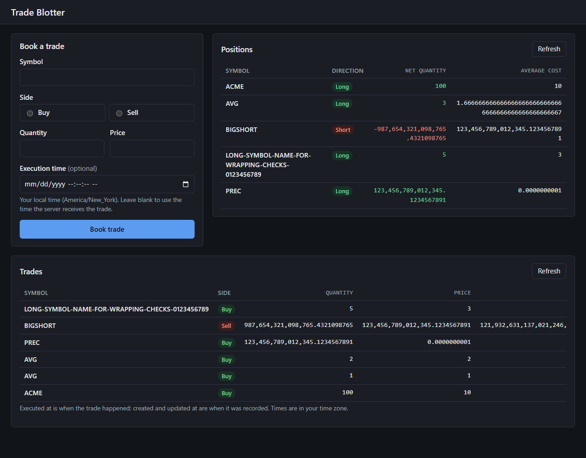
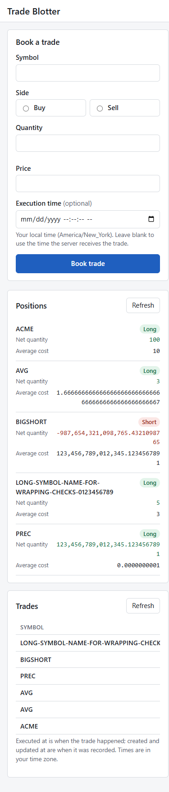
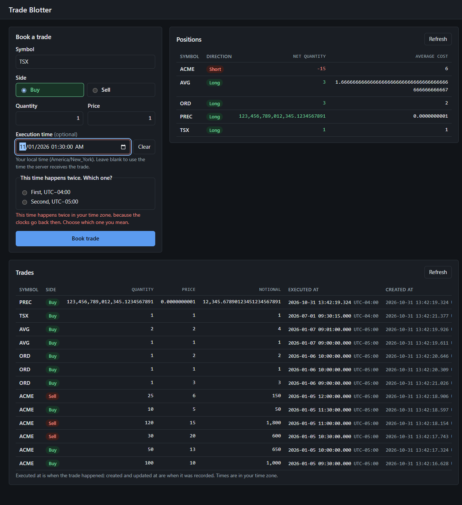
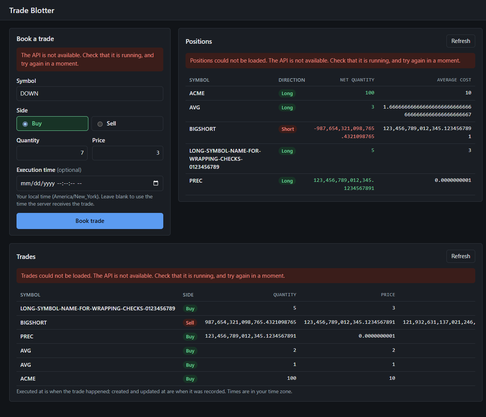

# Trade Blotter

Book trades, review them in a blotter, and see the position per symbol derived from the trade
history.

Trade Blotter is a full-stack TypeScript application: a Fastify API over SQLite and a Vue 3
frontend. Every quantity, price, notional and average cost is handled as an exact decimal, from
the JSON request to the database and back.

## Contents

- [Features](#features)
- [Technology](#technology)
- [Screenshots](#screenshots)
- [Prerequisites](#prerequisites)
- [Getting started](#getting-started)
- [Database](#database)
- [Running the application](#running-the-application)
- [Test-drive search, filters and sorting](#test-drive-search-filters-and-sorting)
- [Build and test](#build-and-test)
- [API](#api)
- [Position accounting](#position-accounting)
- [Architecture](#architecture)
- [Platform support](#platform-support)
- [Known limitations](#known-limitations)
- [Dependency advisories](#dependency-advisories)
- [Further documentation](#further-documentation)

## Features

- **Book trades** with a symbol, a side (Buy or Sell), a quantity, a price and an optional
  execution time. Invalid input is reported field by field, with every problem shown at once.
- **Trade blotter:** every trade, newest execution first, with its notional and three
  timestamps: when it was executed, created and last updated. Times are shown in your time zone
  with their UTC offset; the exact UTC value is in the tooltip.
- **Search, filter and sort the blotter:** by all or part of a symbol, by side, and by a range of
  execution dates in your time zone (daylight-saving days included exactly); sort by execution
  date, symbol, quantity or price, either way. Positions always cover every trade.
- **Positions** derived from the trade history: long or short, net quantity and average cost
  per symbol, shown with every digit the server returns.
- **Exact decimals:** values are read from the JSON source text, calculated with `decimal.js`,
  stored as text and written back without passing through a binary floating-point number.
- **Daylight-saving aware time entry:** a skipped local time is refused, and a time that happens
  twice asks which occurrence you mean.
- **Safe persistence:** one SQLite file, migrated automatically at startup or with a command.
  A failed migration stops startup and changes nothing; the application never deletes or
  recreates a database. A trade that would breach the position limit is refused inside the same
  transaction that would store it.
- **Documented API:** OpenAPI 3.1 with Swagger UI, and RFC 9457 problem details for errors.
- **Responsive frontend** with light and dark themes that follow the system setting.

## Technology

| Part | Technology |
| --- | --- |
| Runtime | Node.js 22.23.1 |
| API | TypeScript, Fastify 5, TypeBox schemas, `@fastify/swagger` and Swagger UI |
| Persistence | SQLite through Node's built-in `node:sqlite`, Drizzle ORM and drizzle-kit (`1.0.0-rc.5-5935859`) |
| Decimals | `decimal.js` |
| Frontend | Vue 3, Pinia, Vite |
| Tests | Vitest; Vue Test Utils and jsdom for the frontend |
| Quality | ESLint with typescript-eslint and eslint-plugin-vue; strict TypeScript |

There is no database server, Docker image or external service. npm workspaces hold the API
(`server/`) and the frontend (`client/`).

## Screenshots

| Desktop | Phone, light theme |
| --- | --- |
|  |  |

| Choosing between two occurrences of a local time | API unavailable |
| --- | --- |
|  |  |

## Prerequisites

| Tool | Required | Notes |
| --- | --- | --- |
| Node.js 22.23.1 | Yes | The supported and verified version, recorded in `.nvmrc` |
| npm 12.0.1 | Yes | Bundled with Node.js 22.23.1 |
| Git | Yes | To clone the repository |
| A web browser | For the frontend | Any current Chrome, Edge, Firefox or Safari |

Nothing else needs installing: SQLite is built into Node.js, Drizzle is an npm dependency, and no
package compiles native code or runs an install script.

**Node.js 22.23.1 is the only supported version.** The `engines` range is `^22.23.1`: later 22.x
releases are accepted but have not been verified, and other major versions are not supported.
`npm ci` warns `EBADENGINE` on another version, and the server refuses to start if a runtime
feature it needs is missing.

Install it from <https://nodejs.org/dist/v22.23.1/>, or with a version manager that reads
`.nvmrc`: `nvm install` with [nvm](https://github.com/nvm-sh/nvm) or
`fnm install` with [fnm](https://github.com/Schniz/fnm); on Windows,
`nvm install 22.23.1` with [nvm-windows](https://github.com/coreybutler/nvm-windows). Check with:

```bash
node --version   # v22.23.1
npm --version    # 12.0.1
```

## Getting started

```bash
git clone https://github.com/cs973112/trade-blotter-ts.git
cd trade-blotter-ts
npm ci           # installs the exact versions in package-lock.json, for the API and the frontend
npm run verify   # lint, typecheck, build and run every test
```

`npm run verify` exiting with code 0 means the setup works. Run every command in this README from
the repository root.

## Database

The database is a single SQLite file, `server/data/trade-blotter.db` by default (ignored by Git).
The API creates it and applies any pending migration every time it starts, before it accepts
requests. To do this without starting the API:

```bash
npm run db:migrate -w server
```

It prints `Database is up to date: <path>`; running it again changes nothing. If a migration
fails, every pending migration is rolled back, the command prints
`Database migration failed; no migration was applied.` with the reason, and it exits with code 1.

Set `DATABASE_PATH` to use another file; an absolute path is recommended. The
[setup guide](docs/setup.md#database) covers other files, backups, starting afresh and schema
changes.

## Running the application

### Development

In two terminals, from the repository root:

```bash
npm run dev -w server   # the API on http://localhost:5299, restarting on changes
npm run dev -w client   # the frontend on http://localhost:5173
```

Open <http://localhost:5173>. The frontend calls the API through Vite's proxy, so start the API
first; if it is not running, the page says so.

### Production build

```bash
npm run build               # the API to server/dist/, the frontend to client/dist/
npm start -w server         # terminal 1: the compiled API on http://localhost:5299
npm run preview -w client   # terminal 2: the built frontend on http://localhost:4173
```

Stop either with Ctrl+C: the API finishes requests in progress, closes the database and exits.

### In the background: app:start, app:stop, app:status

One command starts the compiled API and the built frontend in the background, so the terminal
stays free; the same commands work on Windows, Linux and macOS. Build first (`npm run build`).

```powershell
npm run app:start                                               # API :5299, frontend :4173, default database
npm run app:status                                              # running or stopped, ports, URLs, database, process ids
npm run app:stop                                                # stops both; the database is left as it is
npm run app:start -- --database "$env:TEMP\tb-review\trades.db" # a separate database
npm run app:start -- --api-port 5399 --web-port 4273            # other ports
```

| Option | Else from | Default |
| --- | --- | --- |
| `--api-port <n>` | `PORT` | `5299` |
| `--web-port <n>` | `WEB_PORT` | `4173`, the built frontend's preview port |
| `--host <name>` | `HOST` | `localhost` |
| `--database <path>` | `DATABASE_PATH` | `server/data/trade-blotter.db` |

`LOG_LEVEL`, `DOCS_ENABLED` and `SYMBOL_MAX_LENGTH` reach the API as usual. A relative database
path is relative to the folder you run the command from. On Linux and macOS set variables the
usual way (`DATABASE_PATH=/tmp/tb-review/trades.db npm run app:start`).

- **Start** runs the API as `npm start -w server` does and the frontend as
  `npm run preview -w client` does, with the frontend forwarding API requests to the API it
  started. It refuses a port that is already in use, and starts nothing if the applications are
  already running. It reports both URLs and Swagger UI once each application answers; if one does
  not, it stops whatever it started and prints the end of that application's log. It never
  creates, resets or seeds data beyond what the API itself does at startup (migrations).
- **Stop** stops only processes that `app:start` started, with their child processes, and waits
  until their ports are free; running it again is harmless. Each process is recorded with a
  random token that is part of its command line, so a process whose id the operating system has
  since given to another program is recognised and left alone; nothing is ever stopped because
  of the port it uses. On Linux and macOS each application gets SIGTERM and shuts down cleanly
  (SIGKILL only after 10 seconds). On Windows a background process cannot be asked to stop, so it
  is terminated; SQLite keeps every committed trade.
- **Status** says whether each application is running and gives its port, URL and process id,
  the database and the log files.
- The run record and the logs (`api.log`, `web.log`) are in `.run/` at the repository root,
  which Git ignores.

With seeded data the order is: stop, clear or seed, start, try it, and stop again before
clearing or reseeding; see [Sample data](#sample-data-dbseed-and-dbclear). Tools that change trade
records call `refuseIfDatabaseInUse(path)` from `server/scripts/lifecycle.ts`, which refuses a
database that an application started by `app:start` is using, and tools that only read should
still refuse the development database (`isDevelopmentDatabase(path)`).

### Sample data: db:seed and db:clear

Fill a separate database with realistic trades to try the application at volume, and empty it
again. Both work on Windows, Linux and macOS. In PowerShell:

```powershell
$db = "$env:TEMP\tb-review\seed.db"
npm run app:stop                                       # nothing may be running on it
npm run db:seed -- --count 10000 --database $db        # 100, 1000, 10000, 25000, ... trades
npm run app:start -- --database $db                    # browse, search, filter, sort, book
npm run app:stop
npm run db:clear -- --database $db --confirm           # removes the trades; keeps the file
```

On Linux and macOS use `db=/tmp/tb-review/seed.db` and `"$db"`.

- **`db:seed -- --count <n> --database <path> [--seed <text>]`** seeds an empty trade table:
  a new file is created and migrated as the API would at startup; an existing Trade Blotter
  database must have no trades (clear it first). The trades are deterministic: the same count and
  seed (default `trade-blotter`) give the same trades every time. They cover 24 symbols (MS, MSFT
  and MSTR share letters; BRK.B has punctuation; three trade at prices with up to ten decimal
  places), Buy and Sell, executions from 2025-01-02 to 2026-10-30 across several daylight-saving
  changes, repeated execution times, quantities and prices, and trades that open, increase,
  reduce, close and cross positions. Every trade is validated by the application's own rules,
  all are inserted in one transaction (in batches, so 25,000 take a few seconds), and they are
  read back through the application, counted and checked with its accounting. It prints the
  verified count and the time taken.
- **`db:clear -- --database <path> --confirm`** removes every trade and nothing else: the file,
  its schema and its migrations stay. SQLite's record of the highest booking sequence also stays,
  so booking sequences are never reused: trades seeded after a clear continue from there. It
  checks that no trade is left; clearing an empty database is harmless.
- **Safety.** Both need `--database` (`DATABASE_PATH` is ignored here) and refuse the
  development database `server/data/trade-blotter.db`, however its path is written (including a
  link to it), and anything else in `server/data/`, such as backups. They refuse a file that is not
  a Trade Blotter database without changing it, and refuse to run while an application started
  with `app:start` is running. Neither ever deletes a database file.
- **Limitation:** an API started some other way (`npm start -w server`, `npm run dev -w server`)
  cannot be detected. Stop every API using the database before seeding or clearing it.

### API performance: perf:api

Measures the running API on a seeded database: `GET /trades` unfiltered, with a partial symbol
search, with each side, with an execution-date range and with all three combined, sorted by each
field in both directions, and `GET /positions`. In PowerShell:

```powershell
$db = "$env:TEMP\tb-perf\perf.db"
npm run db:seed -- --count 10000 --database $db
npm run app:start -- --database $db
npm run perf:api -- --database $db                     # tables on screen
npm run perf:api -- --database $db --json "$env:TEMP\tb-perf\api-10000.json"
npm run app:stop
```

Or every size in one go, on the same file (100, 1,000, 10,000 and 25,000 trades by default):

```powershell
npm run perf:api:sizes -- --database $db
```

For each size it clears the file, seeds it, starts the applications on it, measures, saves the
results and stops the applications. The file is kept, with the last size in it, for trying the
UI. It refuses to begin while an application started with `app:start` is running: it starts and
stops only its own. On Linux and macOS use `db=/tmp/tb-perf/perf.db` and `"$db"`.

- **Options.** `perf:api`: `--database <path>` (required), `--api-url <url>` (default: the API
  started with `app:start`; another spelling of its address, such as `http://127.0.0.1:5299`, is
  accepted, any other address refused), `--warmup <n>` (default 5), `--iterations <n>` (default
  10) and `--json <file>`. `perf:api:sizes`: `--database`, `--sizes 100,1000,...`, `--warmup`,
  `--iterations`, `--api-port`, `--web-port` and `--out <folder>` (default `.run/perf/api-<time>/`,
  which Git ignores: one JSON file per size and `summary.txt`). Results are never committed.
- **What it measures.** Requests are sequential, one at a time over one kept-alive connection,
  so results compare across dataset sizes; there is no concurrent load. Each request is timed
  with `performance.now()` (monotonic) from sending it until the last byte of the body has
  arrived. JSON parsing is **not** included in that time; `JSON.parse` is timed separately after
  each response (the frontend's own exact-decimal parsing is measured in the browser, by
  [perf:ui](#browser-performance-perfui)). For each scenario it reports the matched rows, the response
  size in bytes, the minimum, median, p95 (nearest rank, so with 10 samples it is the maximum) and
  maximum latency, and the API process's memory: the working set on Windows, RSS on Linux and
  macOS, sampled between scenarios, never during a request, with the process's own peak where the
  system records it (not on macOS).
- **What it checks.** Every response, warmups included, must be `200 application/json` with the
  same bytes as the first, and the first is compared trade by trade (id, booking sequence, symbol,
  side, quantity, price, notional, executedAt) or position by position with the database, read
  read-only. Decimals are read from their exact JSON text, as the API reads request bodies, and
  compared with the stored values in canonical form. An invalid response stops the run, and nothing is recorded for it. The trades are
  fingerprinted before and after; any change discards the results. It never seeds, clears,
  starts or stops anything.
- **Safety.** It needs `--database`, refuses the development database and anything in
  `server/data/`, and measures only the API that `app:start` started on that exact file: the run
  record must name the file, the API's process must be alive and hold its token, and that process,
  and no other, must be listening on its port (on Windows another program can listen on the same
  port on another address). It then checks that the API serves exactly the trades in the file.
  Anything else is refused, with nothing measured.

### Browser performance: perf:ui

Measures the built frontend in headless Chrome on the same running applications: loading the page
with every trade, a partial symbol search, Buy, Sell, the combined filters, Clear, sorting by price
and by quantity both ways, scrolling a long list, jumping to its end, and typing while every trade
is shown. In PowerShell, with the applications started on a seeded database as above:

```powershell
npm run perf:ui -- --database $db
npm run perf:ui -- --database $db --json "$env:TEMP\tb-perf\ui-10000.json"
npm run perf:ui:sizes -- --database $db        # 100, 1,000, 10,000 and 25,000 trades, as perf:api:sizes
```

- **Options.** `--database <path>` (required), `--web-url <url>` (default: the frontend started
  with `app:start`), `--warmup <n>` (default 2), `--iterations <n>` (default 5), `--json <file>`,
  `--chrome <path>`, `--timeout <seconds>` for each action (default 180) and `--max-heap-mb <n>`
  (default 4096), and `--scenarios <ids>` to measure only some of them (`load`, `search`, `buy`,
  `sell`, `combined`, `clear`, `price-asc`, `price-desc`, `quantity-asc`, `quantity-desc`,
  `scroll`, `jump`, `typing`; the initial load always runs, as it opens the page).
  `perf:ui:sizes` takes these and the `perf:api:sizes` options; its results go to
  `.run/perf/ui-<time>/`.
- **Interrupted runs.** The JSON file (`--json`, or each size's file of `perf:ui:sizes`) is
  rewritten after every scenario, with `"complete": false` until the run ends, so stopping a run
  keeps every scenario it finished. Each result carries a `runId`, and every scenario names the run
  its samples come from: results of separate runs are kept apart, never pooled.
- **Chrome.** It uses Google Chrome, or any Chromium browser, found in this order: `--chrome`,
  `CHROME_PATH`, then the usual place: `Program Files`, `Program Files (x86)` or `%LOCALAPPDATA%`
  `\Google\Chrome\Application\chrome.exe` on Windows, `/Applications/Google Chrome.app` (or
  `~/Applications`) on macOS, and `google-chrome`, `google-chrome-stable`, `chromium` or
  `chromium-browser` on the `PATH` on Linux. It starts Chrome itself, headless, with an empty
  temporary profile and its own DevTools port, so your own Chrome and its profile are never
  touched, and closes it and removes the profile at the end, also after an error or Ctrl+C. It
  drives Chrome over the DevTools protocol with Node.js's built-in WebSocket; nothing is installed.
- **What it measures.** It uses the page's own controls: real mouse clicks on Apply and Clear and
  real key presses; the selects and dates are set and their change events fired. An action is done
  when the table shows the expected rows from a request made after it, with no update in progress,
  and the browser has produced the next frame (to within one frame). For each action it reports the
  matched rows, the minimum, median and maximum of the measured runs (no percentile: there are too
  few runs for one to mean anything; every run is in the JSON), and these medians, from the
  browser's own clocks: **before request** (click until the request started), **waiting** (until
  the first byte: the frontend's proxy and the API), **transfer**, and **after response** (parsing,
  exact-decimal conversion, Vue, layout and paint together: they cannot be told apart without
  changing the application), plus long tasks (50 ms or more), and script, style and layout time
  from Chrome. The initial load uses a new browser context each run (empty cache), from navigation
  start until every trade and every position is shown. Scrolling reports frames and the longest
  gap between them; typing, each key press until the second frame after it. Separately, the
  frontend's exact-decimal parser (its source, `client/src/api/json.ts`, run in the page) and
  `JSON.parse` are timed on the full trade list. Memory: the page's JavaScript heap (before and
  after a forced garbage collection), DOM nodes, and the resident memory of every Chrome process,
  summed. Console errors and page crashes are reported.
- **What it checks.** The same as perf:api for the database and the API, and also that the
  frontend is the one `app:start` started (its process, on its port, forwarding to that API), that
  it is the production build, and that through it the trades are exactly those in the file. After
  every run the rows on the page (symbol, side and execution time, in order) are compared with the
  database. Nothing is booked, so the trades are unchanged; that is checked at the end.
- **Limits.** Headless Chrome on the same machine as the applications, without throttling: absolute
  times differ from a desktop browser on another machine. A page that needs more than
  `--max-heap-mb` is stopped (Chrome reports it out of memory), and every action has a timeout;
  both are reported as failures, never as results.

### Configuration

All settings are optional environment variables; an invalid value stops the API at startup with
a message naming the variable.

| Variable | Default | Meaning |
| --- | --- | --- |
| `HOST` | `localhost` | Interface the API listens on |
| `PORT` | `5299` | API port; `0` lets the operating system choose |
| `DATABASE_PATH` | `server/data/trade-blotter.db` | SQLite file; `:memory:` is refused |
| `LOG_LEVEL` | `info` | `fatal`, `error`, `warn`, `info`, `debug` or `trace` |
| `DOCS_ENABLED` | `true` | `false` disables Swagger UI and the OpenAPI document |
| `SYMBOL_MAX_LENGTH` | `64` | Longest symbol accepted, an integer from 1 to 255 |
| `API_TARGET` | `http://localhost:5299` | Where the frontend servers forward API requests |

There are no secrets and no `.env` files. Examples for each shell, port changes and
troubleshooting are in the [setup guide](docs/setup.md).

## Test-drive search, filters and sorting

A walk-through for a reviewer: build, run the compiled API on a throwaway database, open the
frontend, book a few trades and try the trade-list controls. Your own database
(`server/data/trade-blotter.db`) is never opened. The commands are for Windows PowerShell, run
from the repository root; [Linux and macOS](#on-linux-and-macos) differs only in how variables are
set.

**1. Check the tools, install and build** (Node.js 22.23.1 and npm 12.0.1; see
[Prerequisites](#prerequisites)):

```powershell
node --version          # v22.23.1
npm --version           # 12.0.1
npm ci                  # the exact versions in package-lock.json
npm run build           # the API to server/dist/, the frontend to client/dist/
```

**2. Terminal 1: the API, on a database in your temp folder.** `$env:` settings last only for
this terminal.

```powershell
$env:DATABASE_PATH = "$env:TEMP\trade-blotter-review\trades.db"
npm start -w server     # http://localhost:5299; created and migrated on first start
```

(Or start both in the background from one terminal, against the built frontend on port 4173:
`npm run app:start -- --database "$env:TEMP\trade-blotter-review\trades.db"`; see
[In the background](#in-the-background-appstart-appstop-appstatus).)

**3. Terminal 2: the frontend.**

```powershell
npm run dev -w client   # http://localhost:5173
```

Open <http://localhost:5173>. Swagger UI is at <http://localhost:5299/documentation> (also
through the frontend, at <http://localhost:5173/documentation>).

If port 5299 or 5173 is already in use, for example by your own running copy, choose others:
`$env:PORT = '5399'` before `npm start -w server` in terminal 1, and in terminal 2
`$env:API_TARGET = 'http://localhost:5399'; npm run dev -w client -- --port 5183`.

**4. Book these trades** with the form (Execution time is your local time; type it or pick it):

| # | Symbol | Side | Quantity | Price | Execution time | What it does to the position |
| --- | --- | --- | --- | --- | --- | --- |
| 1 | AAPL | Buy | 100 | 150.25 | 2026-03-02 09:30 | opens long 100 at 150.25 |
| 2 | AAPL | Buy | 50 | 155.5 | 2026-03-03 10:00 | increases: 150 at 152 |
| 3 | NVDA | Sell | 0.5 | 1000 | 2026-03-07 23:59:59 | opens short 0.5 at 1,000 |
| 4 | MSFT | Sell | 20 | 410 | 2026-03-07 15:45 | opens short 20 at 410 |
| 5 | AAPL | Sell | 30 | 160 | 2026-03-08 12:00 | reduces: 120, still at 152 |
| 6 | MSFT | Buy | 20 | 400 | 2026-03-09 00:00 | closes: MSFT disappears from Positions |
| 7 | TSLA | Buy | 10 | 200 | 2026-03-10 09:45 | opens long 10 at 200 |
| 8 | GOOG | Buy | 10 | 200 | 2026-03-10 09:45 | opens long 10 at 200 |
| 9 | TSLA | Sell | 25 | 210.75 | 2026-03-11 14:20 | crosses: short 15 at 210.75 |
| 10 | BRK.B | Buy | 3 | 9.5 | 2026-03-12 16:00 | opens long 3 at 9.5 |

Positions then show AAPL long 120 at 152, BRK.B long 3 at 9.5, GOOG long 10 at 200, NVDA short
0.5 at 1,000 and TSLA short 15 at 210.75.

**5. Try the controls above the trade table.** Nothing changes until you press **Apply**;
**Clear** resets everything and lists every trade again.

| Set, then press Apply | Expect |
| --- | --- |
| Symbol `aPl` | the three AAPL trades (any case, any part of the symbol) |
| Symbol `sf` | the two MSFT trades |
| Side Sell | the four Sell trades |
| From and To both 2026-03-08 | only trade 5: trade 3 at 23:59:59 on the 7th and trade 6 at midnight on the 9th are outside |
| Symbol `a`, Side Sell, From 2026-03-01, To 2026-03-31 | trades 9, 5 and 3 |
| Sort by Price, Ascending | BRK.B at 9.5 first and NVDA at 1,000 last: numbers, not text |
| Sort by Execution date, Oldest first | trade 1 first; trades 7 and 8 (same time) in booking order |
| Symbol `zzz` | "No trades match these filters." |
| From 2026-03-10, To 2026-03-08 | a message under To; nothing is sent |
| Side Buy, Apply; then book a Sell | the confirmation says the trade is not in the filtered list; Positions include it |
| Side Buy applied; type `zzz` in Symbol without Apply; book a Buy | the list keeps the applied Side Buy filter and shows the new trade; "Changes not applied yet." stays |

Reloading the page always starts again from the default filters. The same queries work against
the API directly, for example:

```powershell
curl.exe "http://localhost:5299/trades?symbol=aPl&side=Buy&sortBy=price&sortDirection=asc"
```

**6. Finish.** Stop both servers with Ctrl+C, then remove the throwaway database and the setting:

```powershell
Remove-Item -Recurse -Force "$env:TEMP\trade-blotter-review"
Remove-Item Env:DATABASE_PATH
```

**7. Run the automated tests** (no server, browser or existing database needed; each test makes
its own temporary database):

```powershell
npm run verify               # lint, typecheck, build and every test
npm run db:check -w server   # the migrations match the schema
```

### On Linux and macOS

The commands are the same; only setting variables differs (not verified on these systems, see
[Platform support](#platform-support)):

```bash
export DATABASE_PATH=/tmp/trade-blotter-review/trades.db
npm start -w server                       # terminal 1
npm run dev -w client                     # terminal 2
PORT=5399 npm start -w server             # other ports, if 5299 or 5173 is taken
API_TARGET=http://localhost:5399 npm run dev -w client -- --port 5183
rm -rf /tmp/trade-blotter-review          # afterwards
```

On a machine without a desktop browser (a container, WSL or a remote host), start the frontend
with `npm run dev -w client -- --host 0.0.0.0` and open it from your own browser through the
forwarded port; the API can stay on `localhost`, because the frontend forwards to it.

## Build and test

| Command | What it does |
| --- | --- |
| `npm run lint` | ESLint over the whole repository |
| `npm run typecheck` | Type-check the API and the frontend without emitting files |
| `npm run build` | Build the API to `server/dist/` and the frontend to `client/dist/` |
| `npm test` | Run every test once (1087 API tests and 220 frontend tests) |
| `npm test -w server` | API tests only |
| `npm test -w client` | Frontend tests only |
| `npm run verify` | Lint, typecheck, build and test, in that order |
| `npm run app:start` / `app:status` / `app:stop` | The built applications in the background; see [In the background](#in-the-background-appstart-appstop-appstatus) |
| `npm run db:seed` / `db:clear` | Sample trades in a separate database; see [Sample data](#sample-data-dbseed-and-dbclear) |
| `npm run perf:api` / `perf:api:sizes` | API benchmark on a seeded database; see [API performance](#api-performance-perfapi). Not part of `npm test` or `verify` |
| `npm run perf:ui` / `perf:ui:sizes` | Browser benchmark in headless Chrome; see [Browser performance](#browser-performance-perfui). Not part of `npm test` or `verify` |

```bash
npm test -w server -- test/domain              # one folder
npm test -w server -- -t "positions"           # tests whose name matches
npm exec -w server -- vitest                   # watch mode
```

The tests need no running server, browser, network or existing database. They create their own
databases in the operating system's temp folder, use ports chosen by the operating system, and
remove everything afterwards. The API tests run in two groups, one after the other: first the
application's own (`app`), then those of the tools in `server/scripts` (`scripts`), which start
background processes and seed large databases; kept apart, the tests that hold a child process to
a deadline never compete with them for the CPU.

## API

With the API running, Swagger UI is at <http://localhost:5299/documentation> and the OpenAPI 3.1
document at <http://localhost:5299/documentation/json>.

| Endpoint | What it does |
| --- | --- |
| `POST /trades` | Book a trade. Returns `201` and the stored trade. |
| `GET /trades` | Every trade, newest `executedAt` first; optional parameters search, filter and sort. |
| `GET /positions` | Every open position, sorted by symbol. |

A trade request has `symbol`, `side` (`Buy` or `Sell`, any case), `quantity`, `price`, and
optionally `executedAt`, an RFC 3339 date-time with an offset (the server clock when omitted).
Quantity and price may be JSON numbers or numeric strings: greater than zero, less than 10^15,
with at most 10 decimal places. The server sets `id`, `bookingSequence`, `createdAt` and
`updatedAt`; the same names in a request are ignored.

`GET /trades` takes optional query parameters, combined with AND: `symbol` (case-insensitive,
matches anywhere in the symbol), `side` (`Buy` or `Sell`), `executedFrom` and `executedTo`
(inclusive, RFC 3339 with `Z` or an offset; write `+` as `%2B`), `sortBy` (`executedAt`,
`symbol`, `quantity` or `price`) and `sortDirection` (`asc` or `desc`). Without them the list is
unchanged. Invalid values are answered with `400` and an `invalid-query` problem.
[docs/architecture.md](docs/architecture.md#api-contract) has the details.

```bash
curl -i -X POST http://localhost:5299/trades \
  -H 'Content-Type: application/json' \
  -d '{"symbol":"MSFT","side":"Buy","quantity":100,"price":"301.25","executedAt":"2026-01-02T09:30:00-05:00"}'
curl 'http://localhost:5299/trades?symbol=sf&side=buy&executedFrom=2026-01-01T00:00:00Z&sortBy=price&sortDirection=asc'
curl http://localhost:5299/positions
```

In Windows PowerShell, use `curl.exe` with the same arguments, and a backtick instead of `\` at
the end of a line.

A created trade:

```json
{"id":"0b8f4c6e-…","bookingSequence":1,"symbol":"MSFT","side":"Buy","quantity":100,"price":301.25,
 "notional":30125,"executedAt":"2026-01-02T14:30:00.000Z","createdAt":"2026-03-01T12:00:00.000Z",
 "updatedAt":"2026-03-01T12:00:00.000Z"}
```

A position: `{"symbol":"MSFT","netQuantity":100,"averageCost":301.25}`. `netQuantity` is negative
for a short.

Errors are RFC 9457 problem details (`application/problem+json`). An invalid trade names every
invalid field at once:

```json
{"type":"urn:trade-blotter:problem:invalid-trade","title":"Invalid trade","status":400,
 "detail":"Symbol is required.","errors":{"symbol":["Symbol is required."],"price":["Price must be greater than zero."]}}
```

Other statuses: `400` for a body that is not a JSON object or a trade that would exceed the
position limit, `404` for an unknown path, `405` with an `Allow` header for an unsupported method,
`413` for a body over 1 MiB, `415` for a body that is not JSON, and `500` for anything unexpected.
The [API contract](docs/architecture.md#api-contract) has the details.

## Position accounting

Positions are never stored. Each request folds the trades for every symbol, in trade order,
through one pure domain function. A Buy adds to the net quantity and a Sell subtracts from it, so
long and short positions follow the same rules. Each trade falls under exactly one rule:

| Rule | When | Net quantity | Average cost |
| --- | --- | --- | --- |
| Open | The position is flat | The trade's signed quantity | The trade price |
| Increase | Same direction as the position | Grows | Quantity-weighted average of the position and the trade |
| Reduce | Opposite direction, smaller | Shrinks | Unchanged |
| Close | Opposite direction, equal | Zero; the position is omitted | Zero |
| Cross | Opposite direction, larger | Changes sign | The trade price |

- **Trade order** is execution time, then booking order. A trade recorded late for an earlier
  execution time is applied at its execution time. Creation and update times never affect it.
- **Symbols** are trimmed, composed to Unicode NFC and upper-cased, so `brk.b` and ` BRK.B ` are
  the same position. Control and invisible characters are refused.
- **Precision:** notionals and net quantities are exact. Average cost is the only value that can
  need rounding (5/3, for example); it is calculated to 50 significant digits, rounding half to
  even, and reported as calculated.
- **Position limit:** a trade that would take any intermediate position to 10^30 or beyond is
  refused with `400` and never stored.
- Realised profit and loss is out of scope.

The [business rules](docs/architecture.md#business-rules) and the
[numeric policy](docs/architecture.md#numeric-policy) give the full detail.

## Architecture

```
Vue 3 frontend ──HTTP──► Fastify routes ─► application services ─► repository interface
                                                                        ▲
                                         Drizzle repository ────────────┘ ─► SQLite
```

Source dependencies point inward: the domain imports no framework or database code, and the
Drizzle repository implements an interface the application defines.

| Layer | Folder | Responsibility |
| --- | --- | --- |
| Domain | `server/src/domain/` | Trades, validation, symbols, timestamps, positions and the decimal policy, as pure functions |
| Application | `server/src/application/` | Trade and position services; the repository, clock and id interfaces |
| API | `server/src/api/` | Routes, request and response schemas, lossless JSON, problem details, OpenAPI |
| Infrastructure | `server/src/infrastructure/` | Drizzle schema, migrations, the repository, the system clock, the id generator |
| Composition | `server/src/main.ts`, `server/src/server.ts` | Builds everything and passes dependencies in explicitly, without a dependency-injection framework |
| Frontend | `client/src/` | Vue components, one Pinia store, a typed HTTP client |

ESLint rules and a test both fail if a layer imports something it must not. Creating a trade
checks the symbol's position and inserts the trade in one SQLite transaction.

Each trade has three timestamps: `executedAt` (optional in the request; the server clock when
omitted), and `createdAt` and `updatedAt`, which only the server sets. Trades are immutable, so
`updatedAt` equals `createdAt`.

[docs/architecture.md](docs/architecture.md) has diagrams, the database schema, the transaction
boundary, error handling and the test strategy.

## Platform support

- **Verified:** Windows 11 x64 with Node.js 22.23.1 and npm 12.0.1. Installation, lint,
  typecheck, build, all tests, migrations, the compiled API and the built frontend were run from
  a fresh copy of the source.
- **Intended, not verified:** macOS and Linux. The commands are the same, the code builds paths
  with `node:path`, files use LF line endings, and the lockfile includes the native build
  packages for Linux x64 and arm64 (glibc and musl), macOS x64 and arm64, and Windows x64 and
  arm64. None of this has been run on those systems, with one exception: the background process
  manager behind `app:start`, `app:stop` and `app:status` was run on Linux (Debian under WSL 2,
  Node.js 22.23.1) with a stand-in application, covering start, process identity, a clean SIGTERM
  stop of each process group and its children, reused process ids and ports in use. The real API
  and frontend were not run on Linux, and nothing was run on macOS, where the manager reads process
  command lines with `ps`.

## Known limitations

- Verified on Windows 11 x64 only; see [Platform support](#platform-support).
- Node.js 22.23.1 is the only supported runtime.
- Trades cannot be amended or deleted, and there is no audit history.
- Realised profit and loss is not calculated.
- The frontend and API have no authentication; the API listens on `localhost` by default.
- The frontend tests use jsdom; no end-to-end browser tests are included.
- `GET /trades` has no pagination: it returns every matching trade, and the table shows them
  all. A large history will eventually need server-side pagination.
- The API filters in the database, then sorts the matching trades in memory, because exact
  decimal quantities and prices cannot be compared in SQLite without converting them to
  floating point. The symbol search cannot use an index.
- Search, filter and sort settings are not kept when the page is reloaded.
- From and To dates are turned into instants in the browser's time zone when Apply is pressed;
  a reload or a later booking reuses those instants.
- Building the frontend needs the native Vite packages (rolldown and lightningcss) for your
  platform; `npm ci` installs them from the npm registry.
- The page slows down with large histories, as measured by `perf:api` and `perf:ui` (Windows 11,
  headless Chrome): the API returns 25,000 trades in under a second, but showing them takes about
  14 s, and at 10,000 trades and more every full-list action (Clear, sorting) and every filter
  takes seconds, during which the page does not respond; typing in Symbol takes about 0.3 s per
  key with 10,000 trades shown and 0.8 s with 25,000. Pagination or virtualization will be needed.
- The benchmark tools were run on Windows 11 only; their Linux and macOS code paths (`/proc`,
  `lsof`, `ps`, finding Chrome) have not been run.
- **Intermittent test hang, unexplained.** Once, on Windows, `npm test` stopped for about ten
  minutes in the setup of `test/platform/compiled-server.test.ts`, which then reported its 7 tests
  as skipped; at the same time an unrelated in-process test (`test/platform/lossless-json.test.ts`)
  took 15 s and failed its 5 s limit, so more than one test worker was stalled. It did not happen
  again in 8 runs of that file alone, 3 runs of the application tests and several full runs. The
  cause is not known; a machine-wide stall is suspected, not confirmed. If a run stops for minutes,
  note which processes are running (and any antivirus activity) before stopping it, then run the
  tests again.

## Dependency advisories

`npm audit` reports 16 moderate advisories, all from two packages:
[GHSA-3g3m-2fjr-6pw4](https://github.com/advisories/GHSA-3g3m-2fjr-6pw4) in `glob` and
[GHSA-g3hv-75wg-m249](https://github.com/advisories/GHSA-g3hv-75wg-m249) in `minimatch`.

- They are reached through development tooling (ESLint, typescript-eslint, Vue Test Utils) and,
  at runtime, through `@fastify/static`, which Swagger UI uses to serve its files.
- Patched releases are new major versions that none of the packages depending on them accepts
  yet, so there is no update within the declared ranges. No `overrides` are used.
- In a local check, the API loaded `glob` at startup but called none of its functions while
  serving Swagger UI, its static files, the OpenAPI document and `GET /positions`. Whether either
  advisory can be exploited in this application has not been assessed.
- Do not run `npm audit fix --force`: it proposes major downgrades that break the build.
- They are an open item, tracked separately from the application's features.

## Further documentation

- [Setup guide](docs/setup.md): installation, configuration, database, ports, troubleshooting
- [Architecture](docs/architecture.md): layers, diagrams, business rules, numeric and timestamp
  policies, persistence, API contract, testing
