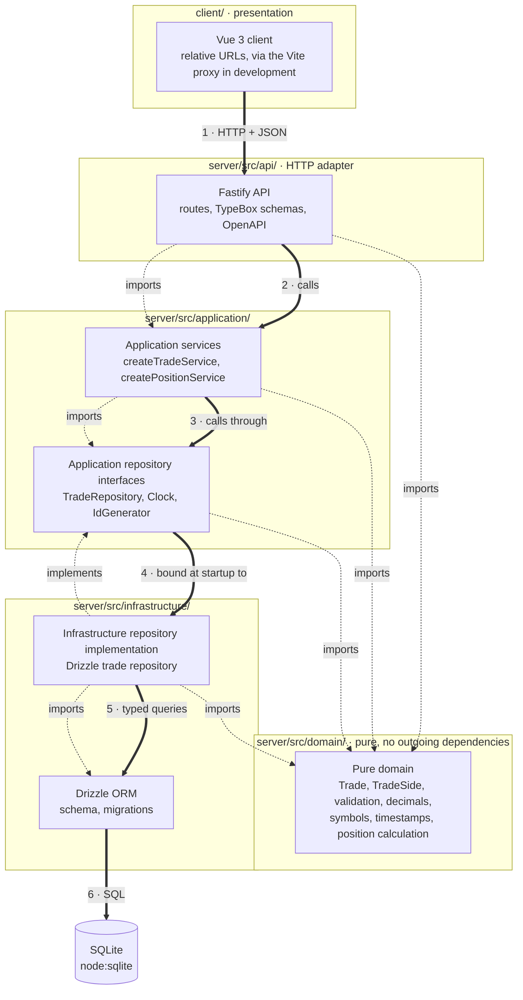
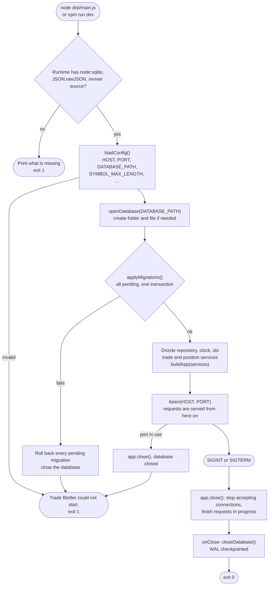
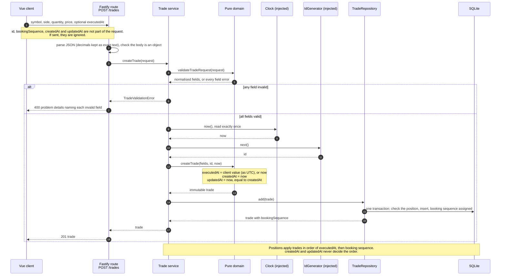
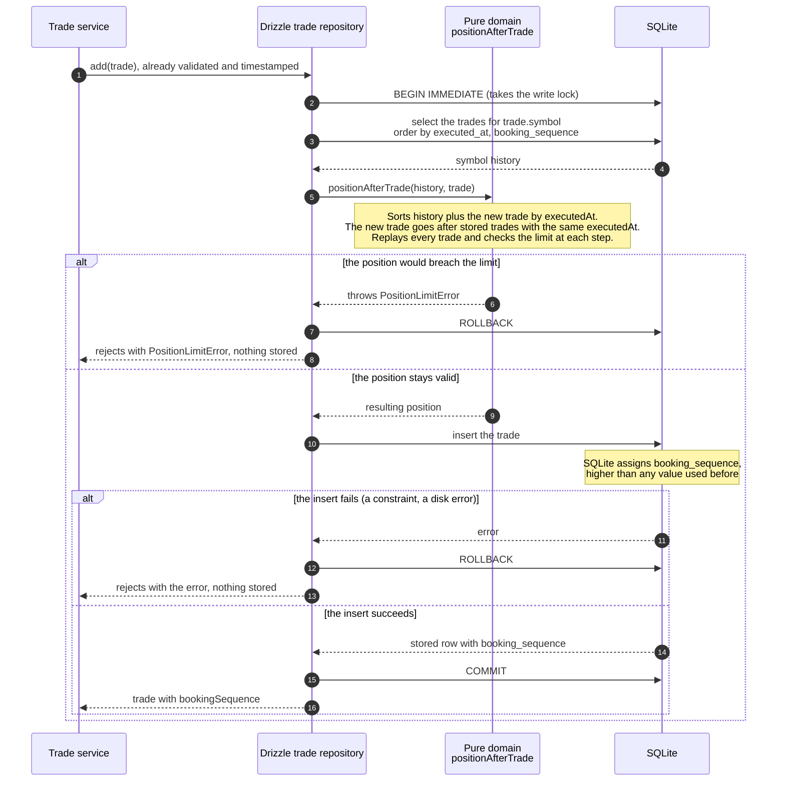
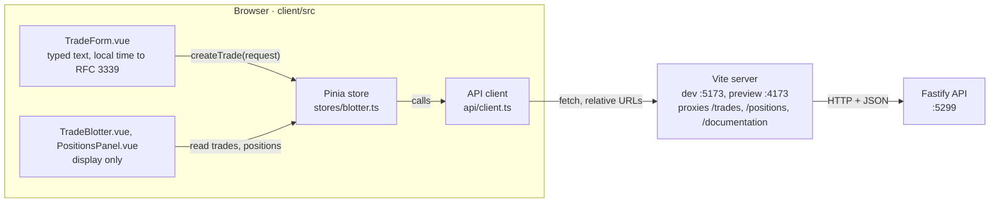

# Architecture

Trade Blotter records trades and derives a position per symbol from the trade history. This
document describes the layers and their boundaries, how a trade is created and timestamped, the
business rules, the numeric and timestamp policies, persistence, error handling and testing. The
scenario catalogue in `server/test/scenarios/` encodes the rules below as test
data; where the two disagree, fix one of them deliberately.

## Technology

| Concern | Choice |
| --- | --- |
| Runtime | Node.js 22.23.1 (`engines`: `^22.23.1`), ES modules |
| Language | TypeScript, strict, erasable syntax only (Node runs sources directly in development) |
| HTTP | Fastify 5 |
| Schemas and API docs | TypeBox, `@fastify/swagger` (OpenAPI 3.1), `@fastify/swagger-ui` |
| ORM and migrations | Drizzle ORM with its `node-sqlite` driver, and drizzle-kit; both pinned to `1.0.0-rc.5` |
| Database | SQLite through the built-in `node:sqlite` module |
| Decimal arithmetic | `decimal.js` |
| Backend tests | Vitest |
| Frontend | Vue 3, Pinia, Vite (`client/`, an npm workspace); Vitest with Vue Test Utils and jsdom |
| Lint | ESLint with `typescript-eslint` strict type-checked rules, `eslint-plugin-vue`, plus layer import rules |

`server/src/platform.ts` checks at startup that the runtime provides `node:sqlite`,
`JSON.rawJSON` and the `JSON.parse` reviver's `context.source`, and refuses to start otherwise.

## Layers

Vue 3 → Fastify routes → application services → repository interfaces → Drizzle ORM → SQLite,
arranged so that every source-code dependency points inward, towards the domain.

### Diagram A: components and dependency boundaries

Thick numbered arrows are the **runtime flow** of a request. Dashed arrows are **source-code
dependencies**: the module at the tail imports the module at the head. The two differ in one
place: at runtime the service calls the repository, but in the source the Drizzle repository
depends on the application's interface, not the other way round.



The Vue client shares no source code with the server; it depends only on the HTTP contract (see
[Frontend](#frontend)). The
composition root, `server/src/main.ts`, is not drawn: it is the one module that imports every
layer, builds the Drizzle repository, clock and id generator, and passes them to the service
factories.

### Responsibilities and rules

| Layer | Responsibility | May import | Must not import |
| --- | --- | --- | --- |
| **Domain** (`domain/`) | Business types (`Trade`, `TradeSide`, `Position`), trade validation and normalisation, the decimal policy, symbols, timestamps, trade order and position calculation. Pure functions: no I/O, no clock, no randomness. | Other domain modules, `decimal.js` | Everything else, including `node:` modules |
| **Application** (`application/`) | Use cases: create a trade, list trades, list positions. Reads the clock once per trade, asks for an id, calls the domain, stores through the repository interface. Declares the interfaces it needs (`ports.ts`) and its one error type. | Application and domain modules | Fastify, Drizzle, SQLite, Vue, `api/`, `infrastructure/` |
| **API** (`api/`) | Fastify routes, TypeBox schemas, lossless JSON, mapping service results and errors to HTTP, OpenAPI. Holds no business rules. | Application, domain | Drizzle, SQLite, `infrastructure/` |
| **Infrastructure** (`infrastructure/`) | Drizzle schema and migrations, the SQLite connection, the Drizzle `TradeRepository`, the system clock, the UUID generator. Converts between rows and domain types. | Application interfaces, domain, Drizzle, `node:sqlite` | Fastify, `api/` |
| **Composition root** (`main.ts`) | Reads configuration, opens the database, applies migrations, builds every dependency and passes it in. | Everything | |
| **Presentation** (`client/`) | Vue components, one Pinia store and a typed HTTP client. Collects trades and displays what the API returns; its checks exist for usability only, and it never calculates positions. | Vue, Pinia, its own modules; the HTTP contract | Server code, Node built-ins, server libraries |

The rules for every server layer are enforced twice: by ESLint `no-restricted-imports` (one
rule per folder in `eslint.config.js`), and by `server/test/architecture/layers.test.ts`, which
reads the source and fails on any import the rules forbid.

Keep it light. There is one repository for one table, no generic `Repository<T>`, no base classes,
no decorators and no dependency injection container. Services are factory functions that take
their dependencies as an object.

## Project structure

```
server/
  drizzle.config.ts                drizzle-kit configuration (schema path, output folder)
  drizzle/                         generated migrations, committed and reviewed
  src/
    main.ts                        composition root
    migrate.ts                     the db:migrate command
    config.ts                      environment configuration
    platform.ts                    runtime feature check
    server.ts                      createServer (composition: database, migrations, services, app) and startServer
    domain/
      decimal.ts                   decimal policy, canonical text, decimal input rules
      symbol.ts                    normaliseSymbol, compareSymbols
      timestamp.ts                 UtcTimestamp, parseTimestamp, toUtcTimestamp
      trade.ts                     Trade, TradeSide, validateTradeRequest, createTrade, notional, trade order
      position.ts                  Position, applyTrade, calculatePositions
    application/
      ports.ts                     TradeRepository, Clock, IdGenerator
      errors.ts                    TradeValidationError
      trade-service.ts             createTradeService: createTrade, listTrades
      position-service.ts          createPositionService: listPositions
    infrastructure/
      database/
        schema.ts                  Drizzle table definition
        connection.ts              openDatabase(path): node:sqlite client, pragmas, Drizzle instance
        migrate.ts                 applyMigrations(db)
      drizzle-trade-repository.ts  createDrizzleTradeRepository(db): TradeRepository
      system-clock.ts              Clock backed by Date
      uuid-generator.ts            IdGenerator backed by crypto.randomUUID
    api/
      app.ts                       buildApp(options): Fastify instance with routes for the given services
      json.ts                      lossless decimal JSON
      problem-details.ts           RFC 9457 errors, error mapping, 404 and 405
      openapi.ts                   OpenAPI and Swagger UI
      schemas.ts                   TypeBox schemas: the documented contract
      responses.ts                 domain trade and position to JSON
      routes/trades.ts             POST and GET /trades
      routes/positions.ts          GET /positions
    types/                         json-source-text.d.ts: JSON.rawJSON and the reviver's source text, not yet in TypeScript's library
  test/
    architecture/                  layer import rules
    domain/                        pure domain tests
    application/                   services with in-memory doubles
    platform/                      runtime capability tests
    scenarios/                     scenario catalogue and its oracle checks
    infrastructure/                repository, constraints, migrations, db:migrate, schema drift
    support/                       rational oracle, in-memory repository, fixed clock, test databases
    api/                           the whole application through app.inject(): catalogue, endpoints, OpenAPI, startup
    isolation/                     test databases stay in the temp folder and out of the repository
    config.test.ts                 configuration
client/                            Vue app (npm workspace)
  index.html                       page shell
  vite.config.ts                   dev and preview servers, API proxy, test settings
  public/                          favicon.svg, served as is
  src/
    main.ts                        creates the app and the Pinia store
    App.vue                        layout; loads trades and positions on open
    api/
      contracts.ts                 request and response types from the OpenAPI contract
      json.ts                      JSON parsing that keeps numbers as exact text
      client.ts                    createTrade, listTrades, listPositions; ApiError
    stores/blotter.ts              trades and positions, loading and error state, refresh after booking
    lib/
      decimal-text.ts              checking typed decimals, formatting decimal text
      timestamps.ts                local date and time to RFC 3339; UTC to local display
    components/
      TradeForm.vue                trade entry and validation feedback
      TradeBlotter.vue             trade table
      PositionsPanel.vue           positions table
      LocalTimestamp.vue           one timestamp in local time
    styles.css                     layout and theme
  test/                            Vitest: lib, API client, components, app, boundaries
docs/
```

## Repository interface and implementation

The application owns the interface; infrastructure implements it. Services never see Drizzle.

```ts
// application/ports.ts
export interface TradeRepository {
  /**
   * Stores a new trade and returns it with the booking sequence the store assigned. Atomic: checks
   * the trade against its symbol's stored history with positionAfterTrade and inserts it only if
   * that passes. Rejects with PositionLimitError, storing nothing, otherwise.
   */
  add(trade: NewTrade): Promise<Trade>
  /** Every stored trade in trade order: executedAt ascending, then booking sequence ascending. */
  listInTradeOrder(): Promise<readonly Trade[]>
}

export interface Clock { now(): Date }
export interface IdGenerator { next(): string }
```

`NewTrade` is a `Trade` without its `bookingSequence`. The store assigns the sequence, so it
records the order trades were booked in, independent of any timestamp.

The interface speaks only in domain types: no Drizzle row, query builder or SQLite type crosses
it. `createDrizzleTradeRepository` implements it on SQLite (see [Repository](#repository) under
Persistence); `test/support/in-memory-trade-repository.ts` implements it in memory for the
application tests, with the same position check and ordering.

## Services, routes and wiring

Services are created by factory functions that take their dependencies as an object and return
plain functions:

```ts
// application/trade-service.ts (abridged)
export function createTradeService(deps: { trades: TradeRepository; clock: Clock; ids: IdGenerator; symbolMaxLength?: number }) {
  return {
    async createTrade(request: TradeRequest): Promise<Trade> {
      const result = validateTradeRequest(request, { symbolMaxLength })
      if (!result.ok) throw new TradeValidationError(result.errors)
      const now = toUtcTimestamp(deps.clock.now())
      return deps.trades.add(createTrade(result.value, { id: deps.ids.next(), now }))
    },
    async listTrades(): Promise<readonly Trade[]> {
      return [...(await deps.trades.listInTradeOrder())].reverse() // newest first
    },
  }
}
export type TradeService = ReturnType<typeof createTradeService>
```

Routes are Fastify plugins that receive their service through the registration options, which
keeps them typed and explicit, with no `app.decorate` and no globals. A handler only translates:
request body in, service call, domain result to JSON out. Errors propagate to the error handler.

```ts
// api/routes/trades.ts (abridged)
export const tradeRoutes: FastifyPluginAsync<{ tradeService: TradeService }> = (app, { tradeService }) => {
  app.post('/trades', {
    schema: createTradeSchema,                       // documents the contract in OpenAPI
    validatorCompiler: () => (body) =>               // the only HTTP-level check: a JSON object
      isTradeRequestContainer.Check(body) ? { value: body } : { error: clientError('The request body must be a JSON object.') },
    handler: async (request, reply) => reply.code(201).send(toTradeResponse(await tradeService.createTrade(request.body as TradeRequest))),
  })
  app.get('/trades', { schema: listTradesSchema, handler: async () => (await tradeService.listTrades()).map(toTradeResponse) })
  return Promise.resolve()
}

// api/app.ts (abridged)
export async function buildApp({ logger, docs, services }: AppOptions): Promise<FastifyInstance> {
  const app = Fastify({ logger, routerOptions: { ignoreTrailingSlash: true } })
  registerLosslessJson(app, { decimalFields: ['quantity', 'price'] })
  registerProblemDetails(app)                         // before the routes, so it can record their methods
  for (const schema of SHARED_SCHEMAS) app.addSchema(schema)
  if (docs) await registerOpenApi(app)
  await app.register(tradeRoutes, { tradeService: services.tradeService })
  await app.register(positionRoutes, { positionService: services.positionService })
  return app
}
```

`server.ts` composes everything, and is the only module besides `main.ts` and `migrate.ts` that
imports every layer:

```ts
// server.ts (abridged)
export async function createServer(config: Config, overrides: ServerOverrides = {}): Promise<FastifyInstance> {
  const db = openDatabase(config.databasePath)
  try {
    applyMigrations(db)                               // throws before any route exists if a migration fails
    const trades = createDrizzleTradeRepository(db)
    const app = await buildApp({
      logger: overrides.logger ?? { level: config.logLevel },
      docs: config.docsEnabled,
      services: {
        tradeService: createTradeService({ trades, clock: overrides.clock ?? systemClock, ids: overrides.ids ?? uuidGenerator,
          symbolMaxLength: config.symbolMaxLength }),
        positionService: createPositionService({ trades }),
      },
    })
    app.addHook('onClose', (_app, done) => { closeDatabase(db); done() })
    return app
  } catch (error) {
    closeDatabase(db)
    throw error
  }
}
```

Tests call the same `createServer` with a temporary `DATABASE_PATH`, a fixed clock and sequential
ids, so they exercise exactly the production wiring.

### Startup and shutdown



- **No request is served before migrations succeed.** Routes are registered only after
  `applyMigrations` returns, and the server listens only after that.
- **A failed migration stops startup.** The error names SQLite's reason, every pending migration
  is rolled back, the database file is left as it was and closed, and the process exits `1` with
  `Trade Blotter could not start. Database migration failed; ...`.
- **Shutdown is graceful.** Requests already in progress complete; then the database connection
  closes, which checkpoints the write-ahead log. `startup.test.ts` holds a request inside the
  server while shutdown begins and checks that it still returns `201` and is stored.
- **`npm run db:migrate -w server`** remains available to migrate without starting the server.

## Trade creation and timestamps

A trade carries three timestamps with different owners and purposes:

| Timestamp | Meaning | Set by | Used for |
| --- | --- | --- | --- |
| `executedAt` | When the trade actually occurred | The client, optionally; the server clock when omitted or `null` | Trade order and position calculation |
| `createdAt` | When the application first recorded the trade | The server, always | Audit and display |
| `updatedAt` | When the stored record last changed | The server, always; initially equal to `createdAt` | Audit and display; never ordering |

### Diagram B: creating a trade



### Rules

1. `executedAt` is optional in the request. When it is omitted or `null`, the service uses the
   clock reading.
2. `createdAt` is always the clock reading at creation.
3. `updatedAt` is assigned by the server and starts equal to `createdAt`.
4. The request type has no `createdAt` or `updatedAt`. Members with those names, valid or not, are
   ignored like any other unknown member and never stored or echoed.
5. The clock is read once per trade, after validation succeeds, so `createdAt` and `updatedAt` are
   always identical at creation, and identical to `executedAt` when the client gave none. A
   rejected request reads no clock, takes no id and stores nothing.
6. Trades are immutable. There is no amendment, deletion or audit history, so `updatedAt` always
   equals `createdAt`.
7. An `executedAt` later than the server clock is accepted. No business rule forbids it, and
   booking a trade ahead of a known execution time is plausible.
8. The clock is an injected `Clock`, so tests control time exactly (`test/support/fixed-clock.ts`).

The timestamp format is described under [Timestamps](#timestamps).

## Persistence

Persistence lives in `server/src/infrastructure/`. It is the only code that imports Drizzle or
`node:sqlite`, and it hands the application domain trades, never database rows.

| File | Purpose |
| --- | --- |
| `database/schema.ts` | Drizzle table definition: columns, constraints, indexes |
| `database/connection.ts` | `openDatabase(path)` and `closeDatabase(db)`: one `node:sqlite` connection with its pragmas, wrapped by Drizzle |
| `database/migrate.ts` | `applyMigrations(db)`: applies pending migrations from `server/drizzle/` |
| `drizzle-trade-repository.ts` | `createDrizzleTradeRepository(db)`: the `TradeRepository` implementation |
| `system-clock.ts`, `uuid-generator.ts` | The production `Clock` and `IdGenerator` |
| `server/src/migrate.ts` | The `db:migrate` command |
| `server/drizzle.config.ts` | drizzle-kit configuration for generating migrations |

### Driver

Drizzle ORM's `node-sqlite` driver runs Drizzle on Node's built-in `node:sqlite`, so there is no
native addon and no second SQLite engine. The driver exists only in the Drizzle 1.0 line; the
project pins `drizzle-orm` and `drizzle-kit` to exactly `1.0.0-rc.5` and confines Drizzle to
`infrastructure/`, so an upgrade to the final 1.0 release touches only the schema, the repository
and the migration runner.

Two driver rules:

- **Transactions are synchronous.** The callback passed to `db.transaction()` must not be `async`;
  TypeScript rejects an async callback, and one forced through would not roll back.
- **No raw SQL for data access.** Inserts and selects use Drizzle's typed query builder.
  Connection pragmas are the only statements the application runs directly; the CHECK
  constraints are SQL expressions inside the schema definition.

### Schema

One table, generated from `database/schema.ts` into the first migration:

| Column | Type | Constraints | Domain field |
| --- | --- | --- | --- |
| `booking_sequence` | `INTEGER` | `PRIMARY KEY AUTOINCREMENT` | `bookingSequence` |
| `id` | `TEXT` | `NOT NULL UNIQUE`; non-empty text | `id` |
| `symbol` | `TEXT` | `NOT NULL`; 1 to 255 characters, no surrounding spaces | `symbol` |
| `side` | `TEXT` | `NOT NULL`; `Buy` or `Sell` | `side` |
| `quantity` | `TEXT` | `NOT NULL`; canonical positive decimal | `quantity` |
| `price` | `TEXT` | `NOT NULL`; canonical positive decimal | `price` |
| `executed_at` | `TEXT` | `NOT NULL`; canonical UTC with milliseconds | `executedAt` |
| `created_at` | `TEXT` | `NOT NULL`; canonical UTC with milliseconds | `createdAt` |
| `updated_at` | `TEXT` | `NOT NULL`; canonical UTC with milliseconds, not before `created_at` | `updatedAt` |

| Index | Columns | Serves |
| --- | --- | --- |
| `trades_trade_order` | `executed_at, booking_sequence` | Listing every trade in trade order |
| `trades_symbol_trade_order` | `symbol, executed_at, booking_sequence` | Reading one symbol's history inside the write transaction |
| Automatic unique index | `id` | The `UNIQUE` constraint |

- **Decimals are canonical text, never `REAL`.** The CHECK accepts only digits with at most one
  point, no leading zero (except `0.x`), no trailing fractional zero, and not zero; so `1.50`, `01`,
  `1e3`, `-1` and `0` are refused. Nothing is calculated, compared or sorted numerically in SQL.
- **Timestamps are canonical UTC text**, `YYYY-MM-DDTHH:MM:SS.mmmZ`, checked with a `GLOB`
  pattern. Fixed-width text sorts chronologically, so the indexes order trades correctly.
- **The constraints guard the representation; the domain owns the business rules.** The input
  range (below 10^15, at most 10 decimal places) and the position limit are enforced by the domain
  before anything is written, not by the schema.
- **No `STRICT` table.** Drizzle cannot declare one. A number written to a `TEXT` column is
  converted to text by SQLite's type affinity (a bound JavaScript `1` becomes `'1.0'`) and then
  judged by the same checks; `typeof(...) = 'text'` rejects blobs. The repository only ever writes
  strings.
- **Notional is not stored.** It is derived from quantity and price when needed.
- **No positions table.** Positions are always derived from the trades.

### Symbol length in the database

The domain limits a symbol to `SYMBOL_MAX_LENGTH` characters (code points): 64 by default,
configurable as an integer from 1 to 255, and checked at startup. The `trades_symbol` CHECK
allows 1 to 255: the highest value the setting accepts. The database is therefore never less
restrictive than any configuration the application allows; with the default it is the outer
bound, and the domain applies the tighter business limit.

This is the decided design; the table is not rebuilt. SQLite cannot change a CHECK constraint in
place, so narrowing it would mean a rebuild migration (copy every row into a new table, drop,
rename). That would fail on any stored symbol longer than the new limit, and a plain rebuild
restarts the `AUTOINCREMENT` counter from the largest copied `booking_sequence` rather than the
largest ever assigned. If the limit is ever narrowed, the migration must check for long symbols
first, carry the `sqlite_sequence` value over, and be tested on a populated database.

### Booking sequence

SQLite assigns `booking_sequence` on insert; the application never chooses it. Because the
column is `INTEGER PRIMARY KEY AUTOINCREMENT`, SQLite records the largest value ever used in its
`sqlite_sequence` table and always assigns a larger one:

- **Deleted values are never reused.** Even if the newest row were deleted, the next trade would
  get a higher number. There is no delete operation today; `drizzle-trade-repository.test.ts`
  simulates one in SQL to prove it.
- **A rolled-back insert uses no value.** The `sqlite_sequence` update is part of the same
  transaction, so a rejected trade leaves no gap.
- **The sequence is unique and increasing**, so it is a deterministic tie-breaker for trades with
  the same `executedAt`. It records the order trades were booked in, not when they executed.
- The largest possible value is 2^63 − 1; SQLite then refuses inserts rather than wrap around.

### Transaction boundary

A trade is stored only if its symbol's position stays valid with the trade included. The check and
the insert happen in one SQLite transaction inside `TradeRepository.add`:



- **Out-of-order execution times are accounted for.** The new trade is placed at its `executedAt`,
  and every later trade of the symbol is replayed on top of it. A trade booked today for last
  week is checked against everything executed since, not just appended to the end. Booking
  order alone is never used for the calculation.
- **Every intermediate position is checked**, not only the final one, so the stored history can
  always be folded by `calculatePositions` without error.
- **`BEGIN IMMEDIATE`** takes SQLite's write lock before the history is read. No other
  connection, in this process or another, can insert a trade between the check and the insert.
  Within one process, `node:sqlite` is synchronous and the callback is synchronous, so nothing else
  runs on that connection in between either.
- **Anything thrown inside the callback rolls back the whole transaction**: the position check, a
  constraint violation, or a database error. Tests check that the trade count and every existing
  row are unchanged afterwards.
- **The rule stays in the domain.** The repository decides *when* the check runs (inside its
  transaction); `positionAfterTrade` in `domain/position.ts` decides *what* is valid. The
  in-memory repository used by application tests calls the same function.
- **Cost.** Each insert reads its symbol's full history, using the
  `trades_symbol_trade_order` index. This is linear in the number of trades per symbol, which is
  fine for a blotter; a snapshot table would be the next step if a symbol ever held millions of
  trades.

`PositionLimitError` is a predictable rejection of the request, not a server fault: the API
answers it with `400`.

Reaching the limit with valid requests takes about 10^15 maximum-size trades on one symbol, so no
test does it that way. The repository and API tests store one oversized trade directly through the
repository, bypassing input validation, and then send an ordinary trade. They prove the check,
the `400` and the rollback; they do not show that ordinary traffic can reach the limit.

### Repository

```ts
// infrastructure/drizzle-trade-repository.ts (abridged)
export function createDrizzleTradeRepository(db: Database): TradeRepository {
  return {
    add(trade) {
      return settle(() =>
        db.transaction((tx) => {
          const history = tx.select().from(trades)
            .where(eq(trades.symbol, trade.symbol))
            .orderBy(asc(trades.executedAt), asc(trades.bookingSequence))
            .all()
            .map(toTrade)
          positionAfterTrade(history, trade)
          return toTrade(tx.insert(trades).values(toRow(trade)).returning().get())
        }, { behavior: 'immediate' }))
    },
    listInTradeOrder() {
      return settle(() =>
        db.select().from(trades).orderBy(asc(trades.executedAt), asc(trades.bookingSequence)).all().map(toTrade))
    },
  }
}
```

- `settle` turns the synchronous work into the `Promise` the interface returns, so anything thrown
  becomes a rejection.
- `toRow` writes decimals with `decimalText()`; `toTrade` reads them with `new Dec(text)` and reads
  timestamps through `parseTimestamp`, refusing any stored value that is not canonical. Rows are
  frozen domain trades by the time they leave the module.
- Drizzle wraps SQLite errors in a "Failed query" error; the SQLite message is its `cause`.

### Migrations

- **Generating.** After a schema change, `npm run db:generate -w server` (`drizzle-kit generate`)
  writes a new folder under `server/drizzle/`, named `<UTC timestamp>_<name>`, holding
  `migration.sql` and a schema snapshot. Migrations are committed and reviewed like code;
  generated SQL is not edited by hand. Migrations are forward-only: there are no down migrations,
  and a mistake is corrected by a new migration.
- **Applying.** `applyMigrations(db)` uses `drizzle-orm/node-sqlite/migrator`. It applies pending
  migrations in folder-name order, all in one transaction, and records each in
  `__drizzle_migrations`.
- **Repeatable.** Applied migrations are skipped, so applying again changes nothing.
- **Failure stops everything.** If any migration fails, every pending migration is rolled back
  and `applyMigrations` throws `Database migration failed; no migration was applied.` with
  SQLite's reason. Nothing deletes, recreates or skips over an existing database; a file holding
  something else is left exactly as it was.
- **`npm run db:migrate -w server`** (`server/src/migrate.ts`) opens the configured database,
  applies pending migrations, prints `Database is up to date: <path>` and exits `0`, or prints the
  error and exits `1`.
- **At startup**, `createServer` calls the same `applyMigrations` before any route exists; see
  [Startup and shutdown](#startup-and-shutdown).
- **Drift check.** `schema-drift.test.ts` runs `drizzle-kit generate` against a copy of the
  migrations folder and fails if the schema has changed without a migration.
  (`npm run db:check -w server`, `drizzle-kit check`, checks the migrations folder for
  conflicts but does not detect drift.)

### Connection

`openDatabase(path)` creates the parent folder if needed and opens one `DatabaseSync`, then sets:

| Pragma | Value | Why |
| --- | --- | --- |
| `busy_timeout` | `5000` | Wait up to 5 s for another connection's write lock instead of failing at once |
| `journal_mode` | `WAL` | Readers do not block the writer and the writer does not block readers |
| `foreign_keys` | `ON` | Enforce foreign keys if a later table declares them |

An existing file is opened as it is. The database path comes from `DATABASE_PATH`; the default is
`server/data/trade-blotter.db` (git-ignored), resolved from the server folder rather than the
process's current directory. A relative `DATABASE_PATH` is resolved against the process's current
directory. `:memory:` is refused, because every trade would be lost on restart.

## API contract

The Vue frontend depends on exactly this contract. All paths are case-sensitive; a trailing slash
is ignored; a query string is ignored. The OpenAPI 3.1 document at `/documentation/json`
describes it in full, and Swagger UI is at `/documentation` (both can be turned off with
`DOCS_ENABLED=false`).

| Endpoint | Request | Success |
| --- | --- | --- |
| `POST /trades` | `{ symbol, side, quantity, price, executedAt? }` | `201`, the stored trade |
| `GET /trades` | | `200`, every trade: newest `executedAt` first, then highest `bookingSequence` first |
| `GET /positions` | | `200`, every non-flat position, sorted by symbol in code-point order |

`HEAD` is available wherever `GET` is. There are no update, delete, filtering or pagination
endpoints.

**Trade**

| Field | Type | Set by |
| --- | --- | --- |
| `id` | UUID string | Server |
| `bookingSequence` | integer | Database: increases with every stored trade, never reused |
| `symbol` | string | Client, normalised |
| `side` | `"Buy"` or `"Sell"` | Client, normalised |
| `quantity`, `price` | exact JSON number | Client |
| `notional` | exact JSON number | Server: `quantity × price` |
| `executedAt` | canonical UTC string | Client, or the server clock when omitted or `null` |
| `createdAt` | canonical UTC string | Server |
| `updatedAt` | canonical UTC string | Server; equal to `createdAt` |

**Position:** `{ symbol, netQuantity, averageCost }`, exact JSON numbers, `netQuantity` signed
(positive long, negative short).

```http
POST /trades
Content-Type: application/json

{"symbol":" msft ","side":"buy","quantity":10.5,"price":"301.25","executedAt":"2026-01-02T09:30:00.123-05:00"}
```

```http
HTTP/1.1 201 Created
Content-Type: application/json; charset=utf-8

{"id":"6f1c…","bookingSequence":1,"symbol":"MSFT","side":"Buy","quantity":10.5,"price":301.25,"notional":3163.125,
 "executedAt":"2026-01-02T14:30:00.123Z","createdAt":"2026-03-01T12:00:00.000Z","updatedAt":"2026-03-01T12:00:00.000Z"}
```

Request members are matched by exact name. Unknown members are ignored and never stored or
echoed, including `id`, `bookingSequence`, `notional`, `createdAt` and `updatedAt`: the
client cannot set any server-managed field. If a member appears twice, the last occurrence wins.
Bodies are limited to Fastify's default of 1 MiB.

## Validation and error handling

### Validation flow

1. **Parsing** (`api/json.ts`). Only `application/json` and `+json` media types are accepted
   (otherwise `415`). Decimal members are kept as exact source text and never become a JavaScript
   number. Malformed JSON is a `400` with a fixed `detail`: `The request body is not valid JSON.`,
   with `(at character N)` when the parser reports a position, or a message naming a forbidden
   `__proto__`/`constructor.prototype` key. The parser's own message is never passed on, because it
   can quote the body or describe the implementation. A parsing failure that is not a syntax error
   is the server's fault: it is logged and answered with a bare `500`.
2. **Container** (TypeBox, in the route). The body must be a JSON object, checked with a compiled
   TypeBox schema; anything else is a `400` with `detail: "The request body must be a JSON
   object."` The full TypeBox request schema documents the fields in OpenAPI but does not
   validate them, so field messages never come from two places.
3. **Fields** (`validateTradeRequest`, domain). Checks every field, including its JSON type, and
   returns either the normalised fields or a message for each invalid field. It never throws for
   invalid input, so one `400` names every invalid field at once.
4. **Position** (repository transaction). The trade must keep its symbol's position within the
   limit; see [Transaction boundary](#transaction-boundary).

A rejected request stores nothing and uses no booking sequence: the next stored trade gets the
next number.

### Error mapping

All errors are RFC 9457 `application/problem+json` bodies. Generic errors use
`type: "about:blank"` and the HTTP status phrase as `title`; the two business rejections have
their own `type` URNs.

| Condition | Status | `type` | Body |
| --- | --- | --- | --- |
| Invalid trade fields | `400` | `urn:trade-blotter:problem:invalid-trade` | `title: "Invalid trade"`; `errors` maps each invalid field, in request order (`symbol`, `side`, `quantity`, `price`, `executedAt`), to its messages; `detail` repeats the first |
| The trade would take its symbol to the position limit | `400` | `urn:trade-blotter:problem:position-limit` | `title: "Position limit exceeded"`, `detail`, `symbol` |
| Body is not a JSON object, empty or malformed | `400` | `about:blank` | `detail` says why |
| Unknown route | `404` | `about:blank` | |
| Unsupported method on a known route | `405` | `about:blank` | `Allow` header with the supported methods (RFC 9110): `GET, HEAD, POST` for `/trades`, `GET, HEAD` for `/positions` |
| Body larger than 1 MiB | `413` | `about:blank` | |
| Body is not JSON | `415` | `about:blank` | |
| Anything else, including database failures | `500` | `about:blank` | Logged with the request id; the body has no `detail` |

```json
{
  "type": "urn:trade-blotter:problem:invalid-trade",
  "title": "Invalid trade",
  "status": 400,
  "detail": "Symbol is required.",
  "errors": {
    "symbol": ["Symbol is required."],
    "price": ["Price must be greater than zero."]
  }
}
```

`problem-details.ts` maps `TradeValidationError` (application) and `PositionLimitError`
(domain) to `400`, uses the status of Fastify's own client errors, and turns everything else
into a bare `500`. Only messages created for the client (`clientError`) are shown in `detail`.
A `405` comes from the not-found handler: it records every route's methods as routes are added,
and answers a known path with an unknown method with `405` instead of `404`.

## Frontend

The Vue client in `client/` is a separate npm workspace. It knows the server only as the HTTP API
documented above: it imports no server module, and its only network calls are `POST /trades`,
`GET /trades` and `GET /positions`.



- **One origin.** The client calls relative paths. In development and preview, Vite forwards
  `/trades`, `/positions` and `/documentation` to the API (`API_TARGET`, default
  `http://localhost:5299`), so the API needs no CORS. A production deployment serves
  `client/dist/` and forwards the same paths to the API in the same way.
- **State.** One Pinia store holds trades and positions, each with `loading`, `loaded` and
  `error`. It is shared because booking a trade (in the form) must refresh both tables: after a
  successful `POST /trades` the store reloads `GET /trades` and `GET /positions` together. Only
  the newest response for each list is applied, and a failed refresh keeps the last data on
  screen with an error message. Positions always come from the API; the client never calculates
  them, and it shows trades and positions in the order the API returns them.
- **Decimals stay text.** Quantity and price are text inputs; the trimmed text is sent as JSON
  strings (`"10.50"`), so the server receives exactly the digits typed. Responses are parsed with
  `parseJsonKeepingNumberText`, which quotes every number literal before `JSON.parse`, so an
  average cost with 50 significant digits arrives intact. This works in every browser and does
  not depend on newer `JSON.parse` features. Display only adds thousands separators to the
  integer part; no digit is rounded or dropped. A test replaces this with `Number()` conversion
  and checks that the precision tests fail.
- **Client checks are for usability.** Before sending, the form requires a symbol, a side, and a
  quantity and price that are plain positive numbers. The input range, decimal places and every
  other rule are the server's: its field errors are shown next to the matching fields.
- **Errors.** `ApiError` has four kinds: `invalid-trade` (field errors shown inline),
  `rejected` (the position-limit explanation, or a generic message for any other 4xx),
  `network` and `server`. Server details are never shown: a `500` body, a proxy error page or an
  unexpected response all become a fixed message. A response that does not match the contract
  is treated as a server failure rather than displayed.
- **Accessibility.** Every control has a label; Buy and Sell are a radio group in a fieldset;
  invalid fields get `aria-invalid` and `aria-describedby` pointing at their message; focus moves
  to the first invalid field, or back to Symbol after a booking; alerts use `role="alert"` and
  confirmations `role="status"`; tables have captions and header scopes; side and direction are
  written in words as well as colour. The layout stacks on narrow screens and tables scroll
  sideways.

### Execution time input

The optional execution time is an `<input type="datetime-local">` (seconds allowed), read as the
browser's local time zone, which the form names. `resolveLocalDateTime` keeps the wall time the
user picked and adds the offset in force at that moment, giving RFC 3339 such as
`2026-07-01T09:30:15-04:00`; it never sends a locale-formatted string, and never invents a time.

| What the user picks | What happens |
| --- | --- |
| Nothing | `executedAt` is left out; the server uses its clock. |
| An ordinary local time | Sent with its offset. |
| A time skipped when the clocks go forward (`02:30` on a spring-forward night) | Refused with a message; nothing is sent. |
| A time that happens twice when the clocks go back (`01:30` on a fall-back night) | The form shows both occurrences with their offsets (`First, UTC−04:00`, `Second, UTC−05:00`) and requires a choice. Changing the time clears the choice. |

Returned timestamps are shown in one fixed format, local time with milliseconds and the offset in
force at that instant (`2026-01-02 09:30:00.123 UTC−05:00`), inside a `<time>` element whose
`datetime` and tooltip carry the exact UTC value. The blotter labels `Executed at` separately
from `Created at` and `Updated at`, and says that the first is when the trade happened and the
others when it was recorded.

## Business rules

### Trade fields

| Field | Rule | Messages |
| --- | --- | --- |
| `symbol` | Required string. Normalised (below); then non-empty, at most the configured length, no control or invisible characters. | `Symbol is required.` / `Symbol must be a string.` / `Symbol must be at most 64 characters.` / `Symbol must not contain control or invisible characters.` |
| `side` | Required string, `Buy` or `Sell`, ignoring case and surrounding whitespace. Stored as `Buy` or `Sell`. | `Side must be Buy or Sell.` |
| `quantity` | Required decimal, greater than zero, within the input range. | `Quantity is required.` / `Quantity must be a number.` / `Quantity must be greater than zero.` / `Quantity must be less than 10^15 with at most 10 decimal places.` |
| `price` | As `quantity`. | As `quantity`, with `Price` |
| `executedAt` | Optional. Omitted or `null` means the server clock. Otherwise an RFC 3339 date-time with an offset. | `Execution time must be an RFC 3339 date-time with an offset, such as 2026-01-01T09:00:00Z.` |

### Symbols

1. Trim leading and trailing whitespace (`String.prototype.trim`).
2. Compose to Unicode NFC, so the same visible text is always the same symbol.
3. Upper-case without locale (`String.prototype.toUpperCase`): `brk.b` becomes `BRK.B`, `straße`
   becomes `STRASSE`.
4. Reject control characters (Unicode category Cc), invisible format characters (Cf) such as a
   zero-width space, unpaired surrogates (Cs), and line and paragraph separators (Zl, Zp),
   anywhere in the symbol. They would make visually identical symbols distinct positions.
5. Require at least one character, and at most `SYMBOL_MAX_LENGTH` characters (code points)
   after normalisation. The default is 64: longer than any common identifier (exchange tickers,
   option symbols of about 21 characters, ISINs and FIGIs of 12) while keeping the blotter
   readable and the column bounded.

Any other character is allowed, including punctuation (`^GSPC`, `BRK/B`, `A$`) and non-Latin
scripts.

### Positions

Positions are never stored. Each request for positions loads the trades and folds them per
symbol, in trade order, through one pure domain function, `calculatePositions`. Services call
it; neither the API nor the repository computes positions. A Buy contributes a positive signed
quantity and a Sell a negative one, so longs and shorts share one code path. Each trade falls
under exactly one rule (`applyTrade`):

1. **Open from flat.** Net quantity becomes the signed quantity; average cost becomes the price.
2. **Increase** (same direction). Average cost becomes the quantity-weighted average of the
   existing position and the trade.
3. **Reduce** (opposite direction, smaller). Net quantity shrinks; average cost is unchanged.
4. **Close** (opposite direction, equal). The position is flat: zero quantity, zero average cost.
5. **Cross** (opposite direction, larger). Net quantity changes sign; average cost becomes the
   trade price, because the whole remaining position was opened by this trade.

Flat positions are omitted. Realised P&L is out of scope.

### Ordering

Trades apply in **trade order**: `executedAt` ascending, then booking sequence ascending
(`compareTradeOrder`). `calculatePositions` sorts its input itself, so the result never depends on
the order the trades arrive in. `createdAt`, `updatedAt` and ids never affect the order. A trade
recorded late for an earlier execution time is applied at its execution time.

`GET /trades` returns the reverse: newest `executedAt` first, and for equal execution times the
most recently booked first. Positions are sorted by symbol in Unicode code-point order.

## Numeric policy

Every quantity, price, notional and average cost is a `decimal.js` value created through `Dec`
(`server/src/domain/decimal.ts`), a private clone configured as below. No JavaScript `number` is
used for these values anywhere, and the domain refuses a JavaScript number as a quantity or price
input, because it may already have lost digits.

| Setting | Value | Why |
| --- | --- | --- |
| Input range | Greater than 0 and less than 10^15 | A quadrillion units or currency per unit is beyond any real trade, and it bounds every result |
| Input scale | At most 10 decimal places, after trailing zeros are removed (`1.500` has one) | Covers equity, FX and crypto prices and fractional quantities |
| Working precision | 50 significant digits | Large enough that every notional and net quantity is exact |
| Rounding | Half to even (banker's rounding) | Unbiased when results are rounded repeatedly |
| Net quantity limit | Magnitude below 10^30 | Keeps sums exact; unreachable in practice |

What these settings guarantee:

- **Notional is exact.** Quantity and price each have at most 25 significant digits, so their
  product has at most 50. The largest notional, `999999999999999.9999999999²`, is
  `999999999999999999999999800000.00000000000000000001`.
- **Net quantity is exact.** Sums keep at most 10 decimal places and stay within 50 digits up to
  10^40; the limit is 10^30.
- **Average cost is the only rounded value, and it is rounded only where arithmetic requires it.**
  A weighted average divides, and a recurring result such as 5/3 cannot be stored exactly in any
  decimal form. It is computed at 50 significant digits, rounding half to even, and that value is
  kept in the fold and reported as computed. There is no display rounding on the server; the
  frontend formats for display only. Each increase adds at most a few parts in 10^49 of relative
  error. Domain tests compare terminating averages exactly and recurring averages to the exact
  fraction with a relative tolerance of 10^-45.
- **Overflow is rejected before persistence.** Out-of-range inputs, including exponents beyond
  `decimal.js`'s own range, fail validation with a `400` and are never stored. Reaching the net
  quantity limit would need 10^15 maximum-size trades on one symbol. Even so, it is checked
  before every insert, inside the same transaction (see [Transaction boundary](#transaction-boundary)):
  a trade that would breach it is refused with `PositionLimitError` and the API answers `400`.
  A stored history therefore never breaches the limit.

**JSON.** A decimal may be sent as a JSON number or as a string in JSON number grammar (`"10.50"`,
`"1e2"`; no spaces, signs, separators or leading zeros). Request numbers are read from their source
text and response decimals are written with `JSON.rawJSON`, so no value passes through a binary
float in either direction. Responses use canonical text: plain notation, no trailing zeros, never
`-0`. Clients that parse JSON numbers into binary floats (as browsers do) see the nearest float;
the exact digits are on the wire for clients that need them.

**Storage.** SQLite stores decimals as `TEXT` in canonical form.

## Timestamps

These rules apply to `executedAt` input and to every stored and returned timestamp.

- Accepted input: RFC 3339 `date-time` with an offset: `YYYY-MM-DDTHH:MM:SS[.f{1,3}](Z|±HH:MM)`.
  `T` and `Z` may be lower case. Offsets range from `-23:59` to `+23:59`.
- Rejected input: values without an offset (no server time zone is ever assumed), date-only
  values, missing seconds, a space separator, more than 3 fractional digits, hour `24`, leap second
  `60`, dates that do not exist, basic format, and offsets without a colon.
- The instant must fall between `0001-01-01T00:00:00.000Z` and `9999-12-31T23:59:59.999Z`.
- Stored and returned as canonical UTC with milliseconds, `2026-01-01T09:00:00.000Z` (the output of
  `Date.prototype.toISOString`). In the domain this is the `UtcTimestamp` type, which only
  `parseTimestamp` and `toUtcTimestamp` produce.

## Configuration

| Variable | Default |
| --- | --- |
| `HOST` | `localhost` |
| `PORT` | `5299` (the frontend dev server forwards to it) |
| `DOCS_ENABLED` | `true` |
| `LOG_LEVEL` | `info` |
| `DATABASE_PATH` | `server/data/trade-blotter.db`, resolved from the server folder; a relative value is resolved against the process's current directory; `:memory:` is refused |
| `SYMBOL_MAX_LENGTH` | `64`; an integer from 1 to 255 |

Invalid configuration stops startup with a message naming the variable.

## Testing

Each layer is tested at its own boundary, with real collaborators below it where they are cheap.

| Layer | Boundary and doubles | Where |
| --- | --- | --- |
| Platform | S1 `node:sqlite`; S2 lossless JSON; S3 OpenAPI; S4 compiled server and startup guard; S5 decimal policy; S6 Drizzle on `node:sqlite` | `server/test/platform/` |
| Scenario catalogue | Business, validation, timestamp, precision and HTTP scenarios as data, checked against an exact rational oracle | `server/test/scenarios/` |
| Architecture | Every server layer's imports obey its rule | `server/test/architecture/` |
| Domain | Pure functions, no doubles: decimal input, symbols, timestamps, validation of every trade-request scenario, timestamp assignment, immutability, every position scenario, each position rule, ordering, the position limit | `server/test/domain/` |
| Application | Services with the in-memory repository, a fixed clock and sequential ids: every trade-request scenario, one clock read per trade, server-owned `createdAt` and `updatedAt`, nothing stored on rejection, newest-first listing, positions by execution time | `server/test/application/` |
| Infrastructure | Real SQLite files in temporary folders, migrated as at startup: exact decimal and timestamp round-trips, booking sequences (never reused), same-time and out-of-order ordering, several symbols, every CHECK and UNIQUE constraint, rollback leaving rows and counts unchanged, position-limit refusals including trades executed in the past, close and reopen, a second connection, migrations on an empty database, reapplying, all-or-nothing failure, the `db:migrate` command, schema drift, the system clock and UUID generator | `server/test/infrastructure/` |
| API | `createServer` (production wiring) over a temporary database, driven by `app.inject()` with a fixed clock: every trade-request and HTTP scenario (with booking sequences proving rejected requests store nothing), exact response bodies, server-owned fields, offsets, ordering, positions, the position-limit `400`, a real database failure as a bare `500`, the OpenAPI document and Swagger UI, startup migration success and failure, restart, graceful shutdown with a request in progress, configuration | `server/test/api/` |
| Compiled server | The production build as a real process on a temporary database: migrates at startup, books and lists a trade over HTTP, keeps it across a restart, refuses to start on a failed migration, invalid configuration or a missing runtime feature (extends S4) | `server/test/platform/` |
| Frontend | Vitest, Vue Test Utils and jsdom, with the real store and API client and only `fetch` replaced by a scripted fake API; tests run in `America/New_York` so daylight-saving cases are real: form validation, side choice, exact decimal text sent and shown, optional and ambiguous or skipped execution times, field errors from the server, network and server failures, list order, loading, empty and error states, refresh after booking, long and short positions, accessibility attributes and focus, and the client's import boundary | `client/test/` |

Every test database lives in its own temporary folder and is removed afterwards.

