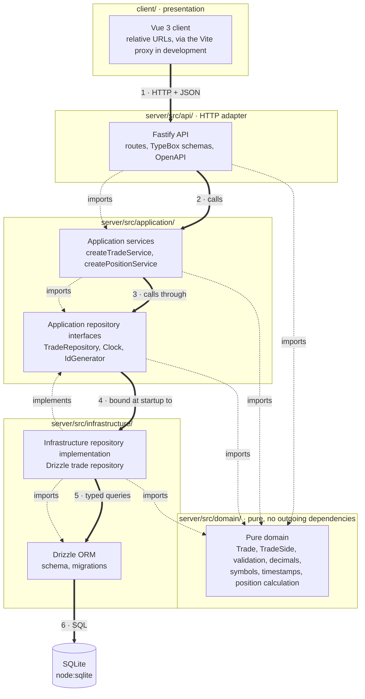
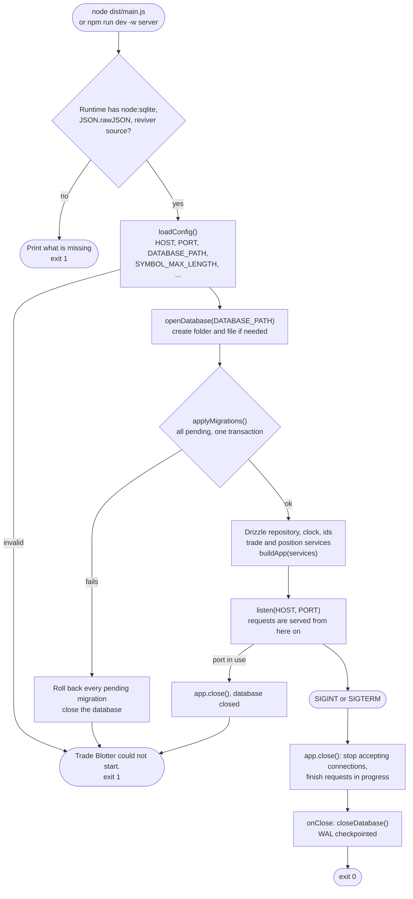
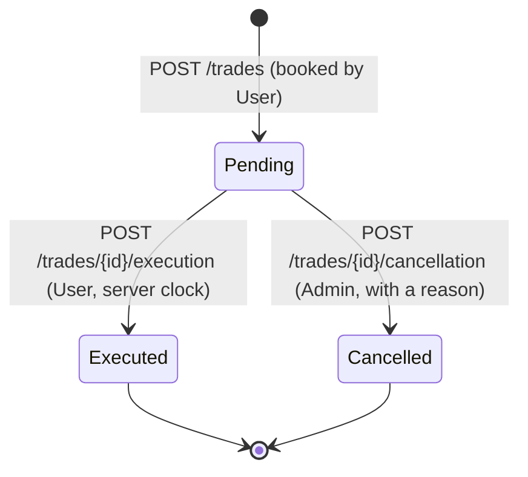
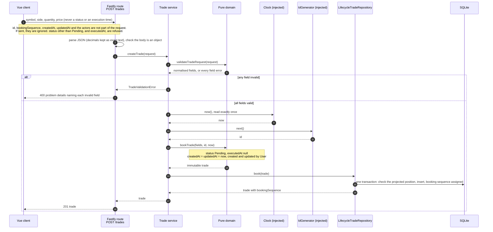
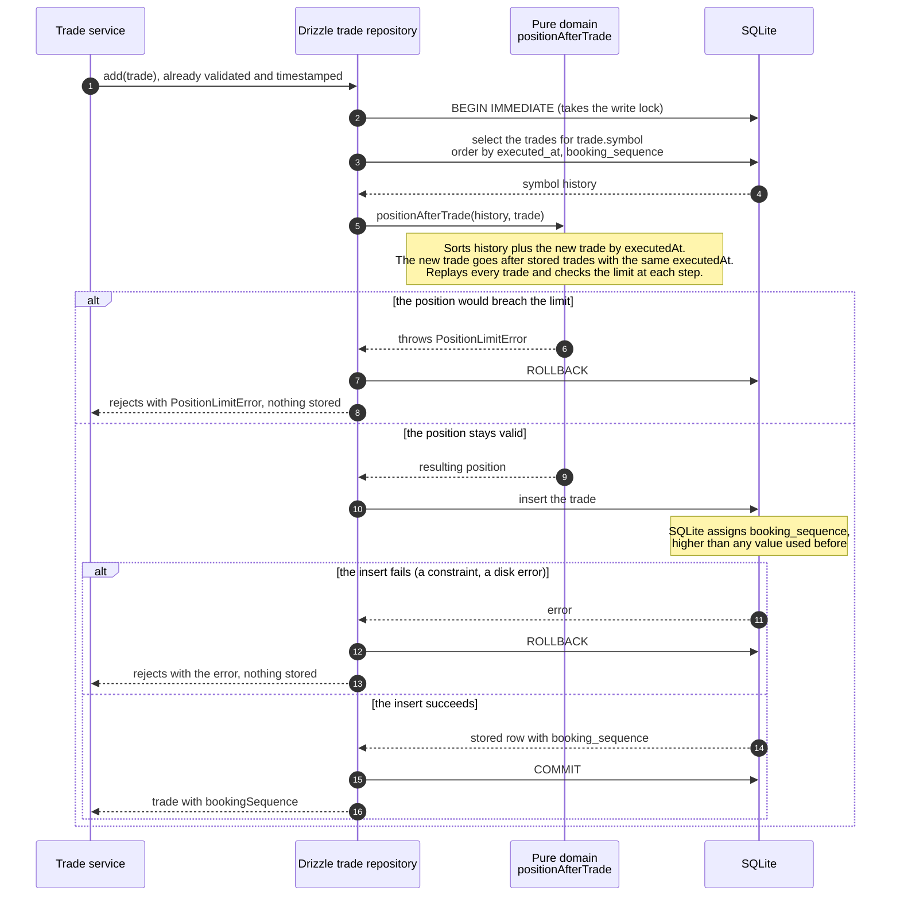
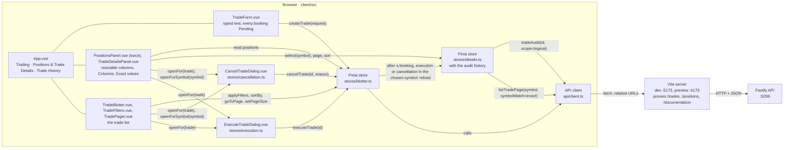

# Architecture

Trade Blotter records trades and derives a position per symbol from the trade history. This
document describes the layers and their boundaries, how a trade is created and timestamped, the
business rules, the numeric and timestamp policies, persistence, error handling and testing. The
scenario catalogue in `server/test/scenarios/` encodes the rules below as test
data; where the two disagree, fix one of them deliberately.

## Technology

| Concern | Choice |
| --- | --- |
| Runtime | Node.js 22.21.0 exactly (npm 10.9.4, SQLite 3.50.4; `engines` and `.nvmrc`: `22.21.0`), the one supported and verified version; ES modules |
| Language | TypeScript, strict, erasable syntax only (Node runs sources directly in development) |
| HTTP | Fastify 5 |
| Schemas and API docs | TypeBox, `@fastify/swagger` (OpenAPI 3.1), `@fastify/swagger-ui` |
| ORM and migrations | Drizzle ORM with its `node-sqlite` driver, and drizzle-kit; both pinned to `1.0.0-rc.5-5935859` |
| Database | SQLite through the built-in `node:sqlite` module |
| Decimal arithmetic | `decimal.js` |
| Backend tests | Vitest |
| Frontend | Vue 3, Pinia, Vite (`client/`, an npm workspace); Vitest with Vue Test Utils and jsdom |
| Lint | ESLint with `typescript-eslint` strict type-checked rules, `eslint-plugin-vue`, plus layer import rules |

`server/src/platform.ts` checks at startup that the runtime provides `node:sqlite`,
`JSON.rawJSON` and the `JSON.parse` reviver's `context.source`, and refuses to start otherwise.
It checks features, not the version number. The version policy is separate: `SUPPORTED_NODE_VERSIONS`
(`22.21.0`, one exact version) is what every `engines` field, `package-lock.json` and `.nvmrc` must
hold (a test compares them), and `review:01` judges the running version against it with
`nodeVersionVerdict` in `server/scripts/review-steps.ts`: PASS on 22.21.0 (`VERIFIED_NODE_VERSIONS`),
FAIL on every other version. `SUPPORTED_NPM_VERSION` (10.9.4) and `SUPPORTED_SQLITE_VERSION` (3.50.4)
record what 22.21.0 bundles; the documentation checks compare the documents with them. Until
2026-11-20 the policy was `^22.21.0`, with 22.23.1 verified as well.

## Layers

Vue 3 → Fastify routes → application services → repository interfaces → Drizzle ORM → SQLite,
arranged so that every source-code dependency points inward, towards the domain.

### Diagram A: components and dependency boundaries

Thick numbered arrows are the **runtime flow** of a request. Dashed arrows are **source-code
dependencies**: the module at the tail imports the module at the head. The two differ in one
place: at runtime the service calls the repository, but in the source the Drizzle repository
depends on the application's interface, not the other way round.



The Vue client shares no source code with the server; it depends only on the HTTP contract (see
[Frontend](#frontend)). The
composition root, `server/src/main.ts`, is not drawn: it is the one module that imports every
layer, builds the Drizzle repository, clock and id generator, and passes them to the service
factories.

### Responsibilities and rules

| Layer | Responsibility | May import | Must not import |
| --- | --- | --- | --- |
| **Domain** (`domain/`) | Business types (`Trade`, `TradeSide`, `Position`), trade validation and normalisation, the decimal policy, symbols, timestamps, trade order and position calculation. Pure functions: no I/O, no clock, no randomness. | Other domain modules, `decimal.js` | Everything else, including `node:` modules |
| **Application** (`application/`) | Use cases: create a trade, list trades, list positions. Reads the clock once per trade, asks for an id, calls the domain, stores through the repository interface. Declares the interfaces it needs (`ports.ts`) and its one error type. | Application and domain modules | Fastify, Drizzle, SQLite, Vue, `api/`, `infrastructure/` |
| **API** (`api/`) | Fastify routes, TypeBox schemas, lossless JSON, mapping service results and errors to HTTP, OpenAPI. Holds no business rules. | Application, domain | Drizzle, SQLite, `infrastructure/` |
| **Infrastructure** (`infrastructure/`) | Drizzle schema and migrations, the SQLite connection, the Drizzle `TradeRepository`, the system clock, the UUID generator. Converts between rows and domain types. | Application interfaces, domain, Drizzle, `node:sqlite` | Fastify, `api/` |
| **Composition root** (`main.ts`) | Reads configuration, opens the database, applies migrations, builds every dependency and passes it in. | Everything | |
| **Presentation** (`client/`) | Vue components, two Pinia stores and a typed HTTP client. Collects trades and displays what the API returns; its checks exist for usability only, and it never calculates positions. | Vue, Pinia, its own modules; the HTTP contract | Server code, Node built-ins, server libraries |

The rules for every server layer are enforced twice: by ESLint `no-restricted-imports` (one
rule per folder in `eslint.config.js`), and by `server/test/architecture/layers.test.ts`, which
reads the source and fails on any import the rules forbid.

Keep it light. There is one repository for one table, no generic `Repository<T>`, no base classes,
no decorators and no dependency injection container. Services are factory functions that take
their dependencies as an object.

## Project structure

```
server/
  drizzle.config.ts                drizzle-kit configuration (schema path, output folder)
  drizzle/                         generated migrations, committed and reviewed: create_trades, exact_decimal_sort_keys
  scripts/                         tools run with npm: app:start/stop/status, db:seed/clear, perf:api/ui, check:ui, review:01-07,
                                   check:all, check:docs, check:failures
                                   (browser.ts finds a browser; seed-data.ts makes dataset version 2; review-run.ts tracks runs;
                                   check-all.ts runs every verification, in a worker (check-all-worker.ts) that a supervisor
                                   (check-all-supervisor.ts) starts and watches, from check-all-main.ts; failure-detection.ts and
                                   docs-check.ts are two of them)
  src/
    main.ts                        composition root
    migrate.ts                     the db:migrate command
    config.ts                      environment configuration
    platform.ts                    runtime feature check
    server.ts                      createServer (composition: database, migrations, services, app) and startServer
    domain/
      decimal.ts                   decimal policy, canonical text, decimal input rules
      symbol.ts                    normaliseSymbol, compareSymbols
      timestamp.ts                 UtcTimestamp, parseTimestamp, toUtcTimestamp
      trade.ts                     Trade, TradeSide, validateTradeRequest, createTrade, notional, trade order
      trade-query.ts               TradeFilter, TradeSort, validateTradeQuery, validateTradePageQuery, pageWindow, compareTrades
      position.ts                  Position, applyTrade, calculatePositions
    application/
      ports.ts                     TradeRepository, Clock, IdGenerator
      errors.ts                    TradeValidationError, TradeQueryValidationError
      trade-service.ts             createTradeService: createTrade, listTrades, listTradePage
      position-service.ts          createPositionService: listPositions
    infrastructure/
      database/
        schema.ts                  Drizzle table definition, with the exact sort-key columns and indexes
        connection.ts              openDatabase(path): node:sqlite client, pragmas, Drizzle instance
        migrate.ts                 applyMigrations(db)
      drizzle-trade-repository.ts  createDrizzleTradeRepository(db): TradeRepository; SQL order, paging, planPageRead
      system-clock.ts              Clock backed by Date
      uuid-generator.ts            IdGenerator backed by crypto.randomUUID
    api/
      app.ts                       buildApp(options): Fastify instance with routes for the given services
      json.ts                      lossless decimal JSON
      problem-details.ts           RFC 9457 errors, error mapping, 404 and 405
      openapi.ts                   OpenAPI and Swagger UI
      schemas.ts                   TypeBox schemas: the documented contract
      responses.ts                 domain trade, page and position to JSON
      routes/trades.ts             POST /trades, GET /trades, GET /trades/page, execution, cancellation, audit
      routes/positions.ts          GET /positions
    types/                         json-source-text.d.ts: JSON.rawJSON and the reviver's source text, not yet in TypeScript's library
  test/
    architecture/                  layer import rules
    domain/                        pure domain tests
    application/                   services with in-memory doubles
    platform/                      runtime capability tests
    scenarios/                     scenario catalogue and its oracle checks
    infrastructure/                repository, sort order and paging, constraints, migrations, db:migrate, schema drift
    support/                       rational oracle, in-memory repository, fixed clock, test databases
    api/                           the whole application through app.inject(): catalogue, endpoints, pages, OpenAPI, startup
    scripts/                       the tools: process manager, seeding, benchmarks, process probe, reviewer workflow
    isolation/                     test databases stay in the temp folder and out of the repository
    config.test.ts                 configuration
client/                            Vue app (npm workspace)
  index.html                       page shell
  vite.config.ts                   dev and preview servers, API proxy, test settings
  public/                          favicon.svg, served as is
  src/
    main.ts                        creates the app and Pinia
    App.vue                        the three tabs (ARIA tabs, arrow keys, Home, End); loads trades and positions once on open
    api/
      contracts.ts                 request and response types from the OpenAPI contract, symbolMatch included
      json.ts                      JSON parsing that keeps numbers as exact text
      client.ts                    createTrade, listTradePage, listTrades, listPositions; ApiError
    stores/
      blotter.ts                   the trade list's page, filters, sort, page and page size; positions; booking and refreshes
      details.ts                   the chosen position and one page of its trades (symbolMatch=exact), its sort, page and size
      list-state.ts                loading, loaded and error state shared by both stores
    lib/
      decimal-text.ts              checking typed decimals; grouping digits; formatDecimalPlaces and formatMoney (2 places, half to even)
      column-widths.ts             resizable columns: widths, least widths, keys and pointer, scroll-bar room
      column-visibility.ts         shown and hidden columns, essential ones, defaults
      tabs.ts                      the tabs and which key moves to which
      timestamps.ts                local date and time to RFC 3339; UTC to local display
      local-dates.ts               local calendar date to the UTC start and end of that day
      trade-filters.ts             filter controls to query parameters; header sort rule and labels; page sizes; booked-trade filter match
    components/
      TradeForm.vue                trade entry and validation feedback (Trading)
      PositionsPanel.vue           the Positions grid (Trading), and the master grid of Positions & Trade Details (selectable)
      PositionDetails.vue          Positions & Trade Details: master beside details, stacked when narrow
      TradeDetailsPanel.vue        the chosen position's summary and its trades, paged and sorted on the server
      TradeBlotter.vue             Trade History: trade table with sortable headers, its filters and both pagers
      TradeFilters.vue             symbol, side and date range controls; Apply and Clear
      TradePager.vue               Previous, Next, page position, range and page size, for either list
      SortButton.vue               a sortable column header
      ColumnResizer.vue            a column's resize handle
      ColumnChooser.vue            the Columns control
      ExactValuesToggle.vue        the Exact values checkbox
      MoneyValue.vue               a price, notional or average cost to 2 places, with its exact value
      LocalTimestamp.vue           one timestamp in local time
    styles.css                     layout and theme
  test/                            Vitest: lib, API client, components, tabs, grids, master-detail, exact values, app, boundaries
docs/
```

## Repository interface and implementation

The application owns the interface; infrastructure implements it. Services never see Drizzle.

```ts
// application/ports.ts
export interface TradeRepository {
  /**
   * Stores a new trade and returns it with the booking sequence the store assigned. Atomic: checks
   * the trade against its symbol's stored history with positionAfterTrade and inserts it only if
   * that passes. Rejects with PositionLimitError, storing nothing, otherwise.
   */
  add(trade: NewTrade): Promise<Trade>
  /**
   * Stored trades in trade order: executedAt ascending, then booking sequence ascending. With no
   * filter, every stored trade; otherwise only those matching every member given. Reads only.
   * Positions and the position check use it: they always need the whole history.
   */
  listInTradeOrder(filter?: TradeFilter): Promise<readonly Trade[]>
  /** Trades matching the query's filter, in its sort order: exactly the order compareTrades defines. Reads only. */
  list(query: TradeQuery): Promise<readonly Trade[]>
  /**
   * One page of what `list` returns, and the number of matching trades, both read from the same
   * state of the store. A page past the last has no trades. Reads only.
   */
  listPage(query: TradeQuery, page: PageRequest): Promise<{ trades: readonly Trade[]; totalCount: number }>
}

export interface Clock { now(): Date }
export interface IdGenerator { next(): string }
```

`NewTrade` is a `Trade` without its `bookingSequence`. The store assigns the sequence, so it
records the order trades were booked in, independent of any timestamp.

The interface speaks only in domain types: no Drizzle row, query builder or SQLite type crosses
it. `createDrizzleTradeRepository` implements it on SQLite, filtering, sorting, counting and paging
in SQL (see [Repository](#repository) under Persistence). `test/support/in-memory-trade-repository.ts`
implements it in memory for the application tests, with the same position check, sorting with
`compareTrades` and paging with `pageWindow`: the definitions the SQL is tested against.

## Services, routes and wiring

Services are created by factory functions that take their dependencies as an object and return
plain functions:

```ts
// application/trade-service.ts (abridged)
export function createTradeService(deps: { trades: TradeRepository; clock: Clock; ids: IdGenerator; symbolMaxLength?: number }) {
  return {
    async createTrade(request: TradeRequest): Promise<Trade> {
      const result = validateTradeRequest(request, { symbolMaxLength })
      if (!result.ok) throw new TradeValidationError(result.errors)
      const now = toUtcTimestamp(deps.clock.now())
      return deps.trades.add(createTrade(result.value, { id: deps.ids.next(), now }))
    },
    async listTrades(request: TradeQueryRequest = {}): Promise<readonly Trade[]> {
      const result = validateTradeQuery(request, { symbolMaxLength })
      if (!result.ok) throw new TradeQueryValidationError(result.errors)
      return deps.trades.list(result.value)                    // sorted in SQL; default: newest first
    },
    async listTradePage(request: TradePageQueryRequest = {}): Promise<TradePage> {
      const result = validateTradePageQuery(request, { symbolMaxLength })
      if (!result.ok) throw new TradeQueryValidationError(result.errors)
      const { query, page } = result.value
      const { trades, totalCount } = await deps.trades.listPage(query, page)
      return { trades, page: page.page, pageSize: page.pageSize, totalCount, totalPages: pageCount(totalCount, page.pageSize) }
    },
  }
}
export type TradeService = ReturnType<typeof createTradeService>
```

Routes are Fastify plugins that receive their service through the registration options, which
keeps them typed and explicit, with no `app.decorate` and no globals. A handler only translates:
request body in, service call, domain result to JSON out. Errors propagate to the error handler.

```ts
// api/routes/trades.ts (abridged)
export const tradeRoutes: FastifyPluginAsync<{ tradeService: TradeService }> = (app, { tradeService }) => {
  app.post('/trades', {
    schema: createTradeSchema,                       // documents the contract in OpenAPI
    validatorCompiler: () => (body) =>               // the only HTTP-level check: a JSON object
      isTradeRequestContainer.Check(body) ? { value: body } : { error: clientError('The request body must be a JSON object.') },
    handler: async (request, reply) => reply.code(201).send(toTradeResponse(await tradeService.createTrade(request.body as TradeRequest))),
  })
  app.get('/trades', {
    schema: listTradesSchema,                        // documents the query parameters in OpenAPI
    validatorCompiler: () => (query) => ({ value: query }), // the domain validates them
    handler: async (request) => (await tradeService.listTrades(request.query as TradeQueryRequest)).map(toTradeResponse),
  })
  app.get('/trades/page', {
    schema: listTradePageSchema,                     // GET /trades' parameters, then page and pageSize
    validatorCompiler: () => (query) => ({ value: query }),
    handler: async (request) => toTradePageResponse(await tradeService.listTradePage(request.query as TradePageQueryRequest)),
  })
  return Promise.resolve()
}

// api/app.ts (abridged)
export async function buildApp({ logger, docs, services }: AppOptions): Promise<FastifyInstance> {
  const app = Fastify({ logger, routerOptions: { ignoreTrailingSlash: true } })
  registerLosslessJson(app, { decimalFields: ['quantity', 'price'] })
  registerProblemDetails(app)                         // before the routes, so it can record their methods
  for (const schema of SHARED_SCHEMAS) app.addSchema(schema)
  if (docs) await registerOpenApi(app)
  await app.register(tradeRoutes, { tradeService: services.tradeService })
  await app.register(positionRoutes, { positionService: services.positionService })
  return app
}
```

`server.ts` composes everything, and is the only module besides `main.ts` and `migrate.ts` that
imports every layer:

```ts
// server.ts (abridged)
export async function createServer(config: Config, overrides: ServerOverrides = {}): Promise<FastifyInstance> {
  const db = openDatabase(config.databasePath)
  try {
    applyMigrations(db)                               // throws before any route exists if a migration fails
    const trades = createDrizzleTradeRepository(db)
    const app = await buildApp({
      logger: overrides.logger ?? { level: config.logLevel },
      docs: config.docsEnabled,
      services: {
        tradeService: createTradeService({ trades, clock: overrides.clock ?? systemClock, ids: overrides.ids ?? uuidGenerator,
          symbolMaxLength: config.symbolMaxLength }),
        positionService: createPositionService({ trades }),
      },
    })
    app.addHook('onClose', (_app, done) => { closeDatabase(db); done() })
    return app
  } catch (error) {
    closeDatabase(db)
    throw error
  }
}
```

Tests call the same `createServer` with a temporary `DATABASE_PATH`, a fixed clock and sequential
ids, so they exercise exactly the production wiring.

### Startup and shutdown



- **No request is served before migrations succeed.** Routes are registered only after
  `applyMigrations` returns, and the server listens only after that.
- **A failed migration stops startup.** The error names SQLite's reason, every pending migration
  is rolled back, the database file is left as it was and closed, and the process exits `1` with
  `Trade Blotter could not start. Database migration failed; ...`.
- **Shutdown is graceful.** Requests already in progress complete; then the database connection
  closes, which checkpoints the write-ahead log. `startup.test.ts` holds a request inside the
  server while shutdown begins and checks that it still returns `201` and is stored.
- **`npm run db:migrate -w server`** remains available to migrate without starting the server.

## Trade creation and timestamps

Every trade is booked **Pending** and executed by a separate request (M7). A trade carries three
timestamps, each set by the server:

| Timestamp | Meaning | Set by | Used for |
| --- | --- | --- | --- |
| `executedAt` | When the trade was executed | The server clock, read inside the execution's transaction once the write lock is held; `null` while Pending and for a trade cancelled while Pending. Trades booked Executed before M7 keep the time they were given | Trade order and position calculation |
| `createdAt` | When the application first recorded (booked) the trade | The server, always | Audit and display |
| `updatedAt` | When the stored record last changed | The server: `createdAt` at booking, then the execution or cancellation time | Audit and display; never ordering |

### The lifecycle



Executed and Cancelled are final: an execution or cancellation of a trade that is not Pending is
refused with `409`. Execution changes the trade's own row; cancellation changes it and adds a
cancellation record ([Trade lifecycle](#trade-lifecycle)). The actors are labels the server assigns
to each operation; the application has no authentication.

### Diagram B: booking a trade



### Diagram C: executing a trade

```mermaid
sequenceDiagram
    autonumber
    participant Client as Vue client
    participant API as Fastify route<br/>POST /trades/{id}/execution
    participant Service as Trade service
    participant Repo as LifecycleTradeRepository
    participant DB as SQLite
    participant Domain as Pure domain

    Client->>API: no body (an empty object is accepted)
    API->>Service: executeTrade(id, body)
    alt the body has any member, or is not an object
        Service-->>API: ExecutionValidationError
        API-->>Client: 400 invalid-execution
    else
        Service->>Repo: execute(id, clock)
        Repo->>DB: BEGIN IMMEDIATE (the write lock, before anything is read)
        Repo->>Repo: executedAt = clock(), canonical UTC
        Repo->>DB: read the trade
        Repo->>Domain: executeTrade(trade, executedAt)
        Domain-->>Repo: the same row, Executed, updatedBy User; or why not (404, 409)
        Repo->>DB: read the symbol's rows
        Repo->>Domain: executedPositionAfterExecution(history, trade)
        Note over Domain: every intermediate Executed step within the limit, or PositionLimitError (409)
        Repo->>DB: UPDATE ... WHERE booking_sequence = ? AND status = 'Pending' (exactly one row, or roll back)
        Note over DB: the audit trigger records one Updated entry
        Repo->>DB: COMMIT
        Repo-->>Service: the trade, Executed
        Service-->>API: trade
        API-->>Client: 200 trade
    end
```

### Rules

1. A booking has no execution time and no status other than Pending: the service refuses either
   with a field error before reading the clock.
2. `createdAt` is always the clock reading at booking, and `updatedAt` starts equal to it.
3. The clock is read once per booking, after validation succeeds. A rejected request reads no
   clock, takes no id and stores nothing.
4. The request type has no `createdAt`, `updatedAt`, `createdBy` or `updatedBy`. Members with
   those names are ignored like any other unknown member and never stored or echoed.
5. An execution reads the clock once, inside its transaction, after `BEGIN IMMEDIATE` has taken
   the write lock, so its time is never earlier than any write that committed before it. It must be
   canonical UTC and not before the trade last changed. The trade's `createdAt` is kept.
6. A trade's economic fields never change; it is never amended or deleted. Its status changes once,
   from Pending to Executed or to Cancelled, and every change is in the audit trail.
7. The clock is an injected `Clock`, so tests control time exactly (`test/support/fixed-clock.ts`).

The timestamp format is described under [Timestamps](#timestamps).

## Persistence

Persistence lives in `server/src/infrastructure/`. It is the only code that imports Drizzle or
`node:sqlite`, and it hands the application domain trades, never database rows.

| File | Purpose |
| --- | --- |
| `database/schema.ts` | Drizzle table definition: columns, constraints, indexes |
| `database/connection.ts` | `openDatabase(path)` and `closeDatabase(db)`: one `node:sqlite` connection with its pragmas, wrapped by Drizzle |
| `database/migrate.ts` | `applyMigrations(db)`: applies pending migrations from `server/drizzle/` |
| `drizzle-trade-repository.ts` | `createDrizzleTradeRepository(db)`: the `TradeRepository` implementation |
| `system-clock.ts`, `uuid-generator.ts` | The production `Clock` and `IdGenerator` |
| `server/src/migrate.ts` | The `db:migrate` command |
| `server/drizzle.config.ts` | drizzle-kit configuration for generating migrations |

### Driver

Drizzle ORM's `node-sqlite` driver runs Drizzle on Node's built-in `node:sqlite`, so there is no
native addon and no second SQLite engine. The driver exists only in the Drizzle 1.0 line; the
project pins `drizzle-orm` and `drizzle-kit` to exactly `1.0.0-rc.5-5935859` and confines Drizzle to
`infrastructure/`, so an upgrade to the final 1.0 release touches only the schema, the repository
and the migration runner.

Two driver rules:

- **Transactions are synchronous.** The callback passed to `db.transaction()` must not be `async`;
  TypeScript rejects an async callback, and one forced through would not roll back.
- **No raw SQL for data access.** Inserts and selects use Drizzle's typed query builder.
  Connection pragmas are the only statements the application runs directly; the CHECK
  constraints are SQL expressions inside the schema definition.

### Schema

Two tables, declared in `database/schema.ts`: `trades`, which the first migration creates, the
second (`20261107224357_exact_decimal_sort_keys`) gives two generated sort-key columns, and the
third (`20261120220032_trade_lifecycle_audit`, M3) rebuilds with the trade lifecycle's columns;
and `trade_audit`, created by the third and filled only by its triggers (see
[Audit trail](#audit-trail)).

| Column | Type | Constraints | Domain field |
| --- | --- | --- | --- |
| `booking_sequence` | `INTEGER` | `PRIMARY KEY AUTOINCREMENT` | `bookingSequence` |
| `id` | `TEXT` | `NOT NULL UNIQUE`; non-empty text | `id` |
| `symbol` | `TEXT` | `NOT NULL`; 1 to 255 characters, no surrounding spaces | `symbol` |
| `side` | `TEXT` | `NOT NULL`; `Buy` or `Sell` | `side` |
| `quantity` | `TEXT` | `NOT NULL`; canonical positive decimal | `quantity` |
| `price` | `TEXT` | `NOT NULL`; canonical positive decimal | `price` |
| `executed_at` | `TEXT` | Canonical UTC with milliseconds when `status` is `Executed`; `NULL` otherwise (`trades_executed_at`) | `executedAt` |
| `created_at` | `TEXT` | `NOT NULL`; canonical UTC with milliseconds | `createdAt` |
| `updated_at` | `TEXT` | `NOT NULL`; canonical UTC with milliseconds, not before `created_at` | `updatedAt` |
| `quantity_key` | `TEXT` | `GENERATED ALWAYS AS (...) VIRTUAL`: never stored or written | (sort key) |
| `price_key` | `TEXT` | `GENERATED ALWAYS AS (...) VIRTUAL` | (sort key) |
| `status` | `TEXT` | `NOT NULL`; `Pending`, `Executed` or `Cancelled` (`trades_status`) | `status` |
| `created_by` | `TEXT` | `NOT NULL`; `User` or `Admin` (`trades_actors`) | `createdBy` |
| `updated_by` | `TEXT` | `NOT NULL`; `User` or `Admin` | `updatedBy` |
| `original_trade_id` | `TEXT` | `NULL` on an ordinary trade; on a cancellation row, a `FOREIGN KEY` to `trades(id)`, unique (`trades_original_trade_id`) | `originalTradeId` |
| `cancellation_reason` | `TEXT` | Set exactly on a cancellation row: non-blank, at most 500 characters (`trades_cancellation`) | `cancellationReason` |

`trades_cancellation` holds every row to one of two shapes: an ordinary trade (no original, no
reason, created by `User`), or a cancellation row (another trade's id, `Cancelled`, a reason,
created and last changed by `Admin` at one time). Foreign keys are on for every connection
(`pragma foreign_keys = on`), so a cancellation row cannot name a missing trade, and an original
with a cancellation row cannot be removed or renamed.

| Index | Columns | Serves |
| --- | --- | --- |
| `trades_trade_order` | `executed_at, booking_sequence` | Positions, and listing by execution time |
| `trades_symbol_trade_order` | `symbol, executed_at, booking_sequence` | One symbol's history inside the write transaction; listing by symbol |
| `trades_quantity_order` | `quantity_key, executed_at, booking_sequence` | Listing by quantity |
| `trades_price_order` | `price_key, executed_at, booking_sequence` | Listing by price |
| `trades_original_trade_id` (unique, partial: `WHERE original_trade_id is not null`) | `original_trade_id` | One cancellation row per original; finding a trade's cancellation row. It holds only cancellation rows (see [Partial indexes](#partial-indexes)) |
| Automatic unique index | `id` | The `UNIQUE` constraint |

- **Decimals are canonical text, never `REAL`.** The CHECK accepts only digits with at most one
  point, no leading zero (except `0.x`), no trailing fractional zero, and not zero; so `1.50`, `01`,
  `1e3`, `-1` and `0` are refused. Nothing is calculated in SQL, and nothing is ever converted to a
  floating-point number.
- **Exact sort keys.** `quantity_key` and `price_key` are the number of integer digits, zero-padded
  to ten, followed by the canonical text:
  `printf('%010d', case when instr(c, '.') = 0 then length(c) else instr(c, '.') - 1 end) || c`.
  Because canonical text has no leading or trailing zeros, comparing these keys as text compares
  the values exactly: more integer digits is larger; with as many, the digits decide, and a
  missing fraction comes first (`10` < `10.0000000001`). Only text operations are used, so
  `123456789012345.1234567891` and `...892`, which a JavaScript number cannot tell apart, sort
  correctly. The columns are `VIRTUAL`: SQLite computes them when read or indexed, writes never
  supply them, and the repository never selects them.
- **Timestamps are canonical UTC text**, `YYYY-MM-DDTHH:MM:SS.mmmZ`, checked with a `GLOB`
  pattern. Fixed-width text sorts chronologically, so the indexes order trades correctly.
- **The constraints guard the representation; the domain owns the business rules.** The input
  range (below 10^15, at most 10 decimal places) and the position limit are enforced by the domain
  before anything is written, not by the schema.
- **No `STRICT` table.** Drizzle cannot declare one. A number written to a `TEXT` column is
  converted to text by SQLite's type affinity (a bound JavaScript `1` becomes `'1.0'`) and then
  judged by the same checks; `typeof(...) = 'text'` rejects blobs. The repository only ever writes
  strings.
- **Notional is not stored.** It is derived from quantity and price when needed.
- **No positions table.** Positions are always derived from the trades.
- **Two repositories.** Since M4 every route uses `drizzle-lifecycle-repository.ts`, which books
  Pending and Executed trades, cancels, lists logical trades and reads the audit trail. The M3
  repository (`drizzle-trade-repository.ts`) remains for the seeding and data tools; it reads only
  `Executed` rows and writes every booking as `Executed` by `User`.

### Partial indexes

Two sets of partial indexes sit beside the four full ones, on the same columns, so that a read with
a fixed condition walks only the rows it can return and never reads a row to test it. The unique
index on `original_trade_id` is partial too:

| Index | Condition | Migration | Serves |
| --- | --- | --- | --- |
| `trades_executed_*` (4) | `status = 'Executed'` | `20261120225020_executed_trade_indexes` | `status=Executed` lists, Executed position histories, the M3 repository |
| `trades_original_trade_id` (unique) | `original_trade_id is not null` | `20261121003941_cancellation_unique_index` | One cancellation row per original; finding a trade's cancellation row (`= ?`, `in (...)`, `is not null` all imply the condition) |
| `trades_logical_*` (4) | `original_trade_id is null` | `20261121043510_logical_trade_indexes` | Every trade list and page, and their counts: logical trades, never cancellation records |

The repositories write each condition as a fixed SQL literal (never input), because SQLite can
use a partial index only when the query's own text implies its condition; every filter value is a
bound parameter. The logical condition is the domain's own definition of an ordinary trade,
`original_trade_id is null`, which is exact in every database state. (The form
`ifnull(original_trade_id, '') = ''` is not: with foreign keys off, an empty `original_trade_id`
passes every `CHECK`, and the two then select different rows.)

**Why the unique index is partial.** The lifecycle migration created it over every row. SQLite
then served `original_trade_id is null` from it, taking it to hold about one row per value
though every ordinary trade holds `NULL`, and sorted every trade for each page (15–110 ms a page
of the 25,000-trade benchmark). Holding only cancellation rows, it can no longer be chosen for that
condition. The rule is unchanged: `NULL`s were never equal to one another, so they never took part
in the uniqueness, and a second cancellation row for the same original is still refused
(`UNIQUE constraint failed`). It is an index, not a table constraint, so
`20261121003941_cancellation_unique_index` replaces it (`DROP INDEX`, then
`CREATE UNIQUE INDEX ... WHERE`) inside the migrator's one transaction, with no table rebuild and
no row, audit entry or booking sequence changed.

**The logical-trade indexes (approved after M4).** With the unique index partial, nothing served
`original_trade_id is null` itself: a page in an unfiltered order walked its full sort index and
read each row it stepped over to test the condition, and the count of every logical trade read the
whole table (a middle page by symbol, quantity or price 38–51 ms on the benchmark against 2–6 ms
before M4). `20261121043510_logical_trade_indexes` (generated by drizzle-kit from the schema) adds
four partial indexes, one per sort order, each `WHERE "trades"."original_trade_id" is null`: four
`CREATE INDEX` statements, no table rebuild, no row, audit entry, constraint, trigger or other
index changed. A page and its count now walk `trades_logical_*` and read only the rows they return;
a filtered count (a symbol search, a side) still reads each candidate row, because SQLite 3.50.4
does not treat an `is null` condition as covered, so filtered pages are as before (the README's
Performance section has the figures). The four indexes cost about 4.6 MB on the 28,750-row test
database and a few per cent on each booking; a cancellation adds no entry to them (its record is
not a logical trade, and the original's indexed columns do not change).

`executed-indexes.test.ts` records the repositories' SQL as it runs and checks with
`EXPLAIN QUERY PLAN` that each read uses the intended index: Executed reads a `trades_executed_*`
index; list pages, counts and full lists a `trades_logical_*` index with no sort for the unfiltered
orders; and only cancellation lookups the unique index. It also upgrades a database with the
partial unique index and checks that only the four indexes are added, each holding every logical
trade, with rows, tables, triggers and booking sequences unchanged and a second run doing nothing.

### Audit trail

`trade_audit` records every physical write to `trades`, made by any writer: the repositories, a
seeding tool, or SQL typed by hand.

| Column | Constraints |
| --- | --- |
| `audit_id` | `INTEGER PRIMARY KEY AUTOINCREMENT` |
| `audit_action` | `NOT NULL`; `Inserted`, `Updated` or `Deleted` |
| `audit_on` | `NOT NULL`; canonical UTC with milliseconds, SQLite's own clock at the write: `strftime('%Y-%m-%dT%H:%M:%fZ', 'now')` |
| `audit_by` | `NOT NULL`; always `System` |
| Every column of `trades`, in its order | The value it had at that write. The generated `quantity_key` and `price_key` are stored as plain `TEXT`, the values they evaluated to then |

- **Triggers** (created last by the migration): `trades_audit_insert` (`AFTER INSERT`, the `NEW`
  row, `Inserted`), `trades_audit_update` (`AFTER UPDATE`, the `NEW` row, `Updated`) and
  `trades_audit_delete` (`BEFORE DELETE`, the `OLD` row, `Deleted`). A write and its audit entry
  are one statement: a write that fails a constraint writes no entry.
- **Append-only:** `trade_audit_no_update` and `trade_audit_no_delete` abort any `UPDATE` or
  `DELETE` of `trade_audit`.
- **No invented history:** the triggers are created after the migration has copied the existing
  trades, so those rows have no entry; the first entry for a trade is its first write after M3.
- **A cancellation** is two writes in one transaction, so it leaves exactly two entries: `Updated`
  for the original, then `Inserted` for the cancellation row.
- **Only these columns.** There are no old/new value pairs, logical-trade or event columns: an
  entry is the row itself.
- **Kept with the table.** A `DROP TABLE trades`, and any future migration that rebuilds the
  table, drops its triggers too; such a migration must create them again, and the tests check
  that every trigger is present after migrating and after the server starts.

### Symbol length in the database

The domain limits a symbol to `SYMBOL_MAX_LENGTH` characters (code points): 64 by default,
configurable as an integer from 1 to 255, and checked at startup. The `trades_symbol` CHECK
allows 1 to 255: the highest value the setting accepts. The database is therefore never less
restrictive than any configuration the application allows; with the default it is the outer
bound, and the domain applies the tighter business limit.

This is the decided design; the table is not rebuilt. SQLite cannot change a CHECK constraint in
place, so narrowing it would mean a rebuild migration (copy every row into a new table, drop,
rename). That would fail on any stored symbol longer than the new limit, and a plain rebuild
restarts the `AUTOINCREMENT` counter from the largest copied `booking_sequence` rather than the
largest ever assigned. If the limit is ever narrowed, the migration must check for long symbols
first, carry the `sqlite_sequence` value over, and be tested on a populated database.

### Booking sequence

SQLite assigns `booking_sequence` on insert; the application never chooses it. Because the
column is `INTEGER PRIMARY KEY AUTOINCREMENT`, SQLite records the largest value ever used in its
`sqlite_sequence` table and always assigns a larger one:

- **Deleted values are never reused.** Even if the newest row were deleted, the next trade would
  get a higher number. There is no delete operation today; `drizzle-trade-repository.test.ts`
  simulates one in SQL to prove it.
- **A rolled-back insert uses no value.** The `sqlite_sequence` update is part of the same
  transaction, so a rejected trade leaves no gap.
- **The sequence is unique and increasing**, so it is a deterministic tie-breaker for trades with
  the same `executedAt`. It records the order trades were booked in, not when they executed.
- The largest possible value is 2^63 − 1; SQLite then refuses inserts rather than wrap around.

### Transaction boundary

A trade is stored only if its symbol's position stays valid with the trade included. The check and
the insert happen in one SQLite transaction inside `TradeRepository.add`:



- **Out-of-order execution times are accounted for.** The new trade is placed at its `executedAt`,
  and every later trade of the symbol is replayed on top of it. A trade booked today for last
  week is checked against everything executed since, not just appended to the end. Booking
  order alone is never used for the calculation.
- **Every intermediate position is checked**, not only the final one, so the stored history can
  always be folded by `calculatePositions` without error.
- **`BEGIN IMMEDIATE`** takes SQLite's write lock before the history is read. No other
  connection, in this process or another, can insert a trade between the check and the insert.
  Within one process, `node:sqlite` is synchronous and the callback is synchronous, so nothing else
  runs on that connection in between either.
- **Anything thrown inside the callback rolls back the whole transaction**: the position check, a
  constraint violation, or a database error. Tests check that the trade count and every existing
  row are unchanged afterwards.
- **The rule stays in the domain.** The repository decides *when* the check runs (inside its
  transaction); `positionAfterTrade` in `domain/position.ts` decides *what* is valid. The
  in-memory repository used by application tests calls the same function.
- **Cost.** Each insert reads its symbol's full history, using the
  `trades_symbol_trade_order` index. This is linear in the number of trades per symbol, which is
  fine for a blotter; a snapshot table would be the next step if a symbol ever held millions of
  trades.

`PositionLimitError` is a predictable rejection of the request, not a server fault: the API
answers it with `400`.

Reaching the limit with valid requests takes about 10^15 maximum-size trades on one symbol, so no
test does it that way. The repository and API tests store one oversized trade directly through the
repository, bypassing input validation, and then send an ordinary trade. They prove the check,
the `400` and the rollback; they do not show that ordinary traffic can reach the limit.

### Repository

```ts
// infrastructure/drizzle-trade-repository.ts (abridged)
export function createDrizzleTradeRepository(db: Database): TradeRepository {
  return {
    add(trade) {
      return settle(() =>
        db.transaction((tx) => {
          const history = tx.select().from(trades)
            .where(eq(trades.symbol, trade.symbol))
            .orderBy(asc(trades.executedAt), asc(trades.bookingSequence))
            .all()
            .map(toTrade)
          positionAfterTrade(history, trade)
          return toTrade(tx.insert(trades).values(toRow(trade)).returning().get())
        }, { behavior: 'immediate' }))
    },
    listInTradeOrder(filter = {}) {
      return settle(() =>
        db.select(TRADE_COLUMNS).from(trades)        // the stored columns, never the generated keys
          .where(matching(filter))                   // undefined for an empty filter: every row
          .orderBy(asc(trades.executedAt), asc(trades.bookingSequence))
          .all()
          .map(toTrade))
    },
    list({ filter, sort }) { /* the same, ordered by ordering(sort) */ },
    listPage({ filter, sort }, page) {
      return settle(() => db.transaction((tx) => {   // one read transaction: count and page agree
        const totalCount = tx.select({ count: count() }).from(trades).where(matching(filter)).get()?.count ?? 0
        const window = pageWindow(page, totalCount)  // undefined past the last page: no OFFSET at all
        if (window === undefined) return { trades: [], totalCount }
        const plan = planPageRead(window, totalCount, sort.field, filter, countAllTrades)
        // ...select TRADE_COLUMNS, ordering(sort, plan), LIMIT window.limit OFFSET plan.skip
      }, { behavior: 'deferred' }))
    },
  }
}
```

- `matching` builds the `WHERE` condition from the filter with `and`, `eq`, `gte` and `lte`, every
  value a bound parameter. The symbol search is `instr(symbol, ?) > 0`, a parameterised Drizzle
  `sql` fragment: stored symbols and the search are both normalised (upper case included), so an
  exact substring test is a case-insensitive search, and unlike `LIKE` it has no wildcards and no
  ASCII-only case folding. Bounds compare canonical UTC text, which sorts chronologically.

- `settle` turns the synchronous work into the `Promise` the interface returns, so anything thrown
  becomes a rejection.
- `toRow` writes decimals with `decimalText()`; `toTrade` reads them with `new Dec(text)` and reads
  timestamps through `parseTimestamp`, refusing any stored value that is not canonical. Rows are
  frozen domain trades by the time they leave the module.
- Drizzle wraps SQLite errors in a "Failed query" error; the SQLite message is its `cause`.

### Sort order and paging

Every list is ordered in SQLite by the sort column, then `executed_at`, then `booking_sequence`,
all in the sort direction: exactly the order `compareTrades` (domain) defines, which stays the
reference. Symbols compare as UTF-8 bytes, which is code-point order; timestamps as canonical
text; quantities and prices by their exact keys. `booking_sequence` is unique, so the order is
total and deterministic, and descending is ascending reversed. Filters are applied first (`WHERE`),
then the order, then the page.

`GET /trades/page` reads a page in one deferred read transaction: `COUNT(*)` of the matches, then
the page. In WAL mode both statements see the same snapshot, so `totalCount` and the items always
agree, even while another connection books trades. `pageWindow` (domain) computes an offset only
for a page that exists, so the offset is always below the match count, however large the page
number (up to `Number.MAX_SAFE_INTEGER`, validated as digits and compared as a `BigInt`).

How a page is read is chosen by `planPageRead`; every plan returns the same rows:

- **From the nearer end.** `OFFSET` steps over every row it skips, so a page in the second half is
  read in the opposite direction from the end, and turned round.
- **Through the sort index, or by sorting the matches.** The execution-time index visits rows in
  about the order they are stored; the symbol, quantity and price indexes do not, and each row they
  lead to is a separate lookup. When a symbol or side condition, which no index serves, decides the
  matches and the sort is by symbol, quantity or price, the plan estimates both costs from the
  counts it already has (rows to the page × all trades ÷ matches, against reading every trade once
  and sorting the matches; weights measured on 25,000 trades) and, when sorting is cheaper, writes
  the order's first term as `+column`. That keeps the value and order but stops SQLite walking that
  index. `GET /trades` (every match) sorts instead of walking in that case too.

These were measured, not assumed: on 25,000 trades, SQLite's own choice took up to 122 ms for some
deep filtered pages and 56–156 ms for some filtered full lists, against 10–52 ms when sorting the
matches. `test/infrastructure/sort-order.test.ts` checks the SQL order and every page slice against
`compareTrades` for 64 query combinations on 420 trades built to break a wrong order (decimals at
the input bounds, values a float cannot tell apart, code-point versus UTF-16 symbol order, ties on
every field), and that all four read plans are exercised.

### Migrations

- **Generating.** After a schema change, `npm run db:generate -w server` (`drizzle-kit generate`)
  writes a new folder under `server/drizzle/`, named `<UTC timestamp>_<name>`, holding
  `migration.sql` and a schema snapshot. Migrations are committed and reviewed like code;
  generated SQL is not edited by hand, with two exceptions. `20261121003941_cancellation_unique_index`
  (M4) is a `drizzle-kit generate --custom` migration: drizzle-kit does not see a change to an
  existing index's `WHERE` (it compares columns and uniqueness), so it would generate nothing for
  making `trades_original_trade_id` partial. Its SQL (`DROP INDEX`, `CREATE UNIQUE INDEX ... WHERE`)
  is hand-written, and the one `where` field of that index in its snapshot is set to what
  drizzle-kit writes for a partial index; `drizzle-kit generate` then finds no change, and
  `executed-indexes.test.ts` and `lifecycle-migration.test.ts` check the index SQLite holds. The
  other: `20261120220032_trade_lifecycle_audit`.
  Its snapshot is drizzle-kit's; its SQL is hand-written, because the generated rebuild would add
  `NOT NULL` columns to a populated table with no value, lower the `AUTOINCREMENT` high-water mark,
  and has no triggers. It saves the high-water mark, rebuilds the table (every row copied with its
  id, booking sequence and values, as `Executed` by `User`), restores the mark, recreates the
  indexes, creates `trade_audit`, and creates the triggers last. Migrations are forward-only: there are no down migrations,
  and a mistake is corrected by a new migration.
- **Applying.** `applyMigrations(db)` uses `drizzle-orm/node-sqlite/migrator`. It applies pending
  migrations in folder-name order, all in one transaction, and records each in
  `__drizzle_migrations`.
- **Repeatable.** Applied migrations are skipped, so applying again changes nothing.
- **Failure stops everything.** If any migration fails, every pending migration is rolled back
  and `applyMigrations` throws `Database migration failed; no migration was applied.` with
  SQLite's reason. Nothing deletes, recreates or skips over an existing database; a file holding
  something else is left exactly as it was.
- **`npm run db:migrate -w server`** (`server/src/migrate.ts`) opens the configured database,
  applies pending migrations, prints `Database is up to date: <path>` and exits `0`, or prints the
  error and exits `1`.
- **At startup**, `createServer` calls the same `applyMigrations` before any route exists; see
  [Startup and shutdown](#startup-and-shutdown).
- **The sort-key migration** is two `ALTER TABLE ... ADD ... VIRTUAL` statements and two
  `CREATE INDEX`: no table rebuild, so every row, the `sqlite_sequence` high-water mark and the
  existing indexes are kept. Tested on a populated database created by the first migration alone
  (`migrations.test.ts`); also run, with `npm run db:migrate -w server`, on a copy of a 25,000-trade database
  with a gap in its booking sequence: every row byte-identical, the sequence kept, `integrity_check`
  ok, and every key in exact decimal order.
- **Drift check.** `schema-drift.test.ts` runs `drizzle-kit generate` against a copy of the
  migrations folder and fails if the schema has changed without a migration.
  (`npm run db:check -w server`, `drizzle-kit check`, checks the migrations folder for
  conflicts but does not detect drift.)

### Connection

`openDatabase(path)` creates the parent folder if needed and opens one `DatabaseSync`, then sets:

| Pragma | Value | Why |
| --- | --- | --- |
| `busy_timeout` | `5000` | Wait up to 5 s for another connection's write lock instead of failing at once |
| `journal_mode` | `WAL` | Readers do not block the writer and the writer does not block readers |
| `foreign_keys` | `ON` | Enforce foreign keys if a later table declares them |

An existing file is opened as it is. The database path comes from `DATABASE_PATH`; the default is
`server/data/trade-blotter.db` (git-ignored), resolved from the server folder rather than the
process's current directory. A relative `DATABASE_PATH` is resolved against the process's current
directory. `:memory:` is refused, because every trade would be lost on restart.

## API contract

The Vue frontend depends on exactly this contract. All paths are case-sensitive; a trailing slash
is ignored; a query string is ignored except for the `GET /trades` and `GET /trades/page`
parameters below, and unknown parameters are ignored there too. The OpenAPI 3.1 document at `/documentation/json`
describes it in full, and Swagger UI is at `/documentation` (both can be turned off with
`DOCS_ENABLED=false`).

| Endpoint | Request | Success |
| --- | --- | --- |
| `POST /trades` | `{ symbol, side, quantity, price, status? }`: `status` only `Pending` | `201`, the stored trade, Pending |
| `POST /trades/{id}/execution` | no body | `200`, the trade, Executed |
| `GET /trades` | optional query parameters, below | `200`, a JSON array of every matching trade; with no parameters, every trade: newest `executedAt` first, then highest `bookingSequence` first |
| `GET /trades/page` | the same parameters, and `page`, `pageSize` | `200`, one page of what `GET /trades` lists, with the counts |
| `GET /positions` | | `200`, every non-flat position, sorted by symbol in code-point order |

`HEAD` is available wherever `GET` is. There are no update or delete endpoints: a trade changes
only by being executed or cancelled. `GET /trades` is
unchanged from before pagination existed: the same array, filters, order and decimals; it ignores
`page` and `pageSize`. The frontend uses `GET /trades/page` only.

**`GET /trades` query parameters**

Every parameter is optional. An empty value (`?side=`) is the same as omitting it, a repeated
parameter is refused, and the filters combine with AND. They are validated in the domain
(`validateTradeQuery`); an invalid one is answered with an `invalid-query` problem.

| Parameter | Values | Meaning |
| --- | --- | --- |
| `symbol` | text | Trades whose symbol contains it anywhere, ignoring case (or is it, with `symbolMatch=exact`). Normalised like a symbol (trimmed, NFC, upper-cased); blank matches every trade. At most the maximum symbol length. |
| `symbolMatch` | `contains` (default), `exact` | How `symbol` matches, exactly as written: anywhere in the symbol, or the whole symbol, so `symbol=ms&symbolMatch=exact` lists MS but not MSFT or MSTR. Both ignore case, as symbols are normalised. Without `symbol` it changes nothing. Reported in the parameter order `symbol`, `symbolMatch`, `side`, … The Trade Details use it. |
| `side` | `Buy` or `Sell`, any case | Trades on that side. Omitted: both sides. |
| `executedFrom` | RFC 3339 date-time with `Z` or an offset | Trades executed at or after it (inclusive). |
| `executedTo` | RFC 3339 date-time with `Z` or an offset | Trades executed at or before it (inclusive). Must not be earlier than `executedFrom`. |
| `sortBy` | `executedAt` (default), `symbol`, `quantity`, `price` | Sort field, exactly as written. |
| `sortDirection` | `asc`, `desc` (default) | Sort direction, exactly as written. |

Date-times follow the same rule as `executedAt` in a request: seconds required, at most
millisecond precision, and an offset required. A date alone (`2026-01-01`) or a time without an
offset is refused rather than read in some time zone. In a URL a `+` decodes to a space, so an
offset such as `+05:30` must be written `%2B05:30`; an unencoded one is refused. A whole UTC day is
`executedFrom=2026-01-01T00:00:00Z&executedTo=2026-01-01T23:59:59.999Z`.

Sorting compares symbols by Unicode code point and quantities and prices by exact value, never as
JavaScript or floating-point numbers, and never as plain text (`9.5` < `10`). It is done in SQLite
with exact sort keys (see [Sort order and paging](#sort-order-and-paging)). Ties are broken by
`executedAt`, then `bookingSequence`, in the sort direction, so every order is total and `desc` is
exactly `asc` reversed. With neither sort parameter the order is the original one (`executedAt`
`desc`). Listing only reads: it never changes stored trades, and positions always use the full
history.

```text
GET /trades?symbol=sf&side=buy
GET /trades?executedFrom=2026-01-01T00:00:00-05:00&executedTo=2026-01-31T23:59:59.999-05:00
GET /trades?executedFrom=2026-01-01T09:00:00%2B05:30
GET /trades?sortBy=price&sortDirection=asc
```

**`GET /trades/page`**

Takes every `GET /trades` parameter, meaning the same, and two more:

| Parameter | Values | Default | Meaning |
| --- | --- | --- | --- |
| `page` | 1 to 9007199254740991 | `1` | The page to list, counting from 1. A page past the last is not an error. |
| `pageSize` | 1 to 100 | `50` | Trades per page. |

Both are digits only: a sign, point, exponent or space is refused, and the text is compared as a
`BigInt`, so a huge number is refused rather than rounded. As for the other parameters, an empty
value means omitted and a repeated one is refused (`page=1&page=2`). Invalid page parameters are
reported in the same `invalid-query` problem as the others, after them:
`{"errors":{"side":[...],"page":["page must be a whole number from 1 to 9007199254740991."],"pageSize":["pageSize must be a whole number from 1 to 100."]}}`.

```json
{"items":[{"id":"…","bookingSequence":24999,"symbol":"MSFT", …}, …],"page":2,"pageSize":50,"totalCount":25000,"totalPages":500}
```

- `items` holds the trades on the page, each exactly as `GET /trades` writes a trade, in the same
  order: `GET /trades/page?page=n&pageSize=s` is exactly the n-th slice of `GET /trades` for the
  same filters and sort.
- `totalCount` is the number of matching trades on every page; `totalPages` is `totalCount ÷
  pageSize` rounded up, `0` when nothing matches. They are counted in the same read transaction as
  the page, so they always agree with it.
- A page past the last (`page=501` of 500) answers `200` with `"items":[]` and the real
  `totalCount` and `totalPages`. An empty database answers page 1 the same way, with
  `"totalCount":0,"totalPages":0`.

```text
GET /trades/page                                              page 1 of 50, newest first
GET /trades/page?page=3&pageSize=25&sortBy=quantity&sortDirection=desc
GET /trades/page?symbol=ms&side=Sell&page=2                   filters apply before paging
```

**Trade**

| Field | Type | Set by |
| --- | --- | --- |
| `id` | UUID string | Server |
| `bookingSequence` | integer | Database: increases with every stored trade, never reused |
| `symbol` | string | Client, normalised |
| `side` | `"Buy"` or `"Sell"` | Client, normalised |
| `quantity`, `price` | exact JSON number | Client |
| `notional` | exact JSON number | Server: `quantity × price` |
| `executedAt` | canonical UTC string, or `null` | Server, when the trade is executed; `null` while Pending |
| `createdAt` | canonical UTC string | Server, at booking |
| `updatedAt` | canonical UTC string | Server: `createdAt`, then the execution or cancellation time |

**Position:** `{ symbol, netQuantity, averageCost }`, exact JSON numbers, `netQuantity` signed
(positive long, negative short).

```http
POST /trades
Content-Type: application/json

{"symbol":" msft ","side":"buy","quantity":10.5,"price":"301.25"}
```

```http
HTTP/1.1 201 Created
Content-Type: application/json; charset=utf-8

{"id":"6f1c…","bookingSequence":1,"symbol":"MSFT","side":"Buy","quantity":10.5,"price":301.25,"notional":3163.125,
 "status":"Pending","executedAt":null,"createdAt":"2026-03-01T12:00:00.000Z","updatedAt":"2026-03-01T12:00:00.000Z",
 "createdBy":"User","updatedBy":"User","originalTradeId":null,"cancellationReason":null,"cancellationTradeId":null}
```

```http
POST /trades/6f1c…/execution
```

```http
HTTP/1.1 200 OK
Content-Type: application/json; charset=utf-8

{"id":"6f1c…","bookingSequence":1,"symbol":"MSFT","side":"Buy","quantity":10.5,"price":301.25,"notional":3163.125,
 "status":"Executed","executedAt":"2026-03-01T12:05:00.000Z","createdAt":"2026-03-01T12:00:00.000Z","updatedAt":"2026-03-01T12:05:00.000Z",
 "createdBy":"User","updatedBy":"User","originalTradeId":null,"cancellationReason":null,"cancellationTradeId":null}
```

Request members are matched by exact name. Unknown members are ignored and never stored or
echoed, including `id`, `bookingSequence`, `notional`, `createdAt` and `updatedAt`: the
client cannot set any server-managed field. If a member appears twice, the last occurrence wins.
Bodies are limited to Fastify's default of 1 MiB.

### Lifecycle endpoints (M4, M7)

| Endpoint | Request | Responses |
| --- | --- | --- |
| `POST /trades` | `status` optional, only `Pending` (omitted or `null` is Pending); no `executedAt` | `201` the trade, Pending; `400` `invalid-trade` (`errors.status` for Executed or Cancelled, `errors.executedAt` for any execution time) or `position-limit` |
| `POST /trades/{id}/execution` | none, or `{}` | `200` the trade, Executed; `400` `invalid-execution` (an `errors` entry per member sent); `404` `trade-not-found`; `409` `invalid-transition` (already Executed, Cancelled, a cancellation record) or `position-limit` (the Executed position would reach the limit; the trade stays Pending) |
| `POST /trades/{id}/cancellation` | `{"reason": "..."}` | `201` `{trade, cancellationRecord}`; `400` `invalid-cancellation`; `404` `trade-not-found`; `409` `invalid-transition` |
| `GET /trades`, `GET /trades/page` | `status` filter added | Logical trades only |
| `GET /trades/{id}/audit` | `scope` (`trade` or `logical`), `page`, `pageSize` | `200` an `AuditPage`; `400` `invalid-query`; `404` `trade-not-found`; other methods `405` |
| `GET /positions` | | `netQuantity` (Executed Net, kept), `averageCost`, `executedNetQuantity`, `pendingNetQuantity`, `projectedNetQuantity` |

- **Logical trades.** A list entry is the original row of a logical trade (Pending, Executed, or
  Cancelled once cancelled), with `cancellationReason` and `cancellationTradeId` read from its
  cancellation record. A cancellation record is never an entry; it is reachable through the
  cancellation response and the audit history. `originalTradeId` is therefore always null in lists.
- **Order.** As before (the sort field, then `executedAt`, then `bookingSequence`, all in the sort
  direction), with a trade without an execution time ordered as SQLite orders `NULL`: before every
  executed trade ascending, after them descending, by booking sequence among themselves
  (`compareListOrder`). The order is total, so a page never repeats or skips a trade, and the
  existing indexes produce it. A date range matches executed trades only.
- **Execution (M7).** Nothing is read from the request: the time and the actor (User) are the
  server's, and a body with any member is refused. The repository's `BEGIN IMMEDIATE` transaction
  (see [Trade lifecycle](#trade-lifecycle)) reads the clock once it holds the write lock, so of
  concurrent executions, or an execution and a cancellation, of one trade exactly one succeeds and
  the others answer `409`. A position-limit refusal is `409`, not `400` as for a booking: the
  request is valid, but conflicts with the trades already executed.
- **Cancellation.** The service passes the request''s `reason` only; the actor (Admin), the
  cancellation row''s id and the time come from the server. The repository''s transaction (see
  [Trade lifecycle](#trade-lifecycle)) makes concurrent requests safe: one `201`, the rest `409`.
- **Audit history.** Read only. `scope=trade` lists the entries of the physical row with that id;
  `scope=logical` those of the original and its cancellation record, found from either id, from
  the rows stored and from the audit trail itself (so a row since deleted still counts). Entries
  are in `auditId` order, which is write order, a page at a time like `GET /trades/page`. Each
  snapshot has every column of the row, the generated sort keys included, decimals as exact JSON
  numbers. `405` answers any other method on the path, as on every route with path parameters.
## Validation and error handling

### Validation flow

1. **Parsing** (`api/json.ts`). Only `application/json` and `+json` media types are accepted
   (otherwise `415`). Decimal members are kept as exact source text and never become a JavaScript
   number. Malformed JSON is a `400` with a fixed `detail`: `The request body is not valid JSON.`,
   with `(at character N)` when the parser reports a position, or a message naming a forbidden
   `__proto__`/`constructor.prototype` key. The parser's own message is never passed on, because it
   can quote the body or describe the implementation. A parsing failure that is not a syntax error
   is the server's fault: it is logged and answered with a bare `500`.
2. **Container** (TypeBox, in the route). The body must be a JSON object, checked with a compiled
   TypeBox schema; anything else is a `400` with `detail: "The request body must be a JSON
   object."` The full TypeBox request schema documents the fields in OpenAPI but does not
   validate them, so field messages never come from two places.
3. **Fields** (`validateTradeRequest`, domain). Checks every field, including its JSON type, and
   returns either the normalised fields or a message for each invalid field. It never throws for
   invalid input, so one `400` names every invalid field at once.
4. **Position** (repository transaction). The trade must keep its symbol's position within the
   limit; see [Transaction boundary](#transaction-boundary).

A rejected request stores nothing and uses no booking sequence: the next stored trade gets the
next number.

### Error mapping

All errors are RFC 9457 `application/problem+json` bodies. Generic errors use
`type: "about:blank"` and the HTTP status phrase as `title`; invalid trades, invalid queries and
position limit breaches have their own `type` URNs.

| Condition | Status | `type` | Body |
| --- | --- | --- | --- |
| Invalid trade fields | `400` | `urn:trade-blotter:problem:invalid-trade` | `title: "Invalid trade"`; `errors` maps each invalid field, in request order (`symbol`, `side`, `quantity`, `price`, `executedAt`), to its messages; `detail` repeats the first |
| Invalid `GET /trades` query parameters | `400` | `urn:trade-blotter:problem:invalid-query` | `title: "Invalid query"`; `errors` maps each invalid parameter, in the documented order (`symbol`, `side`, `executedFrom`, `executedTo`, `sortBy`, `sortDirection`), to its messages; `detail` repeats the first |
| The trade would take its symbol to the position limit | `400` | `urn:trade-blotter:problem:position-limit` | `title: "Position limit exceeded"`, `detail`, `symbol` |
| Body is not a JSON object, empty or malformed | `400` | `about:blank` | `detail` says why |
| Unknown route | `404` | `about:blank` | |
| Unsupported method on a known route | `405` | `about:blank` | `Allow` header with the supported methods (RFC 9110): `GET, HEAD, POST` for `/trades`, `GET, HEAD` for `/positions` |
| Body larger than 1 MiB | `413` | `about:blank` | |
| Body is not JSON | `415` | `about:blank` | |
| Anything else, including database failures | `500` | `about:blank` | Logged with the request id; the body has no `detail` |

```json
{
  "type": "urn:trade-blotter:problem:invalid-trade",
  "title": "Invalid trade",
  "status": 400,
  "detail": "Symbol is required.",
  "errors": {
    "symbol": ["Symbol is required."],
    "price": ["Price must be greater than zero."]
  }
}
```

`problem-details.ts` maps `TradeValidationError`, `TradeQueryValidationError` (application)
and `PositionLimitError` (domain) to `400`, uses the status of Fastify's own client errors, and
turns everything else into a bare `500`. Only messages created for the client (`clientError`) are shown in `detail`.
A `405` comes from the not-found handler: it records every route's methods as routes are added,
and answers a known path with an unknown method with `405` instead of `404`.

## Frontend

The Vue client in `client/` is a separate npm workspace. It knows the server only as the HTTP API
documented above: it imports no server module, and its only network calls are `POST /trades`,
`GET /trades/page`, `GET /positions`, `POST /trades/{id}/execution`, `POST /trades/{id}/cancellation` and
`GET /trades/{id}/audit` (`client/test/boundaries.test.ts` checks the list). It never fetches the whole history: the API filters,
sorts, counts and pages. (`api.listTrades`, for `GET /trades`, stays in the typed client for
compatibility; the page does not call it.)



- **One origin.** The client calls relative paths. In development and preview, Vite forwards
  `/trades`, `/positions` and `/documentation` to the API (`API_TARGET`, default
  `http://localhost:5299`), so the API needs no CORS. A production deployment serves
  `client/dist/` and forwards the same paths to the API in the same way.
- **Tabs.** Trading (the form and the Positions grid), Positions & Trade Details, and Trade
  History are ARIA tabs: Left and Right arrows (wrapping), Home and End move between them, with a
  roving tab stop. Every panel stays mounted while hidden (`v-show`), so typed entries, filters,
  sort, pages, the chosen position, column widths and choices survive a change of tab, and a change
  of tab sends no request. Trades and positions are loaded once, when the page opens.
- **State.** One Pinia store holds the trades on the page shown and the positions, each with
  `loading`, `loaded` and `error`, and the trade list's applied filters, sort, page and page
  size, kept apart. It is shared because booking a trade (in the form) must refresh both tables:
  after a successful `POST /trades` the store reloads the same page and `GET /positions` together. Only
  the newest response for each list is applied, and a failed refresh keeps the last data on
  screen with an error message. Positions always come from the API; the client never calculates
  them, and it shows trades and positions in the order the API returns them.
- **Search and filters.** The controls above the trade table hold a draft. Only Apply changes the
  applied filters (`applyFilters`), and Clear resets the controls, the filters, the sort and the
  page (`clearFilters`; the page size is kept). Every trade-list load uses the applied filters,
  including sorting, paging, the reload after a booking and the Refresh button: a filter typed but
  not applied is never sent ("Changes not applied yet." says so). Positions never use them: they
  always cover every trade.
- **Sorting by column header.** Symbol, Quantity, Price and Executed at are buttons in their
  headers; the other columns do not sort. A new column starts ascending, except Executed at, which
  starts newest first; choosing the active column reverses it. The sorted column has `aria-sort`
  and an arrow; each button's hidden text says what choosing it does ("sort descending"). The
  default is newest execution first.
- **Pages.** `TradePager.vue` is shown above and below the table; both read and change the same
  store state, so they always agree: the range ("51–100 of 25,000 trades", "matching trades" when
  filtered), "Page 2 of 500", Previous, Next and a 25/50/100 page-size select (default 50). Previous
  is disabled on page 1 and Next on the last page; when the button just used becomes disabled, focus
  moves to the other one. Applying filters, sorting and changing the page size go back to page 1.
  With nothing to show, no pager is shown. A page that comes back past the end of a shortened list
  is replaced by the last page.
- **Requests.** The client sends the API's own parameters with `URLSearchParams`, leaving out empty
  values and the default sort, and always `page` and `pageSize`: with no filter the first request
  is `GET /trades/page?page=1&pageSize=50`. Previous and Next step from the page asked for, so two
  quick clicks move two pages; only the newest response is applied. A page response is accepted
  only if it is the page and size asked for, `totalPages` is `totalCount ÷ pageSize` rounded up,
  and it holds exactly the trades that fall on that page.
- **Booking messages.** After a booking the store reloads the same page with the same filters and
  sort, and the confirmation says where the trade is, judged from that reloaded page and the
  applied filters: "It is on this page of the trade list."; "It matches the filters but is on
  another page of the trade list." (or "It is on another page…" with no filters); or "It is not in
  the trade list because it does not match the current filters." The filter test copies the API's
  rule (the search normalised like a symbol and found anywhere in it; side; inclusive execution
  bounds). No page number is guessed. While another load is on its way, or after the reload
  failed, only "Booked: …" is said.
- **Decimals stay text.** Quantity and price are text inputs; the trimmed text is sent as JSON
  strings (`"10.50"`), so the server receives exactly the digits typed. Responses are parsed with
  `parseJsonKeepingNumberText`, which quotes every number literal before `JSON.parse`, so an
  average cost with 50 significant digits arrives intact. This works in every browser and does
  not depend on newer `JSON.parse` features. A test replaces this with `Number()` conversion and
  checks that the precision tests fail.
- **Money to two places, for display only.** Prices, notionals and average costs are shown by
  `MoneyValue.vue` through `formatMoney`: `formatDecimalPlaces(text, 2)` rounds the decimal text
  itself, half to even (the server's rounding mode), never through a JavaScript number, and groups
  the digits; a value that rounds to zero has no minus sign. Where digits are hidden, the exact
  grouped value is the tooltip and follows the rounded one for screen readers (", exactly
  90.125"); a grid's **Exact values** checkbox (`ExactValuesToggle.vue`, unchecked at first) shows it
  beside the rounded one instead (in Trade Details, the chosen position's average cost above the
  grid too), and a column whose width was fixed by resizing is widened to fit
  it. Quantities and net quantities are only grouped, never rounded. The store, the API and the
  booking form keep every digit.
- **Grids.** The Trading Positions grid, the master grid and the Trade Details are tables sized to
  their contents (`width: max-content`), in a box that scrolls both ways under a sticky header and
  shows 25 rows (10 for the master when stacked), leaving room for a horizontal scroll bar so the
  last row is never covered. `useResizableGrid` (`lib/column-widths.ts`) gives each column a
  resize handle (`role="separator"` with its width as value): drag it, or focus it and use the
  arrow keys (Shift, Page Up and Down for larger steps), Home (narrowest), End (widest), Enter or a
  double-click (fit the contents), Escape during a drag (undo). The first resize fixes every
  column's width; widths stay within each column's least and greatest width, keep the header and
  cells aligned, survive tab changes and refreshes, and Reset column widths returns to sizing by
  contents. `useColumnVisibility` and `ColumnChooser.vue` show and hide optional columns: an
  essential column (Symbol, Executed at) always stays; order is kept; a hidden column keeps its
  width for when it returns, and one shown for the first time while widths are fixed is fitted to
  its contents. The list says how many columns are shown ("4 of 10 columns shown"). Show all columns
  shows every column, those hidden by default included, in the grid's order and with the widths
  they had; the list stays open and focus stays on the button, which is `aria-disabled` (not
  `disabled`, so focus is not lost) and does nothing once every column is shown. Restore default
  columns, a separate action, puts back the grid's default choice; it is `aria-disabled` in the
  same way at the defaults, so focus stays on it after restoring and Escape still closes the list. The Trade History table keeps its own
  simpler layout (no resizing or Columns).
- **Positions total.** Both Positions grids are `PositionsPanel.vue`, so both show the same
  "Total: N positions" above the table, worked out from the one list of positions in the blotter
  store (`positions.items.length`): every open position `GET /positions` last returned, not the
  rows in view, with no request of its own. It changes when that list is loaded again, after a
  booking, a cancellation or Refresh; a symbol is in the list while its Executed or Pending net is
  not zero, so one with only Pending trades is counted (and shown as Flat).
- **The actual position (M7).** Both Positions grids show Executed net (the API's
  `executedNetQuantity`, the same as `netQuantity`) and Average cost (Executed trades only), each
  exact; Direction is that of the Executed net (`lib/positions.ts`): Long, Short, or Flat for zero.
  The Pending net and Projected net that M5 showed are gone from the page (M6 Phase 2): no column,
  Columns choice, Show all, Restore, caption, tooltip or summary offers them, and the Trade Details
  summary shows the Executed net and the average cost only. The API client still reads and checks
  them (`pendingNetQuantity`, `projectedNetQuantity`), as the contract has them. Column choices live
  only as long as the page (nothing is saved), and a set of choices naming a column the grid does
  not have is ignored (`shownColumns`, `withColumn`), so no older choice can bring them back.
- **Positions & Trade Details.** The master grid is `PositionsPanel.vue` with `selectable`: an
  ARIA grid whose rows carry `aria-selected`, one tab stop on the active row's symbol, Up, Down,
  Page Up, Page Down, Home and End to move, Enter or Space (or a click) to choose; the chosen row is
  coloured and marked with a bar. Choosing calls `details.select(symbol)` (`stores/details.ts`),
  which asks `GET /trades/page?symbol=<symbol>&symbolMatch=exact&page=1&pageSize=25` (the sort is
  added when it is not the default). Another position starts again at page 1, keeping the sort and
  page size, and clears the trades shown so one position's trades never appear under another's
  name; the position already chosen asks nothing. Only the newest request's answer is applied, and
  an answer holding another symbol's trades is refused as a server error. Paging, page size and
  sorting (Executed at, Quantity, Price, Symbol) are the API's. Loading, empty and error states are
  shown, with Try again; a position that closes keeps its trades listed with a note. Booking a trade
  in the chosen symbol reloads the details. From 1,100 px wide the master and details sit side by
  side (the master as wide as it needs, up to about half), below that they stack, and a button
  moves focus to the trades.
- **Booking (M7).** The form has symbol, side, quantity and price only: no status and no
  execution time. It sends neither; the API books every trade Pending, and the client refuses an
  answer that is not a Pending trade without an execution time. The confirmation says the trade is
  Pending and where to execute it; a position-limit refusal adds that the Executed and Pending
  trades were checked together. (M5's Status radio group and M1's execution time field are gone.)
- **Executing (M7).** **Execute…** on a Pending row, in Trade History and in Trade Details,
  opens `ExecuteTradeDialog.vue` (`stores/execution.ts`): a modal dialog (`aria-modal`, labelled and
  described) that shows the trade, with focus on **Keep Pending** so Enter never executes by
  accident, Tab kept inside, and the page behind inert. **Confirm execution** sends
  `POST /trades/{id}/execution` with no body; while it is on its way the dialog cannot be closed and
  Confirm cannot be pressed again. Success closes it, reports the outcome in the panel it was opened
  from, moves focus there once the button is gone, and reloads the trades, the positions and the
  Trade Details with their audit history. `409` (executed or cancelled elsewhere, or the position
  limit) and `404` are explained, refresh the lists and leave only Close; `400` and server errors
  are explained with Keep Pending. Each opening is a session: an answer for an earlier one is
  dropped.
- **Statuses in the lists (M5).** Trade History and Trade Details have a Status column
  (`StatusBadge.vue`): the status written out, drawn differently for each (a dashed outline for
  Pending, filled for Executed, struck through for Cancelled, whose reason is the tooltip and is read
  after the status). Trade History has a Status filter (All, Pending, Executed, Cancelled), sent as
  `status`, and counts as narrowing the list. The lists hold one entry per logical trade, as the API
  sends them; a missing execution time is a dash, read as "Not executed". An Actions column beside
  Status holds **Execute…** and **Cancel…** on Pending trades only (`isExecutable` and
  `isCancellable`: Pending, not a cancellation record) and, in Trade Details, **History**; beside Status, it is in view at 1280 and 768 px
  without scrolling sideways.
- **Cancellation (M5).** One dialog (`CancelTradeDialog.vue`, mounted once in `App.vue`) and its
  store (`stores/cancellation.ts`). `openFor(trade)` shows that trade; `openForSymbol(symbol)` (Trade
  Details' **Cancel a Pending trade in …**) loads `GET /trades/page?symbol=…&symbolMatch=exact&status=Pending&pageSize=100`
  and lists each with side, quantity, price, when booked and id as radio choices, none chosen, so
  the user picks one. The reason is checked as the server checks it (`lib/cancellation.ts`:
  required, trimmed, NFC, at most 500 code points, no control or invisible characters); only
  `{"reason": …}` is sent, so the actors, the time and the cancellation record are the server's.
  While the request is on its way Confirm is disabled and reads "Cancelling…", a second submit does
  nothing, and the dialog cannot be closed. Each opening is a session: an answer for an earlier
  session (closed or reopened meanwhile) is dropped. `blotter.cancelTrade` then reloads the trade
  page and the positions, and the Trade Details and their audit history when they show that symbol;
  after a `409` or `404` it reloads them too before the refusal is shown, since the page was out of
  date. `invalid-cancellation` (400) is shown by the reason; `conflict` (409) and `not-found` (404)
  leave only Close; a network or server failure can be retried. The outcome ("Cancelled: … Reason:
  …. Cancellation record …, recorded by Admin.") is a `role="status"` message in the panel that
  opened the dialog. The dialog is `role="dialog"` with `aria-modal`; the page behind is `inert`
  (the attribute is removed, not set to "false", when the dialog closes); focus starts in the first
  choice or Reason, Tab wraps inside, Escape and Keep trade close it, and focus returns to the button
  that opened it, or to the outcome when that button is gone.
- **Audit history (M5).** **History** on a Trade Details row calls `details.showAudit(id)`, which
  asks `GET /trades/{id}/audit?scope=logical&page=1&pageSize=25`; `AuditHistory.vue` shows the
  entries below the grid, oldest first, one row each: what happened in words (`lib/audit.ts`:
  "Trade booked by User as Pending", "Trade cancelled by Admin", "Cancellation record created by
  Admin, for trade …"), the audit action, when, by whom (System), the trade id, the original's id,
  the status, created and updated by, side, quantity, price, execution time and reason. Its own
  request numbering drops a late answer for another trade; choosing another position closes it.
  The page is accepted only if it is the trade, scope and page asked for and every entry is of one
  of `tradeIds`. Only Refresh and Close are offered: nothing writes an entry.
- **Client checks are for usability.** Before sending, the form requires a symbol, a side, and a
  quantity and price that are plain positive numbers. The input range, decimal places and every
  other rule are the server's: its field errors are shown next to the matching fields.
- **Errors.** `ApiError` has nine kinds: `invalid-trade` (field errors shown inline),
  `invalid-query` (the API's reasons, shown with the trade list, never in the booking form),
  `rejected` (the position-limit explanation, or a generic message for any other 4xx),
  `invalid-cancellation`, `not-found` and `conflict` (the cancellation's refusals),
  `network`, `unavailable` and `server`; `problem` names the problem type when the API gave one. Server details are never shown: a `500` body, a proxy error page or an
  unexpected response all become a fixed message. A response that does not match the contract
  is treated as a server failure rather than displayed.
- **Accessibility.** Every control has a label; Buy and Sell are a radio group in a fieldset;
  invalid fields get `aria-invalid` and `aria-describedby` pointing at their message; focus moves
  to the first invalid field, or back to Symbol after a booking; alerts use `role="alert"` and
  confirmations `role="status"`; each newly shown page is announced in a hidden `role="status"`
  ("Showing 51–100 of 25,000 trades, page 2 of 500."); the two pagers are navigation landmarks
  named "above the table" and "below the table"; tables have captions and header scopes; side and
  direction are written in words as well as colour. Tabs, resize handles, the master grid's rows,
  Columns and Exact values work from the keyboard with a visible focus outline. The layout stacks
  on narrow screens, pagers and tabs wrap, and every table scrolls sideways in its own box; text
  kept for screen readers is positioned inside that box, so a cell scrolled out of view never
  widens the page.

### Execution time

The booking form has no execution time (M7): the server sets it when the trade is executed, from
its own clock, in canonical UTC. M1's `<input type="datetime-local">` and its daylight-saving
handling are gone from the form; `resolveLocalDateTime`'s offset rules remain in
`lib/timestamps.ts`, where the date range filter's day boundaries use the same reasoning.

### Date range filter

From and To are `<input type="date">` calendar dates in the browser's time zone, and both days are
included. `localDayStart` gives the first instant of the From date, and `localDayEnd` the start
of the day after the To date less one millisecond; both are sent as UTC (`toISOString`). Neither
adds 24 hours: each boundary is found from the offsets in force, the way `resolveLocalDateTime`
finds them, so a 23-hour or 25-hour day is covered exactly. In New York, 2026-03-08 is
`2026-03-08T05:00:00.000Z` to `2026-03-09T03:59:59.999Z` (23 hours), and 2026-11-01 is
`2026-11-01T04:00:00.000Z` to `2026-11-02T04:59:59.999Z` (25 hours). Where the clocks skip
midnight (Santiago, 2026-09-06), the day starts at the change, 01:00 local; where midnight
happens twice, at its first occurrence.

A From date later than the To date, an incomplete date, or a boundary outside the years 0001 to
9999 is refused next to its field before anything is sent. Tests take the offsets of named zones
from the engine's time-zone data, so they do not depend on how the operating system applies
`TZ`, and one test checks that the `TZ` the suite sets is in effect.

### Timestamp display

Returned timestamps are shown in one fixed format, local time with milliseconds and the offset in
force at that instant (`2026-01-02 09:30:00.123 UTC−05:00`), inside a `<time>` element whose
`datetime` and tooltip carry the exact UTC value. The blotter labels `Executed at` separately
from `Created at` and `Updated at`, and says that the first is when the trade happened and the
others when it was recorded.

## Business rules

### Trade fields

| Field | Rule | Messages |
| --- | --- | --- |
| `symbol` | Required string. Normalised (below); then non-empty, at most the configured length, no control or invisible characters. | `Symbol is required.` / `Symbol must be a string.` / `Symbol must be at most 64 characters.` / `Symbol must not contain control or invisible characters.` |
| `side` | Required string, `Buy` or `Sell`, ignoring case and surrounding whitespace. Stored as `Buy` or `Sell`. | `Side must be Buy or Sell.` |
| `quantity` | Required decimal, greater than zero, within the input range. | `Quantity is required.` / `Quantity must be a number.` / `Quantity must be greater than zero.` / `Quantity must be less than 10^15 with at most 10 decimal places.` |
| `price` | As `quantity`. | As `quantity`, with `Price` |
| `executedAt` | Not accepted in a booking (`null` counts as none): the server sets it on execution. | `A trade is booked as Pending, with no execution time: omit executedAt. The server sets it when the trade is executed.` |
| `status` | Optional: `Pending` (any case), omitted or `null`. Executed and Cancelled are refused. | `A trade cannot be booked as Executed: it is booked as Pending, then executed (POST /trades/{id}/execution).` / `A trade cannot be booked as Cancelled.` / `Status must be Pending, or omitted.` |

### Symbols

1. Trim leading and trailing whitespace (`String.prototype.trim`).
2. Compose to Unicode NFC, so the same visible text is always the same symbol.
3. Upper-case without locale (`String.prototype.toUpperCase`): `brk.b` becomes `BRK.B`, `straße`
   becomes `STRASSE`.
4. Reject control characters (Unicode category Cc), invisible format characters (Cf) such as a
   zero-width space, unpaired surrogates (Cs), and line and paragraph separators (Zl, Zp),
   anywhere in the symbol. They would make visually identical symbols distinct positions.
5. Require at least one character, and at most `SYMBOL_MAX_LENGTH` characters (code points)
   after normalisation. The default is 64: longer than any common identifier (exchange tickers,
   option symbols of about 21 characters, ISINs and FIGIs of 12) while keeping the blotter
   readable and the column bounded.

Any other character is allowed, including punctuation (`^GSPC`, `BRK/B`, `A$`) and non-Latin
scripts.

### Positions

Positions are never stored. Each request for positions loads the trades and folds them per
symbol, in trade order, through one pure domain function, `calculatePositions`. Services call
it; neither the API nor the repository computes positions. A Buy contributes a positive signed
quantity and a Sell a negative one, so longs and shorts share one code path. Each trade falls
under exactly one rule (`applyTrade`):

1. **Open from flat.** Net quantity becomes the signed quantity; average cost becomes the price.
2. **Increase** (same direction). Average cost becomes the quantity-weighted average of the
   existing position and the trade.
3. **Reduce** (opposite direction, smaller). Net quantity shrinks; average cost is unchanged.
4. **Close** (opposite direction, equal). The position is flat: zero quantity, zero average cost.
5. **Cross** (opposite direction, larger). Net quantity changes sign; average cost becomes the
   trade price, because the whole remaining position was opened by this trade.

Flat positions are omitted. Realised P&L is out of scope.

### Trade lifecycle

Implemented in the domain (M2), the database (M3: the columns, constraints, migration, audit
trail and `drizzle-lifecycle-repository.ts`) and the API (M4: bookings with a status, cancellation,
logical trade lists, positions by status and the audit history; see [Lifecycle endpoints](#lifecycle-endpoints-m4)),
the page (M5: the Status column and filter, cancellation with a reason, the logical audit
history; see [Frontend](#frontend)), and M7: every booking Pending, execution as a separate
operation, and the page showing the actual position.

- **One table, one row type** (`server/src/domain/trade-status.ts`, `LifecycleTrade`): every
  record is a physical row of `trades`, with a status (Pending, Executed or Cancelled), the actors
  who created and last changed it (User or Admin), an execution time (set exactly when the status
  is Executed; null for Pending and Cancelled rows), an `originalTradeId` and a
  `cancellationReason` (both set only on a cancellation row, null on every other row).
- **Booking** (`validateBookingStatus`, `validateTradeRequest`, `bookTrade`): every booking is
  Pending, with no execution time, created and last changed by User at the booking time. A request
  naming Executed or Cancelled, or giving an execution time, is refused. (`validateExecutedTradeRequest`
  and `createTrade` build historical Executed trades for the datasets only, which write them
  straight to the database, as trades booked Executed before M7 were.)
- **Execution** (`executeTrade`, M7): only a Pending trade can be executed. The same row becomes
  Executed, with the execution time as its `executedAt` and `updatedAt`, last changed by User; its
  id, booking sequence, economic fields, creation time and creator are kept, and no row is added.
  Refused: a cancellation row, a trade already Executed, a Cancelled trade, a row that breaks the
  lifecycle rules, and a time that is not canonical UTC or is before the trade last changed.
  `drizzle-lifecycle-repository.ts` runs it in one `BEGIN IMMEDIATE` transaction: it reads the
  clock (after the lock is taken), reads the trade, lets `executeTrade` decide, checks the Executed
  position, and updates the row only `WHERE status = 'Pending'`, rolling back unless exactly one row
  changed. Of concurrent executions and cancellations of one trade, exactly one succeeds.
- **Cancellation** (`cancelTrade`): only a Pending trade can be cancelled. It makes two rows of one
  logical trade in the same table. The original keeps its id, booking sequence, symbol, side,
  quantity, price, creation time and creator (User), and becomes Cancelled, last changed by Admin
  at the cancellation time. A new cancellation row, with an id of its own, names the original
  (`originalTradeId`), copies its symbol, side, quantity and price, is Cancelled, carries the
  reason (required, trimmed, NFC, at most 500 code points, no control or invisible characters),
  and is created and last changed by Admin at that same canonical UTC time. Refused: a
  cancellation row (it records a cancellation and is not a trade), a trade already Cancelled (so a
  second cancellation), an Executed trade, a row that breaks the lifecycle rules, an invalid reason,
  a row id equal to the original's, and a time that is not canonical UTC or is before the original
  last changed. `drizzle-lifecycle-repository.ts` writes both rows in one `BEGIN IMMEDIATE`
  transaction or neither: it reads the trade, lets `cancelTrade` decide, updates the original only
  `WHERE status = 'Pending'` (and rolls back unless exactly one row changed), then inserts the
  cancellation row. The write lock is held from the read to the commit, so of several concurrent
  cancellations exactly one succeeds and the others find the trade already Cancelled; the unique
  index on `original_trade_id` refuses a second cancellation row even from a writer that skipped
  all of this.
- **Lifecycle rules for a row** (`lifecycleProblems`): what M3's CHECK constraints will hold the
  table to, as above.
- **Positions by status** (`server/src/domain/position-summary.ts`, `calculateStatusPositions`):
  per symbol, Executed Net (the Executed trades, in trade order), Pending Net (the signed sum of the
  Pending trades, which have no execution time and so no order) and Projected Net (Executed Net
  plus Pending Net). The average cost comes from Executed trades only, by the rules of
  [Positions](#positions). Cancelled originals and every cancellation row count for nothing. A
  symbol is listed while Executed Net or Pending Net is not zero, so one with only Pending trades is
  listed.
- **Position limits** (approved for M3; `position-summary.ts`, applied by the lifecycle
  repository inside the booking or execution transaction, unchanged by M7). A booking (Pending): the
  final projected position only, Executed Net plus Pending Net with the booking included, refused
  when its absolute value reaches 10^30, long or short (`pendingPositionAfterTrade`); Pending trades
  have no execution time, so no intermediate steps are invented. An execution: the Executed rule
  that an Executed booking had before M7, on the Executed history alone, every intermediate step in
  trade order, with the trade at its execution time and its own booking sequence
  (`executedPositionAfterExecution`, `positionWithTrade`); later Executed trades, such as historical
  ones executed at a later time, are replayed on top of it. It can refuse an execution the projected
  position allowed, when Pending trades that offset it stay Pending. A cancellation is never refused
  for the limit, and may leave the projected position beyond it when it removes an offsetting
  Pending trade.
### Ordering

Trades apply in **trade order**: `executedAt` ascending, then booking sequence ascending
(`compareTradeOrder`). `calculatePositions` sorts its input itself, so the result never depends on
the order the trades arrive in. `createdAt`, `updatedAt` and ids never affect the order. A trade
executed after others that were booked later is applied at its execution time.

`GET /trades` and `GET /trades/page` return the reverse by default: newest `executedAt` first,
and for equal execution times the most recently booked first. Their `sortBy` and `sortDirection`
parameters choose another field and direction; ties always fall back to trade order in the chosen
direction. Filtering, sorting and paging the list never affect positions, which are always derived
from every trade. Positions are
sorted by symbol in Unicode code-point order.

## Numeric policy

Every quantity, price, notional and average cost is a `decimal.js` value created through `Dec`
(`server/src/domain/decimal.ts`), a private clone configured as below. No JavaScript `number` is
used for these values anywhere, and the domain refuses a JavaScript number as a quantity or price
input, because it may already have lost digits.

| Setting | Value | Why |
| --- | --- | --- |
| Input range | Greater than 0 and less than 10^15 | A quadrillion units or currency per unit is beyond any real trade, and it bounds every result |
| Input scale | At most 10 decimal places, after trailing zeros are removed (`1.500` has one) | Covers equity, FX and crypto prices and fractional quantities |
| Working precision | 50 significant digits | Large enough that every notional and net quantity is exact |
| Rounding | Half to even (banker's rounding) | Unbiased when results are rounded repeatedly |
| Net quantity limit | Magnitude below 10^30 | Keeps sums exact; unreachable in practice |

What these settings guarantee:

- **Notional is exact.** Quantity and price each have at most 25 significant digits, so their
  product has at most 50. The largest notional, `999999999999999.9999999999²`, is
  `999999999999999999999999800000.00000000000000000001`.
- **Net quantity is exact.** Sums keep at most 10 decimal places and stay within 50 digits up to
  10^40; the limit is 10^30.
- **Average cost is the only rounded value, and it is rounded only where arithmetic requires it.**
  A weighted average divides, and a recurring result such as 5/3 cannot be stored exactly in any
  decimal form. It is computed at 50 significant digits, rounding half to even, and that value is
  kept in the fold and reported as computed. There is no display rounding on the server; the
  frontend rounds prices, notionals and average costs to 2 places for display only, keeping the
  exact value available (see [Frontend](#frontend)). Each increase adds at most a few parts in 10^49 of relative
  error. Domain tests compare terminating averages exactly and recurring averages to the exact
  fraction with a relative tolerance of 10^-45.
- **Overflow is rejected before persistence.** Out-of-range inputs, including exponents beyond
  `decimal.js`'s own range, fail validation with a `400` and are never stored. Reaching the net
  quantity limit would need 10^15 maximum-size trades on one symbol. Even so, it is checked
  before every insert, inside the same transaction (see [Transaction boundary](#transaction-boundary)):
  a trade that would breach it is refused with `PositionLimitError` and the API answers `400`.
  A stored history therefore never breaches the limit.

**JSON.** A decimal may be sent as a JSON number or as a string in JSON number grammar (`"10.50"`,
`"1e2"`; no spaces, signs, separators or leading zeros). Request numbers are read from their source
text and response decimals are written with `JSON.rawJSON`, so no value passes through a binary
float in either direction. Responses use canonical text: plain notation, no trailing zeros, never
`-0`. Clients that parse JSON numbers into binary floats (as browsers do) see the nearest float;
the exact digits are on the wire for clients that need them.

**Storage.** SQLite stores decimals as `TEXT` in canonical form.

## Timestamps

These rules apply to `executedAt` input and to every stored and returned timestamp.

- Accepted input: RFC 3339 `date-time` with an offset: `YYYY-MM-DDTHH:MM:SS[.f{1,3}](Z|±HH:MM)`.
  `T` and `Z` may be lower case. Offsets range from `-23:59` to `+23:59`.
- Rejected input: values without an offset (no server time zone is ever assumed), date-only
  values, missing seconds, a space separator, more than 3 fractional digits, hour `24`, leap second
  `60`, dates that do not exist, basic format, and offsets without a colon.
- The instant must fall between `0001-01-01T00:00:00.000Z` and `9999-12-31T23:59:59.999Z`.
- Stored and returned as canonical UTC with milliseconds, `2026-01-01T09:00:00.000Z` (the output of
  `Date.prototype.toISOString`). In the domain this is the `UtcTimestamp` type, which only
  `parseTimestamp` and `toUtcTimestamp` produce.

## Configuration

| Variable | Default |
| --- | --- |
| `HOST` | `localhost` |
| `PORT` | `5299` (the frontend dev server forwards to it) |
| `DOCS_ENABLED` | `true` |
| `LOG_LEVEL` | `info` |
| `DATABASE_PATH` | `server/data/trade-blotter.db`, resolved from the server folder; a relative value is resolved against the process's current directory; `:memory:` is refused |
| `SYMBOL_MAX_LENGTH` | `64`; an integer from 1 to 255 |

Invalid configuration stops startup with a message naming the variable.

## Testing

Each layer is tested at its own boundary, with real collaborators below it where they are cheap.

| Layer | Boundary and doubles | Where |
| --- | --- | --- |
| Platform | S1 `node:sqlite`; S2 lossless JSON; S3 OpenAPI; S4 compiled server and startup guard; S5 decimal policy; S6 Drizzle on `node:sqlite` | `server/test/platform/` |
| Scenario catalogue | Business, validation, timestamp, precision and HTTP scenarios as data, checked against an exact rational oracle | `server/test/scenarios/` |
| Architecture | Every server layer's imports obey its rule | `server/test/architecture/` |
| Domain | Pure functions, no doubles: decimal input, symbols, timestamps, validation of every trade-request scenario (Pending-only bookings, Executed and Cancelled statuses and any execution time refused), timestamp assignment, immutability, execution (refusals, time, actor, final states), every position scenario, each position rule, ordering, the position limit for bookings and executions (with replay and booking-sequence ties) | `server/test/domain/` |
| Application | Services with the in-memory repository, a fixed clock and sequential ids: every trade-request scenario, one clock read per booking and per execution, server-owned `createdAt` and `updatedAt`, nothing stored on rejection, execution bodies refused before the clock is read, newest-first listing, positions by execution time and only once executed | `server/test/application/` |
| Infrastructure | Real SQLite files in temporary folders, migrated as at startup: exact decimal and timestamp round-trips, booking sequences (never reused), same-time and out-of-order ordering, several symbols, every CHECK and UNIQUE constraint, rollback leaving rows and counts unchanged, position-limit refusals including trades executed in the past, close and reopen, a second connection, migrations on an empty database, reapplying, all-or-nothing failure, upgrading a populated database made by the first migration (rows, decimals, sequence, indexes, integrity kept), the `db:migrate` command, schema drift, the system clock and UUID generator; the SQL order and every page slice against `compareTrades` for 64 query combinations on deliberately hard data, exact sort keys for every pair of edge decimals, every read plan exercised, paging edge cases (empty table, past the last page, the highest page number, the read transaction) | `server/test/infrastructure/` |
| API | `createServer` (production wiring) over a temporary database, driven by `app.inject()` with a fixed clock: every trade-request and HTTP scenario (with booking sequences proving rejected requests store nothing), exact response bodies, server-owned fields, offsets, ordering, positions, the position-limit `400`, a real database failure as a bare `500`, execution (`200`, `400` for any body member, `404`, `409` for every final state and for the position limit, actors and times never read from the body or headers, simultaneous executions and execution against cancellation, rollback, one audit entry), the accounting rules applied as each trade executes, trades booked Executed before M7, the OpenAPI document and Swagger UI, startup migration success and failure, restart, graceful shutdown with a request in progress, configuration; `GET /trades/page` (envelope, defaults, every page boundary, every sort against `GET /trades`, filters before paging, exact decimals, invalid and repeated parameters, `405`, `GET /trades` unchanged and positions unaffected) | `server/test/api/` |
| Compiled server | The production build as a real process on a temporary database: migrates at startup, books and lists a trade over HTTP, keeps it across a restart, refuses to start on a failed migration, invalid configuration or a missing runtime feature (extends S4) | `server/test/platform/` |
| Frontend | Vitest, Vue Test Utils and jsdom, with the real stores and API client and only `fetch` replaced by a scripted fake API; tests run in `America/New_York` so daylight-saving cases are real: form validation, side choice, exact decimal text sent and shown, no status or execution time offered or sent, the execution dialog (focus, inertness, one request, every refusal, refresh), Execute and Cancel only on Pending trades, field errors from the server, network and server failures, list order, loading, empty and error states, refresh after booking, long and short positions, accessibility attributes and focus, and the client's import boundary; the page contract and its validation, both pagers, Previous and Next with focus, page sizes, first, middle, last and empty pages, header sorting both ways, applied versus draft filters, reset rules, requests answered out of order, the three booking messages; the tabs (keys, ARIA, state kept, one load); column widths (keys, drag, least widths, reset, fit) and visibility (defaults, essential columns, order, restore, widths kept); the master-detail (the exact-symbol query, selection by pointer and keyboard, paging, sorting, late answers dropped, other-symbol answers refused, states, booking reloads); two-place money against an independent BigInt reference, and Exact values | `client/test/` |
| Real browser | `npm run check:ui`: the built frontend and the API in this process on throwaway databases, driven in headless Chrome, Edge or Chromium over the DevTools protocol with real mouse, wheel and key input; 65 checks in four parts: a 40-position fixture (tabs, the 25-row grid, sticky header, resizing, layouts at 1280, 768 and 390 px, booking with exact decimals), a master-detail fixture with MS, MSFT, MSTR and AMS (exact matching, server paging and sorting, Columns, Exact values, a held-back answer dropped), the benchmark's 25,000 trades (167 positions: first, middle and last by keyboard and wheel, scrolling both ways, the positions total in both grids at three widths, Show all columns and Restore default columns by keyboard in all three grids, choosing after scrolling), and a lifecycle fixture booked and cancelled through the lifecycle repository (booking Pending with no status or execution time, the actual position, the Status column and filter, Execute and Cancel only on Pending trades, executing by keyboard with Confirm pressed twice, executed elsewhere (409), cancelling by keyboard and twice pressed, cancelled elsewhere (409), choosing among Pending trades, the audit timeline, a late audit answer dropped, both dialogs at three widths); booking with exact decimals now books, then executes; no console errors (the browser's own log lines for the two 409s the checks provoke on purpose are set aside) | `server/scripts/ui-check.ts` |
| Tools | `server/scripts`: the background process manager with a stand-in application (tokens, reused ids, ports in use, process groups), confirmed termination against a simulated operating system and clock (already exited, exiting during clean-up with EPERM or ESRCH, still alive, refused, a port still answering at the deadline, reused ids and unidentifiable processes never signalled) and on real processes, `check:all` with stand-in steps (order, categories, quick and verbose output, exit codes, one folder per run) and, with stand-in applications and the real clean-up, each unexpected failure: a step or benchmark that throws, an unhandled rejection, a step past its deadline, failures before and after the applications start, clean-up that succeeds, fails or passes its deadline, another program on a reviewer port, its own bookkeeping failing; the supervisor with a real worker process (exit codes 0, 1 and 3, a real uncaught exception that ends the worker and is not resumed from, a real unhandled rejection, the worker killed, blocked past its hard deadline or ending without a summary, crashes after the applications start, after review:07 and after the summary, clean-up refused or past its deadline, another program's record left alone, summaries that cannot be written, the run's own failure-detection copies and a leftover process listed and left alone, Ctrl+C and SIGTERM, and each rule for accepting a worker's result); and the real `npm run check:all` entry point in a process of its own (it loads, refuses an unknown option with exit code 2 and starts nothing, and passes on the supervisor's result), the failure-detection verdicts and real copies that do not compile, lack the text to change or time out (and real client copies: a change detected by the frontend's tests, a Vue template that no longer type-checks under `vue-tsc`, the working source untouched), the documentation checks on documents written to drift, the ESLint ignores, seeding and clearing, dataset version 2 (exactly 25,000 trades, a pinned fingerprint, 167 open positions recalculated trade by trade, long and short, trade counts per symbol), both benchmarks' scenarios and response checks (`perf:api` on a real API), the process probe (a real other process, an exited id, Linux thread ids), the browser search on described Windows, Linux, WSL, macOS and sandbox machines, the UI checks' datasets and test server, and the reviewer workflow on a temporary folder: setup and safe reruns, recognising datasets by fingerprint and naming an earlier version, preserving and replacing a database in a verified backup (restorable, never while in use, never a file that is not a Trade Blotter database), scratch bookings kept, dependencies, a missing or invalid browser, occupied ports, ownership refused for reused ids, other databases, other listeners and applications that do not answer as the Trade Blotter, stopping only confirmed applications, clean-up after an earlier failure, run ids and the log history (a previous run's FAIL never in a new run, NOT RUN and INTERRUPTED steps, order, attempts, data untouched), functional checks failing against other data, and the development database never changed | `server/test/scripts/` |

Every test database lives in its own temporary folder and is removed afterwards. Tests start
processes only through `server/test/support/child-process.ts` (`test-isolation.test.ts` fails on
any other file that imports `node:child_process`, the stand-in application `support/fake-app.ts`
aside); the `check:all` supervisor and launcher tests and their stand-in worker use its
`startNode`, `finished`, `runCommand`, `npmCommand` and `startDetachedNode`, and stop what they
start by its handle or its token, never by a bare process id or port.

### Verification: check:all

`npm run check:all` (`server/scripts/check-all-main.ts`; the verification is `server/scripts/check-all.ts`) is every verification in one command. It adds
no second implementation of the reviewer workflow: it calls `runReviewStep` for each step, so each
of `review:01` to `review:07` makes exactly the checks and assertions it makes on its own, and the
individual commands stay as they are. What it adds:

- **Its own run.** Each run has an id and a folder, `.run/check-all/<run id>/`, holding the
  reviewer's databases, logs, screenshots and benchmark results (`review/`), vitest's JSON results
  (`tests/`), the failure-detection evidence, `documentation.json`, `environment.json` (Node.js,
  npm, SQLite, platform, browser, Git commit, application source fingerprint), `check-all.log`
  (every check with its detail, and every command; individual tests are in `tests/`) and `summary.txt` / `summary.json` (start and finish times, every step's exit code,
  every command with its log and time, the counts per category). A run never reads or writes another
  run's folder, nor `.run/review/`, and uses ports of its own (API 5491 and 5492, frontends 4291 and
  4292), so it can run beside a reviewer who is using `review:03`'s applications.
- **One pass over each test.** The steps run in the order 01, 05, 02, 03, 04, 06, 07: the build and
  the tests (05) come before the applications start (03), which then find the build current and
  build nothing. Step 05 passes vitest `--reporter=json` (through `StepDependencies.testResultsDir`,
  which only `check:all` sets), so each test is counted from its result, not from the log.
- **Dependencies between steps.** A step whose prerequisite failed is not run, and says which one
  (02 and 05 need 01; 03 needs 02; 04 and 06 need 03); step 07 always runs, so the applications are
  always stopped.
- **Unexpected errors, deadlines and clean-up (M6).** `runReviewStep` already made a step that
  throws a FAIL of that step. What escaped it was an error nothing awaited: in M5 the UI benchmark's
  WebSocket `close` handler rejected a CDP request that no code was waiting on, and Node.js ends the
  process on an unhandled rejection, so `check:all` died inside `review:06` with no summary, no
  failure detection, no documentation checks and no `review:07`. The command now runs in two
  processes. `check-all-main.ts`, the entry point, reads the command line and runs the supervisor
  (`check-all-supervisor.ts`); the supervisor writes the worker's configuration in the run's
  folder and starts `check-all-worker.ts`, which runs `checkAll` (`check-all.ts`, a module that
  starts nothing when imported; nothing imports the entry point, so no module waits for one still
  being evaluated). The first version launched the supervisor from `check-all.ts` itself, which
  the supervisor imports: Node.js ended `npm run check:all` at once with exit code 13 ("unsettled
  top-level await"), before any run folder existed, and `check-all-main.test.ts` now runs the real
  entry point and npm in processes of their own. In the worker, `checkAll` listens for `unhandledRejection` (`ProcessEvents`,
  the process or a stand-in in tests) and records each as a FAIL of the phase running then, in
  `unexpected-errors.log`, the step's log, `summary.json`'s `unexpectedErrors` and the step's
  exit code; it does not interrupt the step, and the result is `FAILED`. It never listens for
  `uncaughtException`: the worker has only an `uncaughtExceptionMonitor`, which writes
  `worker-fatal.json` (atomically, a file of its own) and lets Node.js end the process. The worker
  reports its phase in `worker-state.json` (written atomically, with its run id, a token from the
  supervisor, its process id and each phase's limit) and, at the end, the summary's SHA-256. Each
  step runs under a deadline (`STEP_DEADLINES_MS`); at it, `StepDeadlineError` makes the step a
  FAIL and the worker stops waiting for it (`abandoned`). The supervisor's hard deadline is the
  phase's limit (`STEP_DEADLINES_MS`, `PHASE_LIMITS_MS`, failure detection's per-command timeout)
  plus `GRACE_MS`, so a slow phase is never ended early. `judgeWorkerOutcome` accepts the worker's
  result only if it exited by itself with 0, 1 or 3, with no fatal record, a finished record of this
  run, token, process and exit code, and a summary with the recorded hash, this run's id and a
  result consistent with the exit code. Otherwise the supervisor ends the worker through its
  `ChildProcess` handle if it is still running (`terminateOwned`, confirmed by the handle), and
  only once the worker is confirmed gone runs `stepStop` unchanged (ownership by record, token,
  sole listener and identity, bounded waits, ports checked released) under step 07's deadline, then
  `ownedStillRunning`; it lists, without signalling them, processes whose command line names the
  run's folder, its failure-detection copies or the benchmark's browser profile
  (`processesMentioning`), and the run's copies. The crash summary, written atomically with a text
  fallback, separates completed, interrupted and not-run phases; its result is `FAILED`, exit
  code 1. A run that completes is unchanged.
- **Failure detection** (`failure-detection.ts`, also `npm run check:failures`): thirty-seven
  changes, thirty-one in the server and six in the client (M6 Phase 2), that each break one rule (average cost on a reduction, the position limit's boundary, decimal
  places, the page-size maximum, exact symbol matching; eleven in the trade lifecycle rules: a
  cancelled original and a cancellation row ignored by positions, average cost from Executed trades
  only, a booking Pending without execution time, a booking as Executed refused, a booking with an
  execution time refused, a trade executed once, only Pending trades cancellable, a cancellation row
  not cancellable, one cancellation per trade, the cancellation made as Admin; six in persistence:
  an update audited as Updated, the audit trail append-only, the migration keeping the booking
  sequence's high-water mark, the Pending limit applied when storing, the Executed limit applied
  when executing, the existing API reading
  Executed trades only; six in the API and its indexes: cancellation records never listed, the
  status filter, Pending trades counted in positions, a logical trade's audit history holding its
  cancellation record's entries (the page's audit history relies on it), the lists never reading
  through the unique index on `original_trade_id` (made a full index again), and each logical-trade
  index holding the logical trades (one given another condition); and three in
  process clean-up: EPERM is
  neither an exit nor proof that a process has gone, and an id without its token is never signalled;
  and six in the client: no status sent when booking, a refresh after a successful execution,
  Execute only on Pending trades, the Executed net shown as the actual position, a refresh after a
  successful cancellation, and the deferred Pending and Projected net offered nowhere). Each is
  made on a temporary copy of its workspace, `server/.test-build-check-<run>-<check>/` or
  `client/.test-build-check-<run>-<check>/` (a check names its `workspace`), never on the
  source; a client copy is type-checked with `vue-tsc`, which checks the Vue templates too, and
  its tests are the frontend's own (Vitest and jsdom, the real stores and a scripted API). The
  supervisor's crash report names the run's copies in both workspaces. It passes only when the unmodified copy's tests pass (the control), the text to change is
  found exactly once, the changed copy type-checks, and a named test then fails on an
  `AssertionError`. A failing control, missing text, a type error, a test file that cannot be
  collected, a timeout, or failures of another kind (a `TypeError` from the code, an error thrown by
  a test helper) are each a FAIL, never a detection.
- **Documentation consistency** (`docs-check.ts`, also `npm run check:docs`): the endpoints in the
  documents against the registered routes (built in memory, nothing listens), the OpenAPI schemas
  and query parameters against `client/src/api/contracts.ts`, every `npm run` script named, the UI
  labels README quotes against `client/src`, the business rules the documents state (input range,
  decimal places, the position limit, page sizes, sort fields, sides, the reviewer datasets, the
  Node.js range and verified versions) against the constants that enforce them, every linked file
  and screenshot, the test counts against this run's totals (a dated count that differs is a WARN,
  an undated one a FAIL), and README's benchmark figures against the application source
  fingerprint they name (another fingerprint is a WARN).
- **The result.** `PASSED` (exit 0) only for a full run with no FAIL; `--quick` leaves out step 06,
  lists it under "Not run", and at best ends `QUICK PASSED` (exit 0), never as complete
  verification; any FAIL is `FAILED` (exit 1); a required part that could not run (no browser) is
  `INCOMPLETE` (exit 3).

**Confirmed termination.** Stopping a process the tools or the tests started
(`lifecycle.ts`, `terminateOwned`) never relies on the process id alone, because Windows and Linux
reuse ids: a process is identified by the handle of the child it is, or by the token in its command
line, before anything is sent to it. Signal 0 is read three ways: success (alive), ESRCH (gone) and
EPERM (an id held by a process that may not be signalled: another user's, a protected one, or one
still being torn down). EPERM is never taken as proof of anything: while the process might still
be ours it is waited for, within a bounded time, and it counts as gone only when its handle reports
its exit, signal 0 answers ESRCH, or its command line, or failing that its executable's name, shows
the id now belongs to another program. Then every port it listened on must stop answering. A
process still running at the deadline, one that refused SIGKILL, one that could not be identified,
or a port still answering fails with every observation made, in order. `app:stop` (on Windows) and
the tests' clean-up both use it. The clean-up of `review.test.ts` and `lifecycle.test.ts` used to
send SIGKILL to any process holding a recorded id, after the test's own stop had already confirmed
that process gone. The intermittent `kill EPERM` seen there on 2026-11-20 fits an id reused in
between by a process that may not be signalled (Node.js reports EPERM when Windows refuses to open
the process). That explanation is the likeliest, not a proven one; either way the old clean-up
could signal a process that was not the test's, and the new one cannot.

